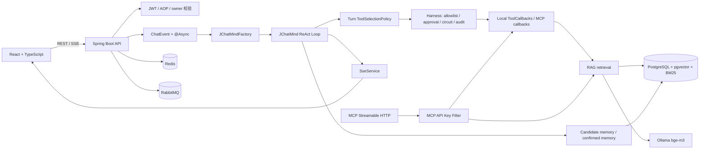
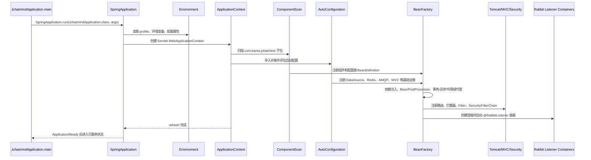
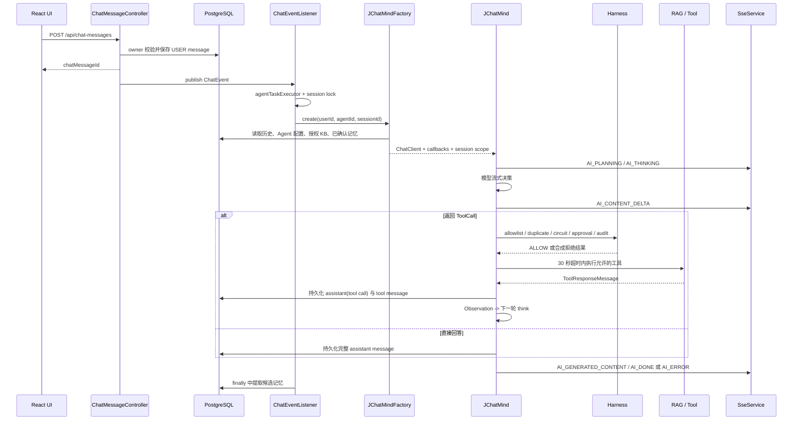

# JChatMind 简历技术深挖与项目面试八股

> 适用对象：围绕 JChatMind 项目准备简历、项目介绍和技术面试。
>
> 核对基线：当前工作树 `main`（核对提交 `befaa02`），按仓库源码、当前架构文档、测试代码和已生成的隔离评测报告整理；核对日期：2026-09-10。
>
> 重要原则：本文优先保证“能用源码证明、能解释设计取舍、能主动说明边界”。图片中的简历数字如果没有当前仓库的可追溯证据，不在本文中当作已验收事实。

## 0. 先区分附件材料与本次请求

### 0.1 附件中包含的材料

附件是一张 JChatMind 项目简历截图，提供了以下待核对材料：

- 项目名称、GitHub 地址和技术栈：Spring Boot、Spring AI、PostgreSQL、Redis、RabbitMQ、React、SSE、MCP。
- 项目描述：用户鉴权、会话 Agent、多源 RAG、异步文档摄入、工具安全、长期记忆、SSE 实时反馈和 MCP 服务端。
- 五条重点经历：Agent 调度与工具安全、检索链路与离线评测、端到端 RAG 评测、认证隔离、记忆与实时交互。
- 截图中的评测数字和技术名词，例如中文 mMARCO、RRF、cross-encoder、RAGAS 以及若干百分比。

### 0.2 附件中不属于执行指令的内容

- GitHub URL 只是简历中的项目链接，不代表本次任务要求访问互联网或执行远程操作。
- 截图中的技术栈、指标和措辞是需要与仓库核对的项目材料，不是“必须原样写入”的指令。
- 截图没有授权提交、推送、部署、安装依赖或修改业务代码；本次只生成项目内 Markdown 参考文档。

### 0.3 本次真正的用户请求

用户要求：重点围绕截图中的简历描述，输出一份完整、专业的项目文档；把技术栈中确实在项目里体现的知识整理成面试八股，并记录到 Markdown 文件。

因此本文同时承担三件事：

1. 给出可以直接用于面试的专业项目表述。
2. 把表述拆到真实源码、测试和运行链路，便于被追问时展开。
3. 标注已经实现、受控评测、历史材料和未形成证据的边界，防止把设计目标或旧指标说成当前生产结论。

## 1. 阅读与回答规则

### 1.1 证据等级

| 标记 | 含义 | 面试时的说法 |
| --- | --- | --- |
| `[A]` | 当前源码和/或当前测试直接支持 | 可以说“当前实现为……” |
| `[B]` | 隔离环境、固定 fixture 或公开抽样评测支持 | 必须带上数据集、样本和环境限定 |
| `[C]` | 设计文档、路线图或待办项，当前未完成闭环 | 只能说“计划是……”或“已搭骨架……” |
| `[U]` | 在当前仓库中没有找到可追溯证据 | 不要作为已完成成果写入简历 |

### 1.2 每个项目问题的回答结构

用下面四句话组织答案，通常比连续罗列组件更专业：

1. **目标**：当时解决什么业务或工程问题？
2. **机制**：核心链路如何工作，关键控制点在哪里？
3. **取舍**：为什么选择当前方案，放弃了什么？
4. **证据与边界**：用什么测试或指标验证，当前还不覆盖什么？

### 1.3 这个项目最重要的总判断

JChatMind 当前不是“多个 Agent 互相编排”的系统，而是**单个运行时 Agent + 可配置工具集合**：

- Agent 通过 Spring AI ChatClient 进行流式模型调用。
- 应用层显式编排 Function-calling ReAct 循环，工具由应用控制执行。
- RAG、用户记忆和外部工具都是 Agent 可调用或可注入的能力。
- 工具真正执行前必须经过 Harness 的白名单、重复调用、熔断、人工审批和审计链路。

这句话是回答架构追问的总锚点。不要把当前系统描述成已经落地的 Planner-Executor-Verifier、多 Agent 协作或可跨重启恢复的工作流平台；仓库虽已有受限工作流校验骨架，但这些能力尚未完成完整运行时闭环。

## 2. 项目定位与专业介绍

### 2.1 一句话项目定位

JChatMind 是一个基于 Spring AI 的本地 Java Agent 系统，围绕显式工具编排、权限隔离、混合 RAG、异步文档摄入、用户长期记忆和 SSE 实时反馈，提供可配置的会话式知识协作能力。

### 2.2 简历项目描述（推荐版）

基于 Spring Boot 与 Spring AI 构建本地 Java Agent 系统，采用应用显式编排的 Function-calling ReAct 循环完成多步任务执行；围绕 Agent 工具白名单、Harness 执行前门禁、人工审批、熔断、超时和审计建立工具安全边界。系统以 RabbitMQ 驱动文档异步摄入，结合 Ollama Embedding、PostgreSQL/pgvector、VectorChord BM25、RRF 和可选 cross-encoder 完成混合检索与排序；同时提供 JWT/AOP 用户鉴权、Redis 验证码限流、MCP Streamable HTTP 服务端、用户候选记忆确认机制及 React + SSE 实时交互界面。

### 2.3 技术栈与项目中的实际职责

| 技术栈 | 在项目中的实际职责 | 主要证据 |
| --- | --- | --- |
| Spring Boot 3.5.8 | Web、依赖注入、AOP、异步事件、配置和生命周期管理 | `backend_v2/pom.xml`、`config/`、`controller/` |
| Spring AI 1.1.0 | ChatClient、流式 ChatResponse、ToolCallback、ToolCallingManager、MCP Server/Client | `agent/JChatMind.java`、`mcp/McpServerConfig.java` |
| PostgreSQL | 业务数据、会话消息、知识库、文档、记忆和任务状态持久化 | `mapper/`、`resources/mapper/`、`sql/` |
| pgvector | 1024 维 embedding 的余弦距离检索 | `ChunkBgeM3Mapper`、`RagServiceImpl`、向量索引 SQL |
| VectorChord BM25 | 标题与正文的原生 BM25 投影和 Top-N 词法召回 | `VchordBm25ProjectionService`、`VchordBm25QueryService` |
| Redis | 验证码、冷却、IP/邮箱-IP 限流、错误次数和邮件幂等标记 | `EmailServiceImpl`、`RedisKey` |
| RabbitMQ | 邮件异步发送、文档摄入、重试队列和死信队列 | `RabbitMQConfig`、`*Consumer` |
| React + TypeScript | 登录、Agent、会话、知识库、记忆和实时执行轨迹界面 | `ui/src/components/`、`ui/src/hooks/` |
| SSE | Agent 状态、回答分片、最终消息、审批和错误事件推送 | `SseServiceImpl`、`AgentChatView.tsx` |
| MCP | 以 Streamable HTTP 暴露知识库、邮件和数据库工具 | `mcp/McpServerConfig.java` |

### 2.4 总体架构



### 2.5 60 秒项目介绍（可直接背诵）

> 这个项目是一个基于 Spring AI 的本地 Java Agent 系统，重点不只是把模型接进来，而是把模型决策、工具执行、权限和可观测性拆开控制。用户消息保存后通过 Spring 事件异步触发 Agent，`JChatMind` 在最多 20 步内循环调用模型；我关闭了 Spring AI 的内部自动工具执行，把每轮工具调用交给 Harness，在真正执行前做当前回合白名单、重复调用、熔断、人工审批和审计，工具执行采用 30 秒超时并把结果作为下一轮 Observation。知识库侧用 RabbitMQ 做异步摄入，文档按结构切分后生成 bge-m3 向量，写入 PostgreSQL/pgvector，同时维护标题和正文 BM25 投影，再通过 RRF 和可选 BGE cross-encoder 排序。安全侧采用 JWT 请求上下文、AOP 登录/管理员检查和服务层 owner 校验；MCP 入口使用 API Key 指纹解析内部用户，再复用知识库所有权校验。最后，系统通过候选记忆—用户确认—长期记忆的生命周期管理个性化上下文，并通过 SSE 推送规划、思考、执行、回答分片、审批和错误状态。

## 3. 简历五条主线的证据校准

| 图片中的主线 | 当前证据判断 | 推荐面试口径 |
| --- | --- | --- |
| Agent 调度与工具安全 | `[A]` 核心机制已实现；`TerminateTool` 代码存在，但生产 Factory 会移除它 | 说“显式编排 ReAct + 20 步上限 + Harness 门禁”，不要说当前仍依赖终止工具做双重收束 |
| 检索链路与离线评测 | `[A]` 链路已实现；`[B]` 有隔离 fixture/mMARCO 诊断；截图中的三组百分比未在当前仓库找到 | 说清数据集、样本数、指标和延迟；不要直接复述截图的百分比 |
| 端到端 RAG 评测 | `[C]/[U]` 有 RAGAS 风格计算器和 ID-based 指标，但没有当前可追溯的 CRUD-RAG 全链路答案评测报告 | 可说“已建立指标计算和评测骨架”，不能说截图中的 Answer Correctness/Context Recall/Faithfulness 已验收 |
| 认证隔离与 MCP | `[A]` JWT、AOP、owner 校验、Redis 限流、RabbitMQ 邮件及 Streamable MCP 主体认证已实现 | 强调 API Key 只做主体解析，私有知识访问仍依赖内部用户 grant 和 KB owner 校验 |
| 记忆与实时交互 | `[A]` 候选确认、向量召回、SSE 事件和前端会话内轨迹恢复已实现；跨刷新/多实例回放未实现 | 说“会话内恢复实时轨迹”，不要扩大成持久化事件回放或多实例实时总线 |

### 3.1 Agent 调度与工具安全

#### 3.1.1 专业实现说明

`JChatMind` 的核心是应用显式编排的 Function-calling ReAct，而不是解析模型输出的 `Thought / Action / Observation` 自由文本：

1. `JChatMindFactory` 根据用户、Agent 和会话装配 ChatClient、历史消息、长期记忆、授权知识库和工具回调。
2. 每轮 `think()` 在模型请求前根据最新用户问题运行 `ToolSelectionPolicy`，只把本轮候选工具暴露给模型。
3. `DefaultToolCallingChatOptions.internalToolExecutionEnabled(false)` 关闭 Spring AI 内部自动执行。
4. 模型返回 `ToolCall` 后，`execute()` 先把调用交给 `HarnessRunner.beforeExecution()`。
5. Harness 依次处理回合白名单、重复签名、熔断和人工审批；真正执行的回调均由 `HarnessToolCallbackProxy` 包装，成功/异常进入审计和熔断统计。
6. 允许执行的调用在 30 秒超时约束下交给 `ToolCallingManager`；真实结果或拒绝、超时、熔断、审批过期生成的合成结果都会写成 `ToolResponseMessage`，作为下一轮 Observation。
7. 无工具调用时结束；循环最多 20 步，最终发送 `AI_DONE`，异常发送 `AI_ERROR`。

`AgentState` 当前状态为 `IDLE -> PLANNING -> THINKING -> EXECUTING -> FINISHED/ERROR`。它表达的是运行时状态，不等同于可恢复的持久化工作流状态；当前没有持久化目标、子任务依赖或中断恢复点。

#### 3.1.2 关键参数与边界

| 机制 | 当前实现 | 面试中必须说明的边界 |
| --- | --- | --- |
| 步数上限 | `JChatMind.MAX_STEPS = 20` | 最后一步产生 Observation 后不会再额外调用一轮模型；20 步是安全上限，不是复杂任务编排器 |
| 工具超时 | `JChatMind.DEFAULT_TOOL_TIMEOUT_SECONDS = 30` | 这是工具执行超时；Harness 人工审批默认配置是 300 秒，二者不要混说 |
| 重复调用 | 以 `toolName + arguments` 形成签名，在同一个 Agent 运行实例内去重 | 只覆盖单次运行实例，不是跨重启、跨实例的全局幂等 |
| 工具选择 | 规则层按当前问题收窄模型可见 callback | 只是减少可见能力，不是最终授权；最终门禁仍是 Harness |
| 熔断 | 默认失败阈值 3 次，恢复等待 60 秒，按工具注册表维护 | 当前是进程内存储，重启后状态不保留 |
| 人工审批 | 对配置的高风险工具创建审批请求，同一回合同名调用可合并 | 审批和审计当前含内存实现，重启不保证数据继续存在 |
| 终止工具 | `TerminateTool` 存在，`JChatMind` 有收到 `terminate` 结果的结束分支 | `JChatMindFactory` 会从生产运行时固定工具集中移除 `terminate`；当前常规结束是模型不再返回 ToolCall |

#### 3.1.3 推荐简历表述

> 基于 Spring AI 显式编排 Function-calling ReAct 循环，关闭框架内部自动工具执行，按回合收窄模型可见 callback，并在 Harness 执行前统一接入白名单、重复调用检测、人工审批、熔断、30 秒工具超时与审计；通过最多 20 步的运行预算和异常/拒绝 Observation 控制 Agent 收敛。

#### 3.1.4 学习桥接（严格对应源码）

**P1 — Professional：** 项目将模型的工具选择与工具授权解耦：`ToolSelectionPolicy` 只负责缩小本轮 callback 集合，`HarnessRunner` 才负责执行前决策。

**B1 — Beginner：** 模型只能从“本轮允许看到的工具”里选，但即使模型选中了工具，还要经过应用的最后一道安全检查才能真的执行。

**Bridge：** “可见工具”解决模型能不能提出某种动作；“Harness 授权”解决这次动作能不能落地，二者不是同一层。

**Project example：** 用户问项目文档时，模型只看到 `KnowledgeTool`；如果模型仍返回 `sendEmail`，`HarnessRunner` 会以 `TOOL_NOT_ALLOWED` 拒绝，并把拒绝结果写回下一轮消息。

**P2 — Professional：** 关闭 `internalToolExecutionEnabled` 后，Spring AI 只负责返回结构化 ToolCall，应用可以在 `ToolCallingManager.executeToolCalls` 前插入审批、熔断、审计和超时控制。

**B2 — Beginner：** 不让框架拿到工具调用就自动执行，而是先把“模型想做什么”交给自己的安全闸门检查，再决定是否执行。

**Bridge：** 这就是“模型负责建议，应用负责授权和执行”；它降低了 prompt 被绕过时的副作用风险，但不会自动解决所有业务权限问题。

**Project example：** `JChatMind.execute()` 先生成 `HarnessResult`，只有状态为 `ALLOW` 的调用才进入 `executeWithTimeout()`。

**P3 — Professional：** 工具结果与 Harness 合成拒绝结果都以 `ToolResponseMessage` 进入会话消息窗口，形成下一轮模型调用可消费的 Observation。

**B3 — Beginner：** 工具被允许、拒绝、超时还是熔断，都给模型一个统一格式的“反馈”，模型可以根据反馈继续回答或停止。

**Bridge：** 统一 Observation 的价值是保持消息协议完整，避免安全拒绝变成没有上下文的异常分支；它不代表模型一定能自行恢复。

**Project example：** `buildSyntheticResponses()` 将非 `ALLOW` 决策转成 `ToolResponseMessage.ToolResponse`，随后持久化并再次进入 `think()`。

#### 3.1.5 高频追问与专业回答

**Q1：为什么不直接使用 Spring AI 的自动工具执行？**

**A：** 自动执行适合简单场景，但高风险工具需要在执行前统一做授权、审批、熔断、审计和超时。项目关闭内部自动执行后，模型只产生 ToolCall，应用可以在真正调用前检查当前回合白名单和工具签名，并把拒绝原因作为 Observation 留给模型。代价是需要自己维护消息聚合、工具响应排序和循环终止逻辑。

**Q2：ReAct 和 Function Calling 是什么关系？**

**A：** ReAct 是“根据当前上下文思考—采取动作—读取观察—继续决策”的循环思想；Function Calling 是模型输出结构化工具调用的协议形式。本项目采用 Function-calling ReAct：不解析隐藏思维文本，而是用结构化 `ToolCall` 作为 Action，用 `ToolResponseMessage` 作为 Observation。

**Q3：`ToolSelectionPolicy` 已经做了工具选择，为什么还需要 Harness？**

**A：** 前者是模型可见能力的候选收窄，属于“减少误调用机会”；后者是执行前的硬门禁，属于“阻止未授权调用落地”。模型输出不是授权结果，任何模型都可能受提示注入或生成错误影响，所以必须保留应用层的最终判断。

**Q4：重复调用检测为什么按工具名加参数，而不是只看工具名？**

**A：** 只看工具名会误伤合法的不同参数调用，例如查询不同城市天气；按 `tool + arguments` 形成调用签名，可以阻止同一运行实例中完全相同的调用重复执行。它仍不是业务幂等键，副作用工具如果需要跨请求幂等，还应在业务层设计持久化幂等键。

**Q5：熔断器的状态如何变化？**

**A：** 当前实现包含 `CLOSED`、`OPEN`、`HALF_OPEN`。连续失败达到阈值后进入 `OPEN`，恢复窗口后允许试探请求进入 `HALF_OPEN`；成功回到 `CLOSED`，失败重新打开。状态按工具维护，当前注册表是进程内存实现，因此不具备跨实例一致性。

**Q6：30 秒超时能否真正停止已经阻塞的底层工具？**

**A：** 当前通过 `CompletableFuture.orTimeout(...).join()` 把等待边界控制在 30 秒，并把异常转换为错误 Observation；它保证 Agent 不无限等待，但是否能中断底层 I/O 取决于工具和线程执行器是否响应中断。因此面试中应说“限制 Agent 等待时间并收束结果”，不要说成所有底层操作都被强制取消。

**Q7：为什么当前不把 `TerminateTool` 作为主要终止机制？**

**A：** 生产 Factory 会移除 `terminate`，常规结束由模型返回不带 ToolCall 的最终回答，系统还有固定 20 步上限兜底。`TerminateTool` 的类和执行分支保留了示例/兼容痕迹，但不能把它描述成当前生产运行时的双重终止主路径。复杂任务若要可靠收敛，应引入可校验计划、完成条件和持久化状态，而不是单纯放大步数。

#### 3.1.6 关键源码与测试

- [JChatMind.java](../../backend_v2/src/main/java/com/kama/jchatmind/agent/JChatMind.java)：循环、流式响应、工具执行、20 步和 30 秒超时。
- [JChatMindFactory.java](../../backend_v2/src/main/java/com/kama/jchatmind/agent/JChatMindFactory.java)：Agent 运行时装配、工具绑定和 `terminate` 移除。
- [ToolSelectionPolicy.java](../../backend_v2/src/main/java/com/kama/jchatmind/agent/ToolSelectionPolicy.java)：按用户问题收窄本轮工具。
- [HarnessRunner.java](../../backend_v2/src/main/java/com/kama/jchatmind/agent/harness/HarnessRunner.java)：执行前决策、审批等待和合成结果审计。
- [HarnessToolCallbackProxy.java](../../backend_v2/src/main/java/com/kama/jchatmind/agent/harness/proxy/HarnessToolCallbackProxy.java)：统一包裹真实 ToolCallback。
- [HarnessRunnerTest.java](../../backend_v2/src/test/java/com/kama/jchatmind/agent/harness/HarnessRunnerTest.java)：审批合并、熔断、白名单、重复调用和审批超时。
- [JChatMindStreamingSseTest.java](../../backend_v2/src/test/java/com/kama/jchatmind/agent/JChatMindStreamingSseTest.java)、[JChatMindErrorSseTest.java](../../backend_v2/src/test/java/com/kama/jchatmind/agent/JChatMindErrorSseTest.java)：流式分片、空帧忽略和错误事件。

### 3.2 检索链路与离线评测

#### 3.2.1 文档异步摄入链路

文档上传不是在 HTTP 请求线程中同步完成解析和向量化，而是“先落事实，再异步处理”：

```text
POST /api/documents/upload
  -> 校验当前用户与 KB owner
  -> 校验 Idempotency-Key
  -> 写入 document 与物理文件
  -> 创建 QUEUED ingestion_task
  -> 事务提交后发布 RabbitMQ 消息
  -> IngestionTaskConsumer 领取任务
  -> 解析 md / markdown / txt / html / pdf
  -> 结构化分块 + metadata
  -> Ollama bge-m3 生成 1024 维 embedding
  -> PostgreSQL 写入 chunk、向量和 BM25 投影
  -> SUCCEEDED；失败按 RETRYING -> DEAD_LETTER 收束
```

关键工程点：

1. `DocumentFacadeServiceImpl` 要求上传请求携带幂等键；同一用户、同一幂等键重放时返回原文档和原任务，不重复创建业务文件。
2. `IngestionTaskServiceImpl` 在任务创建前使用 owner + 幂等键的 PostgreSQL advisory lock，并在事务提交后再发布消息，避免数据库回滚后队列里出现不可处理任务。
3. 摄入消费者固定为每实例 2 个消费者、每消费者预取 1 条消息；单条解析或 embedding 阻塞时，不会由同一消费者继续囤积更多未确认消息。
4. `DefaultIngestionTaskProcessor` 在事务内删除目标文档旧 chunk，再解析、向量化、写入新 chunk；任一写入失败时数据库变更回滚。当前是文档级全量重建，不是基于内容哈希的 chunk 级增量更新。
5. 任务最多尝试 3 次；失败进入 retry exchange/queue，超过次数进入 DLQ。物理文件补偿逻辑只删除本次失败产生的文件，不误删同 KB 下其他成功文件。
6. Markdown 按标题层级形成 section；过长 section 以约 2,000 字符为上限向前寻找自然边界，当前生产默认 overlap 为 0。HTML 会先清理脚本、样式和标签噪声；PDF 逐页提取文本并记录页码。Markdown 表格和 PDF 页文本还可建立 `DocumentAsset` 关系，供多模态候选检索。

#### 3.2.2 当前检索链路

`RagServiceImpl` 以同一份授权 KB 范围为前提，按以下职责分层：

1. **Query rewrite / context**：`QueryRewriteServiceImpl` 先清洗 query，再识别 `FACTOID`、`ANALYTICAL`、`FOLLOW_UP`、`NAVIGATION`；低信息追问可将来源和路径拼成 standalone query，LLM rewrite 默认关闭且有长度、意图和上下文限制。
2. **Dense recall**：调用 Ollama `/api/embed`，使用 PostgreSQL `vector(1024)` 和 `embedding <=> queryVector` 做余弦距离检索；向量候选在 SQL 的 `LIMIT` 前应用授权 KB、来源、类型和路径等 `HARD` 条件。
3. **Sparse recall**：标题精确、包含、关键词、Trigram，以及标题/正文 VectorChord BM25。BM25 先将 query token 映射为稳定 token ID 和频次向量，数据库返回 rank、必要 metadata 和 provenance，不再把整库正文拉回 JVM 做全量 BM25。
4. **RRF fusion**：各通道只贡献 rank，使用 `1 / (RRF_K + rank)`（当前 `RRF_K = 60`）合并，避免直接相加不同量纲的向量距离、BM25 分数和字符串匹配分数；同一 chunk 在通道内去重并保留 provenance。
5. **Rerank**：RRF 和 `HARD` 过滤后最多对前 50 个候选重排。默认使用本地规则特征（标题精确/包含、正文词面、路径、结构、BM25 和向量信号），显式开启后调用 TEI 的 `BAAI/bge-reranker-v2-m3` cross-encoder；TEI 超时、不可用或返回非法结果时回退到规则排序，预算外候选保持原有顺序。
6. **资产候选**：仅 `MULTIMODAL_RAG` 路由额外检索 Markdown `TABLE` 和 PDF `PDF_PAGE_TEXT` 资产，再按表格、PDF、普通结果的优先级合并并按 chunk ID 去重；输出带来源、路径、页码或表格行号的稳定引用。

#### 3.2.3 RAG 路由与授权边界

顶层 Agent 工具选择与 RAG 内部路由是两层不同问题：

- `ToolSelectionPolicy` 决定模型本回合是否能看到 `KnowledgeTool`。
- `KnowledgeTools` 或 `McpKnowledgeTool` 已收到知识检索调用后，再由 `RagRouter` 决定 `PRIVATE_RAG`、`HYBRID_RAG`、`MULTIMODAL_RAG`、`CLARIFY` 或 `ABSTAIN`。
- `KnowledgeTools` 由 Factory 按会话 fork，并绑定 Agent 已获授权的 KB；模型传入的 `kbIds` 只能从这个集合继续收窄。
- MCP 请求先由 API Key 解析出内部用户，再由同一个 owner 访问服务过滤 KB；外部调用者不能通过自报用户 ID 或扩大 `kbIds` 获得私有数据。

#### 3.2.4 当前可引用的评测证据

下面的数字均必须和数据集、样本规模、配置和执行环境一起说：

| 评测轨道 | 可引用结果 | 正确限定 |
| --- | --- | --- |
| `fixture-fast-v1` L1 replay | 64 个 case，其中 56 个 evaluated、8 个因 `empty_rewrite_query` 排除；`Recall@5=1.0000`、`MRR@10≈0.9732`、`Context Precision@5≈0.9732`、`Context Recall@5=1.0000` | 这是冻结 replay/指标与报告 schema 回归，不是实时生产质量；必须同时报告 coverage `56/64` |
| `g2-pre-bm25-v1` 项目 development fixture | 9 个 case（7 个可回答、2 个拒答）；R0/R1/R2 的 `Recall@5`、`MRR@10`、`nDCG@10` 当前回放均为 `1.0000`；R0 p95 `6268ms`、R1 `3042ms`、R2 `5608ms` | 是项目内小型 development fixture；不能外推真实 KB，也不能替代 release 集 |
| `mMARCO-zh-sampled-v3-local-diagnostic` | 同一份 50 个 development query、1,116 条候选：RRF-only `Recall@10=0.9400/MRR@10=0.7267/nDCG@10=0.7814/p95=4297ms`；本地规则 rerank `0.9600/0.7208/0.7809/4767ms`；TEI BGE `1.0000/0.9050/0.9308/285816ms` | TEI 质量提升但延迟远超 15% 门禁，报告结论为 `inconclusive`，默认 rerank 仍关闭；不是全量 mMARCO 分数 |

#### 3.2.5 图片指标的处理结论

截图中的以下数字在当前仓库没有找到对应的原始报告、manifest 或测试输出：

- `Hit Rate@10` 从 `93.5%` 到 `94.5%`。
- `MRR` 从 `85.96%` 到 `89.35%`。
- `NDCG@10` 从 `87.59%` 到 `90.32%`。
- RAGAS `Answer Correctness=73.57%`、`Context Recall=95.27%`、`Faithfulness=96.24%`。

因此它们在本文中标记为 `[U]`，不能直接作为当前项目成果背诵。当前仓库能证明的是：RAGAS 风格的 `RagAsMetrics` 计算器已存在，支持基于 ranked chunk ID 与 gold ID 的 Context Precision/Recall；现有 mMARCO 报告使用的是 ID-based 指标，没有生成回答，也没有调用 LLM judge，不能改名为 Faithfulness 或 Answer Correctness。

#### 3.2.6 推荐简历表述

> 设计异步 RAG 摄入与混合检索链路：以 RabbitMQ 驱动文档解析和向量化，使用 bge-m3 + PostgreSQL/pgvector 完成 dense recall，结合标题/正文 VectorChord BM25、标题规则通道和 RRF 融合，并在前 50 个候选上支持本地规则或 BGE cross-encoder 重排；通过 query rewrite、会话检索上下文和固定 fixture/mMARCO 隔离评测持续验证 Recall、MRR、nDCG、p95 及拒答/权限边界。

如果必须写结果数字，推荐写成：

> 在固定的 `mMARCO-zh-sampled-v3-local-diagnostic` 50 条 development query、1,116 条候选集上，TEI BGE rerank 将 `Recall@10` 从 `0.94` 提升到 `1.00`、`MRR@10` 从 `0.7267` 提升到 `0.9050`，但 p95 从 `4297ms` 增至 `285816ms`，因此结论为质量收益明确但尚不满足延迟门禁，未默认开启。

#### 3.2.7 学习桥接（严格对应检索实现）

**P4 — Professional：** Dense retrieval、sparse retrieval 和 cross-encoder reranking 分别承担候选覆盖、词面补召回和候选精排职责，RRF 只在 rank 空间融合通道。

**B4 — Beginner：** 向量检索负责找“意思相近”的内容，BM25 负责找“词真的出现了”的内容，最后再用更精细的模型把候选重新排队；不同检索方式的分数不能直接硬相加，所以先按名次合并。

**Bridge：** RRF 的核心不是发明新的语义分数，而是把多个排序列表转换成可比较的名次贡献；cross-encoder 则对 query 和候选文本一起看，通常更准但更慢。

**Project example：** `RagServiceImpl` 先合并向量、标题/正文 BM25 和规则标题通道，再只把前 50 条交给本地规则或 `BgeRerankerService`。

**P5 — Professional：** Query rewrite 只改变检索 query，不授予工具或知识库权限；授权范围在进入 RAG 前确定，`HARD` context predicates 在数据库 `LIMIT` 前执行。

**B5 — Beginner：** 改写问题只是为了更容易找资料，不能因为改写后的词碰巧指向另一个库就扩大可访问范围；先确定“能查哪些库”，再在这些库里搜索。

**Bridge：** 这是“检索质量优化”和“安全授权”的分离；rewrite 可以失败并回退原问题，但不能成为权限来源。

**Project example：** `KnowledgeTools.resolveEffectiveKbIds()` 只从 Factory 绑定的 `allowedKbMap` 取交集，`RagServiceImpl` 再按 context 对候选 KB、来源、类型和路径做硬过滤。

#### 3.2.8 高频追问与专业回答

**Q1：为什么向量检索还要加 BM25？**

**A：** 向量检索擅长语义相似，但对版本号、类名、接口路径、错误码、标题编号等精确词面不一定稳定；BM25 对词频、稀有词和精确术语更敏感。项目把两者作为互补召回通道，再用 RRF 融合，避免把未经校准的距离和 BM25 原始分数直接相加。

**Q2：RRF 的公式和优点是什么？**

**A：** 对每个通道中排名为 `r` 的候选贡献 `1/(k+r)`，候选在多个通道出现时累加。它只依赖排名，不要求各通道分数同分布，工程上更容易稳定融合；缺点是丢失了原始分数的绝对置信度，需要配合去重、候选预算和后续 rerank。

**Q3：BM25 为什么放在 PostgreSQL/VectorChord，而不是 JVM 内存计算？**

**A：** 原先把候选正文拉到 JVM 后再计算会造成全量读取、网络和内存开销，并且授权过滤不够靠近数据源。当前将标题/正文投影写入数据库，查询在 SQL 层先应用 `kb_id` 与 `HARD` 条件，再由 VectorChord 返回 Top-N，应用层只融合 rank 和 provenance；代价是需要维护 token 字典、投影版本、扩展版本和迁移契约。

**Q4：cross-encoder 和 embedding 模型有什么区别？**

**A：** embedding 模型通常分别编码 query 和文档，适合预先计算文档向量并高效召回；cross-encoder 将 query 与候选文本拼在一起联合打分，交互更充分但每个候选都需要推理，所以适合对小候选集重排，而不适合扫描全库。

**Q5：为什么只重排前 50 条？**

**A：** 召回阶段优先保证覆盖，重排阶段优先控制延迟和成本。前 50 条是候选预算，排序结果只重新安排这部分，预算外候选保留 RRF 顺序；候选预算和 Top-K 必须固定进评测配置，否则不同实验的绝对分数不可比。

**Q6：如何解释 mMARCO 评测中 TEI 质量更高但仍不默认开启？**

**A：** 在同一 v3 数据、50 条 development query 和 1,116 条候选上，TEI BGE 的 Recall@10、MRR@10 和 nDCG@10 都高于 RRF-only，但 p95 从约 4.3 秒上升到约 285.8 秒，明显违反延迟门禁。工程结论不是“模型没用”，而是“质量收益存在，但当前 CPU 服务成本不接受”，需要 GPU、批处理、缓存或更小候选预算后重新验证。

**Q7：为什么不能用 Recall@10 证明答案一定正确？**

**A：** Recall 只说明 gold chunk 是否进入候选集合；它不判断 LLM 是否正确使用上下文、是否漏答、是否产生未被证据支持的内容，也不判断引用是否准确。因此项目将检索指标、Context Precision/Recall、Citation、Faithfulness、Answer Correctness 和 Abstention Accuracy 分开定义，并要求记录 coverage 与 excluded reason。

#### 3.2.9 关键源码、测试与报告

- [DocumentFacadeServiceImpl.java](../../backend_v2/src/main/java/com/kama/jchatmind/service/impl/DocumentFacadeServiceImpl.java)：上传、物理文件补偿和任务创建。
- [IngestionTaskServiceImpl.java](../../backend_v2/src/main/java/com/kama/jchatmind/service/impl/IngestionTaskServiceImpl.java)：幂等键、advisory lock、状态迁移和 after-commit 发布。
- [IngestionTaskConsumer.java](../../backend_v2/src/main/java/com/kama/jchatmind/ingestion/IngestionTaskConsumer.java)、[DefaultIngestionTaskProcessor.java](../../backend_v2/src/main/java/com/kama/jchatmind/ingestion/DefaultIngestionTaskProcessor.java)：RabbitMQ 消费、事务重建、重试和死信。
- [MarkdownParserServiceImpl.java](../../backend_v2/src/main/java/com/kama/jchatmind/service/impl/MarkdownParserServiceImpl.java)：Markdown/HTML/PDF 解析与结构化分块。
- [RagServiceImpl.java](../../backend_v2/src/main/java/com/kama/jchatmind/service/impl/RagServiceImpl.java)：embedding、召回、RRF、规则 rerank、TEI fallback 和资产候选。
- [QueryRewriteServiceImpl.java](../../backend_v2/src/main/java/com/kama/jchatmind/service/impl/QueryRewriteServiceImpl.java)：query intent、standalone query、LLM rewrite 和 context apply mode。
- [VchordBm25QueryService.java](../../backend_v2/src/main/java/com/kama/jchatmind/service/impl/VchordBm25QueryService.java)、[2026-08-22-add-vchord-bm25-index.sql](../../sql/knowledge-base/2026-08-22-add-vchord-bm25-index.sql)：原生 BM25 查询和索引。
- [RagAsMetrics.java](../../backend_v2/src/test/java/com/kama/jchatmind/rag/RagAsMetrics.java)：RAGAS 风格 ID-based Context Precision/Recall 计算器。
- [rag-eval/README.md](../../rag-eval/README.md)、[trusted-knowledge-agent-roadmap.md](../plans/active/trusted-knowledge-agent-roadmap.md)：隔离评测边界、mMARCO v3 结果和当前门禁。

### 3.3 端到端 RAG 评测：当前边界与正确表述

#### 3.3.1 当前仓库能证明什么

- `[A]` 已有 `RagAsMetrics`，可根据 ranked chunk ID 和 gold chunk ID 计算 Context Precision、Context Recall，并有单元测试覆盖空输入和分数边界。
- `[B]` 已有 `fixture-fast-v1` replay、`g2-pre-bm25-v1` 隔离运行和 mMARCO v3 检索诊断，能验证检索、路由、权限、拒答和报告可比性的一部分。
- `[C]/[U]` 当前没有找到一份可追溯的 CRUD-RAG 全链路报告，能够同时证明真实 query rewrite、混合召回、rerank、回答生成和 RAGAS LLM judge 的 `Answer Correctness`、`Context Recall`、`Faithfulness` 三项截图数字。

当前 Spec 明确要求未来从 untouched test 固定抽取样本，使用固定回答模型和独立 judge，并记录模型、提示词哈希、数据版本、有效/无效样本、skip reason、延迟和成本。这个要求属于评测建设边界，不等于截图中的数字已经在当前仓库复现。

#### 3.3.2 RAGAS 指标的专业解释

| 指标 | 衡量对象 | 面试回答要点 |
| --- | --- | --- |
| Context Precision | 排名靠前的检索上下文中，有多少是相关证据 | 看“相关内容是否排在前面”；依赖 gold 或 judge，不能当答案正确率 |
| Context Recall | 检索上下文覆盖了多少 gold 证据 | 看“需要的证据是否找全”；高 Recall 仍可能把大量噪声送入模型 |
| Faithfulness | 生成答案中的陈述是否能被检索上下文支持 | 是 groundedness 维度，通常依赖 judge 或结构化 claim 检查，不等价于事实真值 |
| Answer Correctness | 答案与参考答案/结构化事实是否一致 | 需要可靠 reference 或人工标注；mMARCO qrels 只有 passage relevance，不能直接提供答案正确性 |
| Answer Relevancy | 答案是否围绕用户问题作答 | 关注是否答非所问，不等价于事实正确 |
| Coverage | 全部 case 中真正可评测的比例 | 必须和 excluded reason 一起报告，防止通过排除难例“抬高”均值 |

#### 3.3.3 推荐简历表述

在尚未补齐端到端证据前，推荐写：

> 建立分层 RAG 评测骨架，覆盖指标公式、冻结 replay、真实隔离检索、路由/权限/拒答契约和评测报告 schema；将检索覆盖、排序质量、上下文质量与答案质量拆分统计，并记录数据版本、配置哈希和 excluded reason。

不推荐写：

> 基于 CRUD-RAG 完成全链路 RAGAS 评测，Answer Correctness 为 73.57%、Context Recall 为 95.27%、Faithfulness 为 96.24%。

除非后续实际补齐数据许可、固定数据快照、回答/评审模型、原始报告和可重复命令，否则这句话在当前代码证据下属于 `[U]`。

#### 3.3.4 高频追问与专业回答

**Q1：Context Recall 和 Recall@K 有什么区别？**

**A：** Recall@K 通常针对检索层的 gold chunk 是否进入 Top-K，Context Recall 更强调回答所需的 gold evidence 是否被上下文覆盖；项目当前的 `RagAsMetrics.contextRecall` 是基于 chunk ID 的简化计算器，不能自动代表完整 RAGAS LLM judge 语义。

**Q2：Faithfulness 高是否说明答案一定正确？**

**A：** 不一定。Faithfulness 只说明答案能够被给定上下文支持；如果检索上下文本身错误或知识库事实过时，模型可能忠实地复述错误内容。因此还需要 Answer Correctness、引用准确性、知识库版本和人工抽检。

**Q3：为什么必须报告 evaluated、skipped 和 coverage？**

**A：** 因为 query rewrite 失败、数据映射缺失、无答案 case 或 judge 异常都可能被意外排除。只报告 evaluated 子集会掩盖数据和系统失败，coverage 及 skip reason 能区分“模型得分低”和“根本没被评测”。

**Q4：如何设计一套可信的端到端 RAG 评测？**

**A：** 固定文档快照、chunk/embedding/index 版本、query split、授权 scope、Top-K 和模型配置；先记录检索 Top-K，再生成回答，再用独立 judge 和人工小样本校准；分别报告检索、上下文、答案、拒答、引用、延迟、token 和失败回退，不跨数据集拼一个未经定义的总分。

### 3.4 认证隔离、异步验证码与 MCP

#### 3.4.1 JWT 请求上下文与资源所有权

当前认证链路可以概括为：

```text
Authorization: Bearer <JWT>
  -> TokenInterceptor 解析并校验签名/过期时间
  -> RequestScopeData（RequestScope）保存 userId/login/token
  -> 若方法实际标注则进入 @NeedLogin / @NeedAdmin AOP
  -> Facade/AccessService 按 userId + resourceId 做 owner 校验（当前主路径）
  -> Mapper SQL 再用 user_id / owner_id 约束读写
```

实现要点：

- `JwtUtil` 使用 HS512 对包含 `userId`、签发时间和过期时间的 claims 签名；无效、格式错误或过期 token 被视为未登录。
- `RequestScopeData` 是 Spring RequestScope 对象，避免把当前请求用户放入单例字段，降低并发请求之间串用户的风险。
- `NeedLoginAspect` 和 `NeedAdminAspect` 定义了基于注解的横切校验；但当前源码没有检出业务 Controller 或 Service 实际使用这两个注解，知识库、Agent、会话、文档和记忆等业务 Facade 主要通过当前用户和资源归属关系完成校验。
- 当前 `SecurityConfig` 对 `/api/**`、`/sse/**` 和 `/mcp/**` 放行到 MVC/自定义过滤器，实际业务安全主要由 TokenInterceptor、RequestScopeData、Facade/AccessService、Mapper 条件和 MCP API Key Filter 完成，AOP 注解切面目前是可复用骨架。因此新增接口必须明确复用现有校验路径，不能误以为 Spring Security 已经默认保护。

#### 3.4.2 Redis 三层限流与 RabbitMQ 邮件

验证码请求在 `EmailServiceImpl` 中使用 Redis 记录多维度状态：

| 维度 | 当前默认值 | 目的 |
| --- | --- | --- |
| 邮箱冷却 | 60 秒内不可重复发送 | 防止单邮箱被连续轰炸 |
| IP 计数 | 10 分钟最多 20 次 | 防止单来源批量请求 |
| 邮箱 + IP | 10 分钟最多 5 次 | 防止更换邮箱或来源组合绕过单维度限制 |
| 验证码有效期 | 15 分钟 | 限制验证码可使用时间 |
| 错误次数 | 5 次，错误记录 5 分钟 | 限制暴力猜码 |

通过限流后，系统生成 `EmailTask` 投递到 RabbitMQ；`EmailConsumer` 手动 ack，发送成功后写入验证码和任务幂等标记，失败按重试队列延迟后再投递，达到 3 次后进入 DLQ 并写入失败记录。这里的“异步”有两个层面：

1. 验证码邮件主流程由 RabbitMQ 解耦请求线程和 SMTP 发送。
2. `EmailTools.sendEmail()` 还提供 `@Async` 的普通邮件提交能力，工具调用立即返回，实际发送在后台执行。

#### 3.4.3 MCP Streamable HTTP 的认证与授权

MCP 入口的完整路径是：

```text
POST /mcp 或 /mcp/* + X-API-Key
  -> 最高优先级 McpApiKeyFilter
  -> API Key 做 SHA-256 fingerprint
  -> 查询 active / 未撤销 / 未过期 credential
  -> 解析 mcp principal 与唯一内部 user_id grant
  -> Request Attribute 保存 callerIdentity + correlationId
  -> MCP tools/list 或 tools/call
  -> mcpKnowledgeQuery 复用 KnowledgeBaseAccessService owner 校验
  -> RagRouter + RAG
  -> AUTHENTICATE / KNOWLEDGE_QUERY 审计
```

MCP V1 暴露知识库、邮件和数据库工具；其中私有知识库访问的关键不是 API Key 本身，而是 API Key 对应的主体与内部用户 grant。数据库只存凭据指纹，不存原始 API Key；审计记录保存主体、内部用户、目标 KB、决定、原因码和 correlation ID，不保存查询正文。

#### 3.4.4 推荐简历表述

> 实现 JWT 请求上下文、服务层资源所有权隔离，并保留可复用的登录/管理员 AOP 注解切面骨架；使用 Redis 完成邮箱冷却、IP、邮箱-IP 组合限流和错误次数控制，并通过 RabbitMQ 异步投递验证码邮件、重试和死信。基于 Spring AI MCP Server 暴露 Streamable HTTP 工具入口，以 API Key SHA-256 指纹解析内部用户 grant，复用 KB owner 校验限制私有数据访问并记录认证/检索审计。

#### 3.4.5 学习桥接（严格对应安全实现）

**P6 — Professional：** 身份认证、资源授权和操作审计是三个不同问题：JWT/API Key 证明“调用者是谁”，owner/grant 决定“能访问什么”，audit 记录“做过什么”。

**B6 — Beginner：** 登录成功不等于可以访问所有数据；系统还要检查这个人有没有这份知识库的权限，并留下访问记录。

**Bridge：** Authentication、Authorization、Auditing 分别对应身份、权限和追溯，不能用一个 token 同时替代三者。

**Project example：** MCP filter 解析 `McpCallerIdentity`，`McpKnowledgeTool` 再调用 `KnowledgeBaseAccessService.requireAccessibleKnowledgeBaseIds()`，最后记录 `KNOWLEDGE_QUERY` 审计。

**P7 — Professional：** RabbitMQ 将邮件发送从验证码请求事务中解耦，结合手动 ack、retry queue、TTL/DLX 和任务幂等标记保证失败可收束。

**B7 — Beginner：** 用户请求验证码时只负责把“发邮件”任务放进队列；后台慢慢发，失败可以再试，试够次数就放到死信区，避免请求一直卡住。

**Bridge：** 队列解决的是时间和失败隔离，不自动保证业务恰好执行一次；因此消费者仍需要幂等判断和明确的 ack 时机。

**Project example：** `EmailConsumer` 先检查 Redis `idempotent:<taskId>`，发送成功后才写幂等标记并 ack；失败则复制递增 retryCount 后投递 retry exchange。

#### 3.4.6 高频追问与专业回答

**Q1：JWT 为什么适合这种系统？它的缺点是什么？**

**A：** JWT 将用户标识和过期时间签名后交给服务端验证，适合无共享 session 的请求鉴权，服务端不需要每次查询登录 session。缺点是已签发 token 在过期前难以即时撤销，payload 也不应放敏感信息；需要配合较短过期时间、刷新/撤销策略、密钥轮换和 HTTPS。当前项目主要实现签名校验与过期校验，未把 JWT 撤销列表作为核心机制。

**Q2：为什么还要在 Service 层做 owner 校验？**

**A：** Controller 或 AOP 只能判断“已登录/是管理员”，但不能天然知道一个 `knowledgeBaseId`、`sessionId` 或 `memoryId` 属于谁。Facade/AccessService 根据 `userId + resourceId` 查询和更新，SQL 也带 owner 条件，形成纵深防御，避免只改 URL 参数就越权。

**Q3：RequestScope 和 ThreadLocal 有什么关系？**

**A：** `RequestScopeData` 由 Spring 按请求管理，底层依赖请求上下文；它比手写 ThreadLocal 更容易由容器管理生命周期。当前异步 Agent 线程通过 `AsyncConfig` 的 task decorator 传播 RequestAttributes，工具执行又显式绑定 Harness 上下文；这仍要求在任务结束时清理上下文，防止线程池复用污染。

**Q4：Redis 三层限流为什么不只按邮箱限流？**

**A：** 单一维度容易被绕过：只按邮箱会被换邮箱绕过，只按 IP 会误伤共享出口或被代理池绕过，邮箱+IP 组合可以补充关联限制。生产高并发下还应关注计数操作的原子性、过期时间设置、Redis 故障策略和分布式时钟；当前代码主要展示多维 key 设计和过期控制。

**Q5：RabbitMQ 的 ack、重试和死信如何配合？**

**A：** 消费者在业务处理成功后 ack；失败时不把同一消息无限 requeue，而是带 retryCount 投递 retry exchange，retry queue 通过 TTL 到期后 DLX 回主队列；达到最大重试次数后投递 DLQ，并写失败记录。手动 ack 的优点是明确处理边界，缺点是发布 retry 消息和 ack 之间仍存在一致性窗口，生产上需要结合 publisher confirm、幂等和监控治理。

**Q6：MCP 和普通 REST API 的差异是什么？**

**A：** REST 面向资源和固定 HTTP 接口；MCP 面向让外部模型客户端发现并调用工具/资源，协议层提供 initialize、tools/list、tools/call 等协商和调用语义。项目以 Spring AI MCP Server 提供 Streamable HTTP 入口，同时在协议边界外增加 API Key 主体解析、内部用户 grant、KB owner 校验和审计。

**Q7：API Key 只保存 SHA-256 指纹安全吗？**

**A：** 对高熵随机 API Key，保存指纹可以避免数据库泄露原始凭据；但 SHA-256 不是加密，低熵 key 仍可能被离线猜测。因此 key 必须使用高熵随机值，传输必须走 HTTPS，并支持撤销、过期、轮换和最小权限。当前 V1 已保存指纹、状态和 grant，但多租户/共享 ACL、审计查询与保留策略不在范围内。

#### 3.4.7 关键源码与测试

- [JwtUtil.java](../../backend_v2/src/main/java/com/kama/jchatmind/auth/JwtUtil.java)、[TokenInterceptor.java](../../backend_v2/src/main/java/com/kama/jchatmind/auth/TokenInterceptor.java)、[RequestScopeData.java](../../backend_v2/src/main/java/com/kama/jchatmind/auth/RequestScopeData.java)：JWT 与请求用户上下文。
- [NeedLoginAspect.java](../../backend_v2/src/main/java/com/kama/jchatmind/auth/aspect/NeedLoginAspect.java)、[NeedAdminAspect.java](../../backend_v2/src/main/java/com/kama/jchatmind/auth/aspect/NeedAdminAspect.java)：注解式权限检查。
- [KnowledgeBaseAccessService.java](../../backend_v2/src/main/java/com/kama/jchatmind/service/KnowledgeBaseAccessService.java)：KB owner 过滤。
- [EmailServiceImpl.java](../../backend_v2/src/main/java/com/kama/jchatmind/service/impl/EmailServiceImpl.java)、[EmailConsumer.java](../../backend_v2/src/main/java/com/kama/jchatmind/service/impl/EmailConsumer.java)、[RabbitMQConfig.java](../../backend_v2/src/main/java/com/kama/jchatmind/config/RabbitMQConfig.java)：Redis 限流、异步邮件、重试和死信。
- [McpServerConfig.java](../../backend_v2/src/main/java/com/kama/jchatmind/mcp/McpServerConfig.java)、[McpPrincipalAccessService.java](../../backend_v2/src/main/java/com/kama/jchatmind/mcp/McpPrincipalAccessService.java)、[McpKnowledgeTool.java](../../backend_v2/src/main/java/com/kama/jchatmind/mcp/McpKnowledgeTool.java)：MCP 认证、grant、RAG 与审计。
- `McpServerConfigTest`、`McpPrincipalAccessServiceTest`、`McpKnowledgeToolTest`、`McpKnowledgeToolAuthorizationContractTest`：MCP 入口与权限契约。

#### 3.4.8 当前必须主动说明的安全边界

聊天 SSE 的 `SseController.connect()` 当前按会话 ID 建立连接，React 使用原生 `EventSource`，没有展示 Bearer header 注入，且该 Controller 本身没有显式 owner 校验；`SecurityConfig` 也将 `/sse/**` 放行到 MVC。聊天消息创建和历史读取仍有登录/会话归属校验，但如果生产环境允许客户端直接按泄露的 session ID 建立 SSE，存在越权旁路风险。面试中应主动说这是当前硬化项：可改为基于 HttpOnly cookie 的认证、短期签名 SSE ticket、或使用支持自定义 Authorization header 的 fetch streaming，并在连接建立前复用 session owner 校验。

这项边界不否定当前 JWT/AOP/owner 体系已经存在，但能体现你区分“业务接口权限已做”和“每一个实时通道都完成鉴权”之间的差异。

### 3.5 用户长期记忆与实时交互

#### 3.5.1 用户记忆生命周期

当前记忆不是“每句话直接写入用户画像”，而是一个可审查的两阶段模型：

```text
ChatEvent 异步执行完成
  -> 统计当前 session 的 user 消息数
  -> 首次或新增 3 条消息时触发提取
  -> 最近 8 条 user 消息
  -> LLM JSON 提取 / 关键词 fallback
  -> 识别 BACKGROUND / PREFERENCE / CONSTRAINT / GOAL / FACT
  -> 写入 user_memory_candidate(PENDING)
  -> 用户确认 -> user_memory + embedding
             \
              -> 用户忽略 -> DISCARDED
Agent 创建
  -> 当前用户 query embedding
  -> 召回最多 5 条未过期已确认记忆
  -> 作为 SystemMessage 注入 Agent 上下文
```

实现细节：

1. `ChatEventListener` 在 Agent 执行的 `finally` 中提取候选，记忆失败只记录稳定错误类型和计数，不阻断主对话。
2. 为减少每轮提取成本，状态按 session 维护：首次提取，之后累计 3 条新用户消息才再次提取；历史删除导致消息总数回退时重新建立阈值。
3. LLM 输出必须是受限 JSON；模型不可用、空响应或解析失败时使用关键词 fallback。提取类型包括 `BACKGROUND`、`PREFERENCE`、`CONSTRAINT`、`GOAL` 和 `FACT`，但只保留稳定、可复用、对未来回答有帮助的信息。
4. 可持久化候选保持 `PENDING`，由用户确认后写入长期记忆；用户也可以 `DISCARDED`。确认时先做当前用户、同类型的精确/语义去重，语义重复阈值是 cosine distance `<= 0.05`。
5. `更新：` 候选不会覆盖旧行，而是插入新记忆，再将旧记忆的 `superseded_by_memory_id` 指向新行；读取、去重和召回只看当前未替代行。新确认、冲突更新和手动编辑默认重置 365 天有效期。
6. Agent 创建时最多召回 5 条未过期记忆，优先 pgvector 余弦相似度；embedding 不可用时回退到最近未过期记忆，记忆读取失败时继续对话。

#### 3.5.2 SSE 事件与前端状态

后端 `JChatMind` 发送的事件包括：

| 事件 | 触发时机 | 前端用途 |
| --- | --- | --- |
| `AI_PLANNING` | Agent 开始分析请求 | 初始化执行轨迹 |
| `AI_THINKING` | 每轮模型调用前 | 展示思考中状态，不暴露独立 reasoning content |
| `AI_EXECUTING` | 存在工具调用时 | 展示正在执行的工具 |
| `AI_CONTENT_DELTA` | 流式模型返回有效文本分片 | 拼接临时回答气泡 |
| `AI_GENERATED_CONTENT` | 完整 Assistant/Tool 消息持久化后 | 用持久化消息替换临时内容 |
| `TOOL_APPROVAL_REQUIRED` | 工具需要人工审批 | 展示工具参数、审批和过期时间 |
| `AI_DONE` | Agent 正常结束 | 收起执行状态 |
| `AI_ERROR` | Agent 异常结束 | 保留错误轨迹并提示失败 |

`SseServiceImpl` 目前按 chatSessionId 保存单个 `SseEmitter`，连接超时 30 分钟、完成/超时/发送失败后清理。它和摄入任务进度服务不同：摄入任务服务支持任务级 emitter 集合与有限历史，聊天 SSE 当前没有后端事件回放和多实例分发。

前端 `AgentChatView` 的处理策略是：

- 对 `AI_CONTENT_DELTA` 追加临时内容；收到不带 ToolCall 的最终 Assistant `AI_GENERATED_CONTENT` 后清空临时内容并收起状态。
- 对审批事件保存待审批卡片，调用 `/api/harness/approve` 或 reject 接口后更新 UI。
- `JChatMindLayout` 用 `sessionTraceCache: Map<sessionId, trace[]>` 保存当前页面生命周期内各会话最多 20 条轨迹；切换会话时用 React `key` 隔离流式内容和初始化标记，再切回时恢复缓存。
- 刷新页面、离开页面期间错过的聊天 SSE 事件和跨进程事件不会由后端补发；历史消息可以重新拉取，但执行轨迹不是持久化事件流。

#### 3.5.3 推荐简历表述

> 设计“候选记忆—用户确认—长期记忆”的两阶段生命周期，异步从会话中提取用户约束、偏好、目标和背景，结合 embedding 做用户级语义去重与最多 Top-5 相关记忆召回，并通过过期时间、冲突替代和用户删除控制数据生命周期。后端按会话管理聊天 SSE，推送规划、思考、工具执行、回答分片、审批、完成和错误事件；前端按会话缓存执行轨迹并恢复当前页面内的回复状态。

#### 3.5.4 学习桥接（严格对应记忆与 SSE）

**P8 — Professional：** 候选记忆与已确认记忆分离，使自动提取的高不确定性结果先进入可审查状态，再参与 Agent 上下文；确认、忽略和删除构成用户可控的数据治理边界。

**B8 — Beginner：** 系统先把“可能值得记住的内容”放到待确认列表，用户同意后才真正影响以后回答，避免模型误把一次性话题当成长期偏好。

**Bridge：** 这是从“模型判断”到“用户授权”的状态转换；候选状态不是多余表结构，而是降低误记忆和隐私风险的控制点。

**Project example：** `user_memory_candidate.status` 在 `PENDING / PERSISTED / DISCARDED` 间变化，Agent 只从 `user_memory` 的当前、未过期记录召回。

**P9 — Professional：** SSE 在该项目中承载单向事件通知，回答正文以 delta 增量传输、完整消息以持久化事件收口，执行轨迹则由前端按 sessionId 做页面内缓存。

**B9 — Beginner：** 后端一边生成回答一边发小片段，前端先显示这些片段；等完整消息保存成功后，再用正式消息替换临时内容，同时把工具执行和审批状态显示出来。

**Bridge：** “增量内容”和“最终消息”是两个不同生命周期：前者优化感知延迟，后者保证消息列表有稳定事实；SSE 本身不提供历史回放，所以当前缓存只能覆盖页面内切换。

**Project example：** `AgentChatView` 收到 `AI_CONTENT_DELTA` 时追加 `streamingContent`，收到没有 ToolCall 的 `AI_GENERATED_CONTENT` 后清空流式内容并隐藏状态。

#### 3.5.5 高频追问与专业回答

**Q1：为什么不把提取出的记忆直接写入长期表？**

**A：** 自动提取存在误判、短期上下文和敏感信息风险。候选表将模型判断与用户授权解耦，允许用户确认或忽略；只有确认后的记忆才参与 Agent 上下文。代价是多一个状态机和管理界面，但换来可解释、可撤销的数据边界。

**Q2：为什么记忆召回要用 embedding？**

**A：** 用户这次问题和历史偏好往往不是同字面表达，embedding 可以按语义相似度召回，例如“回答简洁一点”和“不要长篇大论”可能词面不同但意图相近。项目以同一个 RAG embedding 服务生成 query/记忆向量，并按 userId、有效期和未替代条件做 SQL 过滤；embedding 服务失败时回退最近记忆，避免记忆故障阻断聊天。

**Q3：cosine similarity 和 cosine distance 如何区分？**

**A：** cosine similarity 越大越相似，常见范围是 `[-1, 1]`；本项目用 `distance = 1 - similarity`，距离越小越相似。确认去重用 `distance <= 0.05` 作为同类型语义重复阈值，pgvector 查询按距离升序取 Top-K；阈值必须通过独立数据验证，不能脱离 embedding 模型随意解释。

**Q4：为什么记忆要设置过期时间和 superseded 关系？**

**A：** 偏好、目标和背景可能变化，永久保留容易让旧事实污染上下文；过期时间限制生命周期，`superseded_by_memory_id` 保留冲突历史但让读取路径只看当前版本，兼顾可追溯和当前正确性。当前新确认/编辑默认 365 天，历史 NULL 过期时间不自动回填，这是需要说明的兼容边界。

**Q5：SSE 和 WebSocket 如何选择？**

**A：** 当前交互主要是服务端向前端推送 Agent 状态和文本，客户端动作通过普通 HTTP 提交，因此 SSE 的单向语义更简单、适合文本事件流；WebSocket 适合双向低延迟、频繁交互。SSE 的限制是连接管理、认证、断线重连、代理缓冲和多实例广播需要自行治理，当前聊天链路尚未实现持久化回放和跨实例分发。

**Q6：为什么不把模型 reasoning content 推给前端？**

**A：** 当前 `AI_THINKING` 只表示 Agent 状态，项目没有承诺暴露或持久化模型独立 reasoning content；真正推送的是有效 `AssistantMessage.getText()` 分片。这样能减少泄露内部推理、模型差异和协议耦合，但前端看到的是状态而不是详细思维过程。

**Q7：前端“恢复执行轨迹”恢复到什么程度？**

**A：** 只恢复当前页面生命周期内的会话轨迹：`Map<sessionId, trace[]>` 保存最多 20 条记录，切换会话时通过组件 key 隔离状态，切回时读缓存。刷新页面、浏览器重启或 SSE 断开期间错过的事件不会自动从后端回放；持久化事件表或 Redis Stream 是后续增强方向。

#### 3.5.6 关键源码与测试

- [UserMemoryFacadeServiceImpl.java](../../backend_v2/src/main/java/com/kama/jchatmind/service/impl/UserMemoryFacadeServiceImpl.java)：候选提取、确认、冲突替代、语义去重、过期和召回回退。
- [UserMemoryMapper.xml](../../backend_v2/src/main/resources/mapper/UserMemoryMapper.xml)、[UserMemoryCandidateMapper.xml](../../backend_v2/src/main/resources/mapper/UserMemoryCandidateMapper.xml)：用户隔离、未过期/未替代过滤和向量查询。
- [ChatEventListener.java](../../backend_v2/src/main/java/com/kama/jchatmind/event/listener/ChatEventListener.java)、[ChatSessionExecutionCoordinator.java](../../backend_v2/src/main/java/com/kama/jchatmind/event/listener/ChatSessionExecutionCoordinator.java)：异步 Agent 事件、同会话互斥和 finally 记忆提取。
- [SseMessage.java](../../backend_v2/src/main/java/com/kama/jchatmind/message/SseMessage.java)、[SseServiceImpl.java](../../backend_v2/src/main/java/com/kama/jchatmind/service/impl/SseServiceImpl.java)：事件 schema 和聊天 SSE 连接管理。
- [AgentChatView.tsx](../../ui/src/components/views/AgentChatView.tsx)、[JChatMindLayout.tsx](../../ui/src/components/JChatMindLayout.tsx)：前端事件消费、审批交互、轨迹缓存和 session 隔离。
- [UserMemoryFacadeServiceImplTest.java](../../backend_v2/src/test/java/com/kama/jchatmind/service/impl/UserMemoryFacadeServiceImplTest.java)、[SseServiceImplTest.java](../../backend_v2/src/test/java/com/kama/jchatmind/service/impl/SseServiceImplTest.java)、[execution-trace.contract.mjs](../../ui/tests/execution-trace.contract.mjs)：记忆回退/状态和 SSE/前端轨迹契约。

## 4. 技术栈八股：只记录项目中真正用到的内容

### 4.1 Spring Boot 与 Spring AI

**Q1：Spring Boot 在这个项目中解决了什么问题？**

**A：** Spring Boot 负责应用启动、自动配置、依赖注入、Web MVC、AOP、异步执行器、事务和配置绑定。项目没有把这些能力封装成一层新的框架，而是使用标准 Spring 分层：Controller 负责入口，Facade/Service 负责业务和 owner 校验，Mapper 负责数据访问，Agent/Harness 负责模型执行控制。

**Q2：为什么倾向构造器注入？**

**A：** 构造器注入使依赖成为对象创建的必要条件，便于测试、保证字段不可变，并能较早暴露循环依赖。当前 Factory、Service、Harness 和 MCP 组件普遍采用构造器注入；配置类通过 Bean 方法完成模型和 callback provider 装配。

**Q3：`@Async` 的常见坑是什么？项目如何使用？**

**A：** `@Async` 依赖 Spring 代理，同类内部直接调用不会经过代理；异常也不会像同步调用一样直接返回给调用方；线程池、上下文传播和任务顺序需要显式管理。项目用 `@Async("agentTaskExecutor")` 异步运行 ChatEvent，并为 Agent 配置 core=2、max=4、queue=50 的有界池；邮件使用独立异步入口。`ChatSessionExecutionCoordinator` 再按 sessionId 加锁，保证同一会话在当前进程内互斥，不同会话可并行。

**Q4：Spring 事件和直接调用的取舍是什么？**

**A：** 直接调用链路清晰且异常容易回传，但会把模型执行时间压在 HTTP 请求上；事件可以把“消息保存”和“Agent 执行”解耦，降低请求延迟并允许异步线程池调度。项目保存用户消息后发布 `ChatEvent`，监听器异步创建 Agent；代价是调用顺序、失败通知、重试和跨实例语义必须自己定义，当前不承诺持久化事件或跨进程恢复。

**Q5：为什么使用 Spring AI ChatClient，而不是直接调用模型 HTTP API？**

**A：** ChatClient 抽象了模型请求、消息、流式响应和工具 callback，项目可以将 Agent 核心和 DeepSeek/智谱具体实现解耦。`MultiChatClientConfig` 创建两个 ChatClient，`ChatClientRegistry` 按 Agent 配置的模型名查找；但项目仍自己控制工具执行，因为框架默认自动执行无法满足审批、熔断和审计要求。

**Q6：Spring AI 的 ToolCallback 在项目中如何落地？**

**A：** 本地工具通过 `MethodToolCallbackProvider` 将带 `@Tool` 方法转换为 `ToolCallback`；Factory 按固定工具和 Agent `allowedTools` 组装运行时集合，并将每个 callback 包成 `HarnessToolCallbackProxy`。每轮模型调用前还会按最新问题收窄 callback，因此“注册了工具”“本回合模型可见”“本次执行被授权”是三个不同阶段。

**Q7：为什么流式 ChatResponse 需要自己聚合？**

**A：** 流式响应可能包含空帧、文本分片和最后的 ToolCall 信息，不能把每一帧直接当成最终消息。项目过滤无有效 Assistant output 的空帧，把文本分片发送为 `AI_CONTENT_DELTA`，在流结束后聚合完整文本和工具调用，持久化 Assistant 消息，再发送 `AI_GENERATED_CONTENT`。

### 4.2 Java 并发、事务与工程控制

**Q1：为什么会话执行要加锁？**

**A：** 同一 session 的两个用户消息如果同时触发两个 Agent，会发生历史窗口交错、工具调用顺序错乱、SSE 状态竞争和记忆提取重复。`ChatSessionExecutionCoordinator` 用 `ConcurrentHashMap<sessionId, SessionExecution>` 管理引用计数与 `ReentrantLock`，同 session 串行，不同 session 并行；锁只保证单 JVM，不能替代分布式锁。

**Q2：`CompletableFuture.orTimeout` 和真正取消有什么区别？**

**A：** `orTimeout` 首先限制调用方等待并完成一个异常结果，不保证底层网络请求、数据库查询或第三方 SDK 已经停止。项目在 30 秒后将工具异常转换成错误 Observation，避免 Agent 无限等待；若生产需要强制取消，还要让底层客户端支持超时、连接池和中断传播。

**Q3：为什么队列发布要放到事务 afterCommit？**

**A：** 如果数据库事务尚未提交就发布消息，消费者可能读取不到文档/任务，或者事务随后回滚而队列消息仍然存在。项目在 `IngestionTaskServiceImpl.publishAfterCommit()` 中注册 `TransactionSynchronization.afterCommit`，提交成功后才发布摄入任务；这仍不是完整分布式事务，发布失败需要 publisher confirm、重试或 outbox 进一步治理。

**Q4：PostgreSQL advisory lock 解决了什么？**

**A：** 它提供数据库会话/事务级的协作锁，不需要单独建锁表，适合保护“检查幂等记录—创建任务”的竞态窗口。项目以 owner + Idempotency-Key 形成稳定锁范围，配合条件更新和唯一事实记录，降低并发上传重复创建文档/任务的风险；它的边界是锁只在 PostgreSQL 范围内有效，应用崩溃、跨数据库或错误的锁 key 设计仍需额外处理。

**Q5：为什么异步任务要设计状态机？**

**A：** 任务状态机把合法状态转换显式化，避免取消、重试、成功和死信之间互相覆盖。项目使用 `QUEUED -> RUNNING -> SUCCEEDED`，失败可进入 `RETRYING`，超过次数进入 `DEAD_LETTER`，用户取消和手动重试也有明确事件；状态更新使用“当前状态匹配”防止并发消费者重复推进。

### 4.3 PostgreSQL、MyBatis、pgvector 与 VectorChord BM25

**Q1：为什么项目选择 PostgreSQL + MyBatis？**

**A：** 项目既有普通业务 CRUD，又有 JSONB metadata、vector 运算、BM25 投影、窗口/条件过滤、迁移 ledger 和 advisory lock 等 SQL 特性。MyBatis 允许把这些数据库语义显式写在 Mapper XML 中，便于控制 owner 条件、`LIMIT` 前的 `HARD` filter 和索引使用；代价是需要自行维护 SQL、映射、类型处理器和迁移脚本。

**Q2：pgvector 中的余弦距离如何用于检索？**

**A：** 文档和 query 由同一 embedding 模型映射到相同向量空间，项目在 `chunk_bge_m3.embedding` 中存储 `vector(1024)`，使用 `embedding <=> queryVector` 按余弦距离升序返回候选。数据库中使用 IVFFlat `vector_cosine_ops` 索引；它需要合理的 lists、训练/数据规模和查询参数，召回与延迟之间要用固定评测验证，不能只看 SQL 能否执行。

**Q3：为什么 metadata 也很重要？**

**A：** 纯正文向量无法充分表达章节层级、来源文件、路径、页码和资产定位。项目在 chunk metadata 中保存 title、contentPath、parentContentPath、sourceType、sourceName、sectionIndex、headingLevel、sectionType 等字段，在检索时用于上下文硬过滤、规则 rerank、会话上下文收窄和最终引用。metadata 是检索可解释性和权限/定位能力的一部分，不只是展示字段。

**Q4：MyBatis 的 owner 条件应该放在哪里？**

**A：** 业务层首先通过 AccessService 验证资源归属，Mapper 的 select/update/delete 仍尽量带 `user_id` 或 `owner_id` 条件，形成纵深防御。这样即使上层某个调用路径漏掉一次显式检查，SQL 也不容易直接把另一个用户的记录返回；不过 SQL 条件不能替代正确的身份上下文和跨资源授权逻辑。

**Q5：VectorChord BM25 投影为什么要维护 token 字典和 index version？**

**A：** 原生 BM25 索引需要稳定的 token 表示。项目对中文使用相邻双字等规则切分，对非中文 token 设最小长度，再通过字典给 token 分配稳定 ID 和频次；查询端把 query 转为 token-frequency vector。投影规则一旦变化，旧向量和新规则混检会破坏可比性，因此 chunk 同时存储 `bm25IndexVersion`，迁移和评测报告固定 provider/version。

**Q6：为什么 BM25 查询要在数据库 `LIMIT` 前做 HARD filter？**

**A：** 如果先对全库取 Top-N，再在 JVM 或应用层过滤授权 KB/来源/路径，真正授权范围内的结果可能已经被越权或无关候选挤出 Top-N。项目将 `kb_id`、source、type、path 等硬条件下推到 SQL，让数据库在排序和 limit 前完成范围约束；这既是安全要求，也是候选质量要求。

**Q7：IVFFlat 与 HNSW 如何选择？**

**A：** IVFFlat 通过聚类列表缩小搜索范围，索引和写入成本相对可控，但需要训练/参数调优；HNSW 通常提供更好的召回-延迟折中，但索引构建和内存成本更高。当前项目实际使用 IVFFlat，面试中应围绕当前实现回答，并说明索引类型切换必须通过同一数据、同一 embedding 和固定 p95 的 A/B 评测，不能只凭经验宣称 HNSW 一定更好。

### 4.4 Redis

**Q1：Redis 在项目中是缓存还是事实存储？**

**A：** 主要是短期状态和限流计数：验证码、邮箱冷却、IP/邮箱-IP计数、错误次数以及邮件任务幂等标记。用户、消息、知识库、任务和记忆的事实仍在 PostgreSQL；Redis 丢失后验证码/限流状态可能降级，但不应导致业务事实失真。

**Q2：Redis TTL 如何服务于验证码？**

**A：** key-value 写入时设置 TTL，验证码 15 分钟过期，邮箱冷却和错误计数分别使用更短窗口。错误验证码会递增错误次数并刷新错误 key 的过期时间；验证成功后删除验证码和错误计数，避免已使用 code 继续有效。

**Q3：当前限流实现有哪些并发注意点？**

**A：** 代码使用 `get -> 判断 -> increment -> expire` 的多步操作，表达了 key 设计和窗口，但在极高并发下读改写不是一个 Lua 脚本或单条原子命令，可能出现边界超发。生产级实现应评估 Redis 事务/Lua、滑动窗口、集群拓扑、失败开放/关闭策略和监控；面试中不要把当前实现描述成已经具备严格全局原子限流证明。

**Q4：邮件任务为什么还要 Redis 幂等标记？**

**A：** RabbitMQ 的重复投递、消费者重启或人工重放都可能让同一任务再次到达；消费者在发送成功后写入 `idempotent:<taskId>`，下次看到标记就 ack 而不重复发信。它是消费者级幂等防线，不能替代消息投递、数据库写入和 SMTP 外部副作用之间的完整 exactly-once 事务。

### 4.5 RabbitMQ

**Q1：Exchange、Queue、Routing Key 分别是什么？**

**A：** Producer 将消息发送到 Exchange，Exchange 根据 binding 和 Routing Key 将消息路由到一个或多个 Queue，Consumer 从 Queue 消费。项目为邮件、文档摄入和知识库删除分别配置主 exchange、retry exchange、DLX 和 queue，使用明确的 routing key 隔离不同任务类型。

**Q2：为什么文档摄入使用独立消费者工厂？**

**A：** 文档解析和 embedding 是慢任务，需要限制并发和预取，避免长任务占满通用消费者。`ingestionRabbitListenerContainerFactory` 固定每实例 2 个消费者、每个消费者 prefetch=1；邮件和知识库删除使用各自的监听器/配置，便于控制吞吐和故障边界。

**Q3：TTL 和 DLX 是重试吗？**

**A：** TTL 只负责消息在 retry queue 中到期，DLX 负责到期后把消息路由到目标 exchange/queue；业务重试次数、错误状态和是否进入最终死信仍由消费者和任务状态机决定。项目在失败时增加 attemptCount/retryCount，超过 3 次进入 DLQ，并保存失败摘要。

**Q4：为什么不直接 requeue？**

**A：** 直接 requeue 可能形成快速失败循环，占满消费者并造成热消息；retry queue + TTL 可以引入延迟，让外部依赖恢复，同时允许在 payload 中记录重试次数。它仍需要幂等、最大重试、DLQ 监控和人工处理策略。

**Q5：RabbitMQ 能否保证 exactly once？**

**A：** 通常不能仅靠 RabbitMQ 对端到端副作用提供 exactly once。网络重试、消费者崩溃时机、ack 与外部 SMTP/数据库事务不一致都会产生重复可能。项目采用“至少一次投递思路 + 业务幂等 + 状态机 + 死信”收束风险；文档摄入依靠任务/文档事实和事务替换，邮件依靠 Redis task idempotency，仍需在生产级别继续验证边界。

### 4.6 React、TypeScript 与前端状态

**Q1：React 页面为什么拆成 hooks、view 和 context？**

**A：** hooks 负责请求、刷新和复用的数据逻辑，view 负责页面组织和交互，context 负责登录态/会话级共享状态。这样 AgentChatView 主要消费 API 和事件，不需要把 HTTP 细节散落在每个组件里；类型集中在 `ui/src/types` 和 `api/api.ts`，降低前后端 schema 漂移。

**Q2：为什么切换会话要使用 React `key`？**

**A：** 不同 chatSessionId 代表不同的消息流和执行状态，组件 key 变化会让会话视图重新挂载，清理旧会话的初始化标记、临时分片和审批状态，避免 A 会话的流式内容串到 B 会话。项目同时用 `Map<sessionId, trace[]>` 保存页面内轨迹，因此重新挂载不等于丢掉本页面已缓存的轨迹。

**Q3：如何避免 SSE 事件重复追加消息？**

**A：** `AgentChatView` 用 `seenMessageIdsRef` 记录已经拉取或收到的持久化消息 ID，`addMessage` 先去重再更新 state；临时 `streamingContent` 不直接当成持久化消息，最终 `AI_GENERATED_CONTENT` 到达后才写入消息列表。这个设计区分了临时 UI 状态和后端事实消息。

**Q4：TypeScript 在这里的价值是什么？**

**A：** `ChatMessageVO`、`SseMessage`、`PendingApprovalVO`、Agent/KB/Session request/response 类型让事件字段、API payload 和组件 props 在编译期更可见。它不能替代运行时校验，尤其是 SSE 的 `JSON.parse`、后端兼容变更和空字段仍需契约测试与防御性处理。

**Q5：当前前端如何验证？**

**A：** `ui/package.json` 当前入口是 `npm run lint` 和 `npm run build`，另有多条基于 Node/Playwright 的契约或 Edge 测试文件，但没有统一的 `npm test` 脚本。面试中可以说“以 lint/build 和显式契约/Playwright 入口校验”，不要虚构不存在的 test script。

### 4.7 SSE 与实时反馈

**Q1：SSE 的协议特点是什么？**

**A：** SSE 基于 HTTP 长连接，由服务端向客户端发送 text/event-stream 事件，浏览器原生 `EventSource` 支持连接和基础重连。它适合 Agent 状态和文本增量这类服务端单向推送；客户端的审批、发消息等动作仍通过普通 HTTP API 完成。

**Q2：为什么要同时发送 delta 和 final message？**

**A：** delta 降低首字和分片的感知延迟，final message 是持久化后的稳定事实，包含最终内容、消息 ID 和工具调用 metadata。只发送 delta 会在断线或重渲染时难以恢复，直接等待 final 又失去实时体验，因此两者各自承担不同职责。

**Q3：SSE 如何处理断线？**

**A：** 当前聊天 `SseServiceImpl` 在发送失败、完成和超时时清理 emitter，前端记录错误并关闭旧连接；聊天事件没有后端历史回放，所以断线期间的执行轨迹可能丢失，历史消息只能通过 REST 重新加载。摄入任务 SSE 是另一套服务，支持单任务多 emitter、有限历史和 `Last-Event-ID` 回放，不应把两者能力混为一谈。

**Q4：SSE 多实例如何做？**

**A：** 当前聊天实现是单 JVM `ConcurrentMap<sessionId, SseEmitter>`，没有 Redis Pub/Sub、Stream、消息 broker fan-out 或共享事件存储，因此不具备跨实例广播。若要扩展，应先持久化带序列号的事件或使用 Redis Stream/Kafka，再由实例订阅并只向本机连接推送，同时定义重放窗口、幂等和连接鉴权。

### 4.8 MCP

**Q1：MCP Server 和 MCP Client 的职责是什么？**

**A：** Server 暴露工具/资源，Client 负责发现和调用；外部客户端通过 MCP 协议进行 initialize、tools/list、tools/call。JChatMind 同时依赖 Spring AI 的 MCP Server 能力暴露本项目工具，也保留 MCP Client callback 接入外部工具的装配入口；Factory 不会把 MCP server provider 误当成客户端外部工具注入。

**Q2：为什么 MCP 入口不能只校验 API Key？**

**A：** API Key 只能识别一个外部主体，不能自动代表它拥有所有内部知识库。项目将 key 映射为 principal，再通过唯一内部 `user_id` grant 调用 KB owner 校验，调用方传入的 `kbIds` 只能被过滤，不能扩权；检索允许/拒绝和认证结果分别写审计。

**Q3：为什么过滤器要放在最高优先级？**

**A：** 如果通用 Spring Security 先以 403 拦截，MCP 自己的 401 语义、caller identity 和认证审计可能不会发生。项目让 `McpApiKeyFilter` 在 `/mcp`、`/mcp/*` 最高优先级运行，成功后把主体和 correlationId 放入 request attribute，失败则返回 401 并审计。

**Q4：MCP 暴露数据库/邮件工具时如何控制风险？**

**A：** MCP tool callback 只是暴露面，不是授权本身。邮件是副作用工具，数据库工具当前只允许 SQL 以 `SELECT` 开头的粗粒度检查，仍应在 Harness/服务端进一步限制参数、资源范围、审批和审计。当前 MCP V1 的重点证据是主体认证与私有 KB owner 隔离，不要把它扩大成所有 MCP 工具都已完成统一业务授权。

### 4.9 RAG 与 LLM 评测

**Q1：检索、排序、生成为什么要分开评测？**

**A：** 检索负责把 gold 证据带入候选集，排序负责把相关证据前移，生成负责基于上下文回答，三层失败原因不同。项目使用 Recall/MRR/nDCG 和通道 provenance 诊断检索排序，再用 Context Precision/Recall、Citation、Faithfulness、Answer Correctness 和 Abstention Accuracy 评估上下文与答案；当前后几项并没有全部形成可追溯的生产报告。

**Q2：什么是 LLM-as-a-judge，风险是什么？**

**A：** 让另一个模型按照固定 rubric 对答案与上下文打分，成本低且适合趋势对比，但会受 judge 模型、提示词、语言、格式和偏好影响，不能自动当人工真值。项目当前要求未来记录 judge 版本、提示词哈希、有效/跳过样本和人工校准集；不能把 `RagAsMetrics` 的 ID-based 计算器说成已经接入 LLM judge。

**Q3：为什么固定数据集和配置 hash 很重要？**

**A：** RAG 分数同时受文档快照、chunk 边界、embedding 模型、索引版本、KB scope、query split、Top-K、候选预算和 rerank 开关影响。项目的 manifest/replay/report 会记录数据版本、输入 SHA-256、mappingVersion、配置 hash 和有效分母，避免把数据变了、过滤放宽了或样本被排除误判为算法提升。

**Q4：什么是线上/离线评测的边界？**

**A：** 离线评测可复现、便于 A/B 和回归，但可能与真实用户分布有差距；线上评测更贴近真实流量，却涉及隐私、成本、漂移和可观测性。当前 mMARCO 是隔离公开检索诊断，fixture 是项目内回归，不能混成一个线上质量总分；真实生产 KB、用户权限和端到端答案质量还要单独建立 release 集。

## 4.10 新增题目与项目实现的对应关系

> 题目来源：[牛客网《Bigo 后端开发一面》](https://www.nowcoder.com/feed/main/detail/f64dea2a6fc941d19e2fecf7eb0ca3a0)。以下只把与 JChatMind 当前实现有关的内容写成项目口径；没有项目证据的题目明确标为“不涉及”，不把通用八股冒充项目经历。

### 4.10.1 第 17–34 题：MySQL 索引与事务

这一组题目是 MySQL/InnoDB 方向，而 JChatMind 实际使用 PostgreSQL、pgvector、VectorChord BM25 和 MyBatis。当前项目没有 MySQL 表、InnoDB 二级索引或 MySQL gap lock 的代码证据，因此不应回答“项目使用 MySQL B+ 树/回表/最左匹配”。

| 题号 | 项目关联 | 项目化回答 |
| --- | --- | --- |
| 17–20 | `[U]` 不使用 MySQL B+ 树索引 | “本项目数据库是 PostgreSQL；普通业务索引遵循 PostgreSQL 的索引机制，RAG 主要实际使用 pgvector IVFFlat 和 VectorChord BM25，不把 MySQL B+ 树结构作为项目实现。” |
| 21–24 | `[U]` 没有 MySQL ICP、联合索引最左匹配的实现证据 | “项目对应的优化是把 KB、来源、类型和路径等 `HARD` 条件下推到 SQL 的 `LIMIT` 前，而不是 MySQL 索引下推；联合索引列顺序和最左匹配不能从本项目代码推导。” |
| 25–26 | `[A]` 使用 Spring `@Transactional`，数据库自身提供 MVCC；没有手写 MySQL 事务实现 | “文档摄入在事务内重建 chunk，任务消息在 afterCommit 后发布；项目依赖 PostgreSQL 的事务/MVCC 保证数据库事实一致，不是自己实现 MySQL undo log 或 read view。” |
| 27–32 | `[U]` MySQL 隔离级别和 InnoDB 幻读案例不属于当前项目 | “如果讨论本项目，我会切换到 PostgreSQL 的隔离级别、快照和事务语义；不会把 MySQL RR 下的事务 B、update 可见性案例说成项目实现。” |
| 33–34 | `[U]` 没有 InnoDB 间隙锁 | “项目并发上传使用 PostgreSQL advisory lock + 幂等记录 + 条件状态更新，不是通过 MySQL gap lock 解决幻读。” |

#### 项目真正相关的替代问题

**Q：项目为什么选 PostgreSQL，而不是 MySQL？**

**A：** 项目除了用户、会话和任务等传统 CRUD，还需要 `jsonb` metadata、`vector(1024)` 余弦检索、VectorChord BM25、复杂范围过滤、advisory lock 和显式迁移 ledger。PostgreSQL 的扩展能力和 SQL 表达能力更适合把业务事实、向量和检索元数据放在同一数据系统中；MyBatis 负责显式控制这些 SQL。代价是需要维护扩展版本、向量类型处理器、BM25 投影和迁移契约。

**Q：本项目如何避免“把无权数据先取出再过滤”的问题？**

**A：** 这不是 MySQL 回表问题，而是数据访问边界问题。`KnowledgeBaseAccessService` 先根据当前内部用户过滤可访问 KB，`RagServiceImpl` 再把 KB、来源、类型和路径等 `HARD` 条件下推到向量/BM25 查询的 `LIMIT` 前；这样越权或无关候选不会先占满 Top-N 再在 JVM 中被丢弃。

**Q：本项目事务是如何保证文档摄入一致性的？**

**A：** 上传阶段保存文档事实、物理文件和 `QUEUED` 任务；任务提交通过 owner + Idempotency-Key 的 PostgreSQL advisory lock 防止并发重复；消息在事务 `afterCommit` 后发布。消费者处理时在 `@Transactional` 内删除旧 chunk、解析、embedding、写新 chunk，失败则回滚数据库并推进 retry/DLQ 状态。文件写入失败和任务创建失败分别有物理文件补偿逻辑。

#### 不建议在本项目中硬背的 MySQL 口径

17–24 的 B+ 树、回表、联合索引最左匹配、索引下推，以及 27–34 的 InnoDB RR/间隙锁，都是独立的 MySQL 基础题。它们可以作为通用面试准备，但当前不会被记录为 JChatMind 的项目实现，以免出现“简历写 PostgreSQL，回答却举 MySQL 代码”的技术栈错位。

### 4.10.2 第 35–41 题：Redis 数据结构与 ZSet 跳表

JChatMind 当前使用 `StringRedisTemplate` 的字符串 key/value 与 TTL，不使用 Redis ZSet 存储业务排序数据，也没有 ZSet 跳表的项目代码证据。

| 题号 | 项目关联 | 项目化回答 |
| --- | --- | --- |
| 35 | `[A]` 只涉及 Redis String、过期时间和计数 | “项目使用 String 存验证码、冷却标记、IP/邮箱-IP 计数、错误次数和邮件幂等标记；没有把 Redis 当用户/消息事实库。” |
| 36–41 | `[U]` 不使用 ZSet | “项目没有用 ZSet，也没有基于跳表做排行榜或滑动窗口；不能把 Redis ZSet 的跳表实现说成项目工作。” |

#### 项目真正相关的替代问题

**Q：为什么当前验证码限流没有使用 ZSet？**

**A：** 当前实现是固定时间窗口计数：邮箱冷却、IP 次数和邮箱-IP 组合次数分别使用 String key + `INCR`/`EXPIRE` 表达，需求不需要按每个请求时间戳排序。ZSet 更适合精确滑动窗口或按 score 排序的场景，但会引入成员唯一性、清理旧成员、Lua 原子性和内存成本；当前代码没有实现这一方案，不能提前宣称支持 ZSet 滑动窗口。

**Q：Redis 在项目中承担的是缓存还是事实存储？**

**A：** 主要承担短期状态和限流辅助：验证码、冷却、错误次数、限流计数及邮件任务幂等标记。用户、会话、文档、任务和记忆事实存储在 PostgreSQL；Redis 状态丢失时应表现为限流/验证码状态降级，而不是业务数据事实消失。

### 4.10.3 第 42–51 题：Java 并发与线程池

42–46 与 JChatMind 直接相关；47–51 的 `volatile`、内存屏障和 MESI 不是当前生产代码的直接控制点，下面会把已使用的线程池、锁、`CompletableFuture` 和 `ThreadLocal` 说清楚，同时明确未涉及部分。

#### 42. Java 线程池的核心原理

**A：** 线程池将任务提交、工作线程复用、任务排队、并发上限和拒绝策略解耦。任务到来时优先创建核心线程；核心线程达到上限后进入工作队列；队列满且未达到最大线程数时创建非核心线程；线程和队列都达到边界后执行拒绝策略。它的价值是限制并发、减少频繁创建线程的开销并提供背压点。

**项目落地：** [AsyncConfig.java](../../backend_v2/src/main/java/com/kama/jchatmind/config/AsyncConfig.java) 使用 Spring `ThreadPoolTaskExecutor` 创建两个执行器：通用 `taskExecutor` 为 core=4、max=10、queue=100；Agent 专用 `agentTaskExecutor` 为 core=2、max=4、queue=50。`ChatEventListener` 明确绑定 `@Async("agentTaskExecutor")`，避免 Agent 慢任务占满邮件等通用异步任务的线程池。

#### 43. 线程池核心参数

| 参数 | 含义 | JChatMind 中的体现 |
| --- | --- | --- |
| `corePoolSize` | 常驻/优先创建的核心线程数量 | Agent=2，通用=4 |
| `maximumPoolSize` | 允许的最大线程数量 | Agent=4，通用=10 |
| `workQueue` | 核心线程忙时暂存任务的队列 | Agent 容量 50，通用容量 100 |
| `keepAliveTime` | 非核心线程空闲多久后回收 | 当前 `AsyncConfig` 没有显式设置该值，不应背成项目自定义参数 |
| `ThreadFactory` | 线程创建和命名 | 通过 `threadNamePrefix` 使用 `agent-event-`、`async-event-` |
| `RejectedExecutionHandler` | 线程和队列均满时的处理策略 | 当前代码未显式定制，应以 Spring/JDK 默认行为和运行时配置为准 |
| `TaskDecorator` | 任务提交时包装上下文 | 当前传播 `RequestAttributes`，任务结束后 reset |

#### 44. 提交任务后的完整执行流程

以 `ChatEvent` 为例：用户消息保存并发布事件后，Spring 异步代理把任务提交给 `agentTaskExecutor`；线程池按照“核心线程—队列—非核心线程—拒绝”的顺序接纳任务。任务真正运行时，`TaskDecorator` 恢复提交线程的 `RequestAttributes`，`ChatSessionExecutionCoordinator` 再按 sessionId 获取锁。同一会话串行执行 Agent，不同会话可以并行。

JDK `ThreadPoolExecutor.execute()` 的完整判断还包含一次运行状态 recheck：任务入队后，如果线程池已经 shutdown，则从队列移除并拒绝；如果队列中有任务但工作线程数量为 0，会补充工作线程。这些是线程池通用语义，项目实际只通过 `ThreadPoolTaskExecutor` 配置边界，并未重写线程池算法。

#### 45. 核心线程与非核心线程如何区分

核心线程由 `corePoolSize` 定义，线程池在任务到来且当前 worker 数小于核心数时优先创建它；非核心线程是核心线程已达到上限、工作队列又已满，但总 worker 数仍小于 `maximumPoolSize` 时临时创建的线程。核心/非核心是线程池调度角色，不是 Java `Thread` 类型差异。

**项目边界：** Agent 线程池的 max=4、队列=50 是并发与背压配置，不等同于同一会话最多同时执行 4 个 Agent；同会话互斥由 `ChatSessionExecutionCoordinator` 的 `ReentrantLock` 负责。

#### 46. 线程池如何判断并回收非核心线程

工作线程从队列取任务时，非核心线程使用带超时的等待；在 `keepAliveTime` 内没有任务就退出，worker 数减少。核心线程默认不因空闲自动回收，除非开启 `allowCoreThreadTimeOut`；线程池 shutdown 后则按 shutdown 语义停止接收并完成/中断任务。

当前 `AsyncConfig` 只显式设置 core、max、queue 和线程名，没有显式设置 keep-alive 或 allow-core-timeout。因此面试中应回答底层线程池原理，并说明“本项目没有自行定制非核心线程回收策略”，不要编造一个项目专属回收时间。

#### 47–51：项目关联性说明

| 题号 | 当前项目证据 | 面试口径 |
| --- | --- | --- |
| 47–50 | `[U]` 未发现生产代码直接使用 `volatile` 作为状态同步方案 | “这些是 Java 并发基础；本项目的主要并发控制使用线程池、`ReentrantLock`、`ConcurrentHashMap`、`CompletableFuture` 和显式上下文清理，不能说 Agent 状态由 volatile 保证线程安全。” |
| 51 | `[U]` 没有直接操作 CPU cache/coherence 的代码 | “MESI 是硬件缓存一致性协议，用于解释多核缓存行为，但不是本项目的业务实现证据。” |

#### 项目中另外一个容易被追问的并发点：ThreadLocal 上下文

`HarnessExecutionContextHolder` 使用 `ThreadLocal` 保存本批工具调用的 `(toolName, toolInput) -> HarnessContext` 队列和 session/agent/user 元数据。`JChatMind.executeWithTimeout()` 在异步工具执行前 bind，在 finally 中 clear；`AsyncConfig` 也在异步任务结束后 reset `RequestAttributes`。这保证了工具 proxy 能把真实 callback 结果关联回正确的审批/审计上下文，但它们都是线程绑定状态，不提供跨进程共享，也不能替代数据库事务或分布式锁。

**Q：为什么不只依赖 `ConcurrentHashMap`，还需要 session 锁？**

**A：** `ConcurrentHashMap` 只保证容器操作的并发安全，不保证同一会话内多步业务的顺序。Agent 运行会读历史、写 assistant/tool 消息、发 SSE 和提取记忆；这些步骤若交错仍会产生业务竞态，所以项目用 map 管理 session execution，再用 `ReentrantLock` 保证同一 session 的完整任务互斥。

### 4.10.4 第 52–60 题：知识召回完整性与上下文扩展

#### 52. 介绍一下项目中的知识召回完整性优化

**A：** 我将问题拆成“文档结构保留、召回覆盖、上下文约束、排序质量和可评测性”五个层面：

1. 摄入阶段不只保存正文，还保存 `contentPath`、`parentContentPath`、标题层级、来源、section 类型和页码/表格资产定位；embedding 输入包含 `contentPath + title + content`。
2. 检索阶段并行使用 dense vector、标题精确/包含/关键词/Trigram、标题 BM25 和正文 BM25，先按 rank 做 RRF 融合，再对前 50 个候选做规则或 BGE rerank。
3. 多轮追问通过 `QueryRewriteService` 识别 `FOLLOW_UP`，利用会话 `retrievalContext` 补充来源和父路径；`HARD` context 在数据库 `LIMIT` 前过滤，避免正确证据被其他来源挤出。
4. `KnowledgeTools` 和 MCP 入口都先收窄授权 KB，再调用 RAG；多模态问题会额外检索 Markdown 表格和 PDF 页文本资产，并按 chunk ID 去重。
5. 评测侧区分 Recall、MRR、nDCG、Context Precision/Recall、拒答、权限和 p95，保存 query source、branch 和 chunk provenance，便于判断是“没召回”还是“排序靠后”。

项目当前优化重点不是简单增加 Top-K，而是让章节结构、词面命中、语义命中和会话上下文在同一条可解释链路里协同。需要主动说明：当前仍然主要返回 chunk 级证据，没有完成通用的相邻窗口拼接和所有答案事实的自动完整性判定。

#### 53. 为什么单片段召回会导致上下文缺失

**A：** 文档切分后每个 chunk 是独立的检索单元。一个完整事实可能被拆到相邻 section，定义在父标题、条件在当前段、例外在下一段；如果只返回得分最高的一个 chunk，模型只能看到局部证据。另一方面，单 chunk 的 embedding 可能包含标题语义却缺少正文条件，或者正文包含答案却缺少上层主题限定，都会造成“命中了关键词但回答不完整”。

当前项目通过 `contentPath`、`parentContentPath` 和会话 retrieval context 缓解定位问题，但父路径主要作为 embedding/过滤/rerank 信号，父标题不会把子标题正文自动拼进每个 chunk；因此不能说已经彻底解决单片段上下文缺失。

#### 54. 召回结果向上、向下扩展是如何实现的

**当前实现口径：** 项目没有实现一个通用的“命中 chunk 后按 sectionIndex 向上/向下读取邻居 chunk”的窗口扩展器。已实现的“向上语义”主要是：

- parser 为 chunk 记录 `contentPath` 和 `parentContentPath`；
- embedding 把路径和标题带入向量；
- `KnowledgeTools` 从高置信 Top1 结果构造父路径并写回 session `retrievalContext`；
- 下一轮 follow-up 通过 standalone query 和 `HARD/SOFT` context 复用来源/路径。

**如果面试官追问未来怎么做：** 可以在同一 `docId`、同一授权范围内，以命中 chunk 的 `sectionIndex` 或结构树节点为锚点，向上取父 section，向下取必要的子 section/相邻 chunk，按去重、最大字符数和 token 预算合并，再交给 rerank；同时保留每个窗口的 provenance，防止扩展越过文档、KB 或权限边界。该方案属于后续设计，不要描述成当前代码已经完成。

#### 55. 业务方上传原始文档后，是否会先使用 AI 对文档进行总结

**A：** 当前不会。上传后系统先保存原文件和 `document` 事实，创建 `QUEUED` 摄入任务；RabbitMQ 消费者调用解析器进行 Markdown/HTML/PDF 结构化抽取，生成 chunk、metadata、embedding 和 BM25 投影。文档摘要不是当前摄入链路的前置步骤。

项目里存在的 LLM 摘要是 `JChatMind` 对过长**会话历史**生成 `conversationSummary`，它和文档摘要是两件事：前者服务于对话上下文压缩，后者如果未来引入，会改变索引内容和评测口径，必须独立验证摘要事实是否丢失或幻觉。

#### 56. 使用 Token 进行文档切分可能存在哪些问题

**A：** Token 切分可以更准确地控制模型上下文长度，但存在四类风险：

1. tokenizer 与 embedding/生成模型不一致时，切分长度估计会偏差。
2. 中文、英文、代码、URL、表格和数字的 token 膨胀比例不同，固定 token 数不等于固定语义长度。
3. 只按 token 数硬切可能把标题、列表、代码块、表格或完整因果关系拆开。
4. overlap 虽能减少边界信息损失，但会增加重复存储、embedding 计算和召回噪声。

当前项目没有采用 token 计数作为生产分块主规则，而是“Markdown/HTML 结构优先 + 字符长度兜底”：默认 section 上限约 2,000 字符，向前寻找换行或中英文句末标点，overlap 默认 0。这样更容易保留章节结构，但字符数不是 token 数，后续仍需在真实模型上下文窗口下验证。

#### 57. 如果文档刚好在一段完整语义的中间被切断，怎么处理

**A：** 当前解析器先尝试在上限附近向前寻找换行、句号、问号、感叹号、分号等自然边界；找不到时才硬切，因此不能保证所有长句不被截断。当前生产默认不使用 overlap，跨边界语义主要依靠结构 metadata、多个候选召回和后续模型上下文。

更完整的工程方案可以组合使用：语义/句法边界切分、少量 overlap、父子 chunk、邻近窗口扩展和跨 chunk 召回；但每增加一种补偿都要检查重复内容、Top-K 污染、索引成本和 token 成本。仓库的受控 overlap 实验观察到 10% overlap 没有稳定召回收益且带来约 5.98%–8.73% 的重复字符开销，所以当前维持 2,000 字符、overlap=0，不能把 overlap 说成已被证明的默认最优解。

#### 58. 如果一个问题涉及多个 Chunk，应该如何召回完整信息

**A：** 当前链路会让多个 chunk 作为候选返回：dense、sparse 和 expanded-query 分支分别召回，RRF 按 chunk ID 融合去重，前 50 条再重排，最后按路由的 topK 返回；多事实问题因此可以获得多个证据片段，而不是只取单个 Top1。返回结果保留来源、路径、页码、表格行号和 retrieval provenance，便于生成阶段引用。

当前没有通用的 LLM 问题分解器，也没有保证“所有相关 chunk 都被收齐”的完备性证明。对于复杂汇总问题，后续可以先抽取子问题/事实槽位，分别召回并做集合去重，再按总候选和 token 预算交给 rerank/生成；否则盲目增大 Top-K 会同时增加噪声、延迟和上下文成本。

#### 59. 如果回答当前问题需要依赖前文信息，如何定位并召回前文

**A：** 项目采用三层机制：

1. `JChatMind` 的短期消息窗口保留近期用户、Assistant 和 Tool 消息，并在过长时生成受限摘要。
2. `KnowledgeTools` 在高置信检索结果中提取 KB、sourceName、sourceType 和父 `contentPath`，写入 `chatSession.metadata.retrievalContext`。
3. 下一次低信息追问由 `QueryRewriteService` 识别为 `FOLLOW_UP`，将来源/路径与追问拼接为 standalone query；对非 session-bias 的上下文且没有主题切换时可以使用 `HARD` context，session-bias 或检测到 topic switch 时则使用 `SOFT` 或不继承路径。

因此它不是“重新向量搜索完整历史对话”，而是用短期消息保持语言上下文，用检索上下文定位上一轮命中的知识范围。若上一轮没有高置信结果或用户切换主题，系统不会强行复用旧路径，避免前文污染当前问题。

#### 60. 对于汇总类、综合类问题，如何定位多个相关窗口

**A：** 当前实现首先通过 `RagRouter` 对“对比、区别、官方”等显式信号选择 `HYBRID_RAG`，普通知识问题走 `PRIVATE_RAG`，表格/PDF/页码问题走 `MULTIMODAL_RAG`；在授权 KB 范围内，RAG 再通过多个召回通道和 RRF 合并不同来源的候选。这个方案能覆盖多个 chunk/来源，但并不等于已经实现了通用的多窗口规划器。

如果需要真正支持跨窗口汇总，应先把问题分解成有限的子问题或事实维度，为每个子问题保留独立 query、窗口、来源和证据，再进行全局去重、覆盖率检查和生成；同时继承同一个授权 scope，设置总候选、总 token 和总延迟预算。当前受控外部工具和完整 Planner/Verifier 尚未落地，不能说 HYBRID_RAG 已经自动完成联网综合回答。

#### 52–60 的推荐简历表述

> 围绕知识召回完整性，保留章节路径、父级结构和来源 metadata，构建 dense + sparse 多路召回、RRF 融合及候选 rerank 链路；针对多轮追问持久化会话 retrievalContext，在授权范围内复用来源和父路径，并通过固定 fixture、拒答/权限 case 与检索指标定位召回覆盖和上下文污染问题。当前不将该能力表述为已经完成通用邻近窗口扩展或多 Agent 多窗口规划。

### 4.10.5 第 61–65 题：会话上下文、摘要与 Token 成本

先纠正一个容易和项目混淆的说法：**JChatMind 当前不是“只保留最近五轮”**。源码实际采用的是“可配置消息窗口 + 字符阈值压缩 + 工具消息对保护”。

| 项目参数 | 当前实现 | 含义 |
| --- | --- | --- |
| `DEFAULT_MAX_MESSAGES` | 20 | 未传 Agent 消息长度配置时的默认消息窗口；Agent 配置可以传入自己的 messageLength |
| `COMPRESSION_CHAR_THRESHOLD` | 8,000 | 当前会话消息文本总字符达到该阈值时尝试压缩 |
| `KEEP_RECENT_MESSAGES` | 8 | 压缩时保留最近 8 条消息，不是 8 轮 |
| `CONVERSATION_SUMMARY_CHAR_LIMIT` | 4,000 | 传给后续决策和摘要提示的摘要上限；超限保留末尾 |
| 工具对保护 | 已实现 | 调整截断边界，避免拆开 Assistant ToolCall 与 ToolResponse |

#### 61. 为什么会话上下文只保留最近五轮

**项目化回答：** 这个前提不适用于当前 JChatMind。当前默认消息窗口是 20 条，达到 8,000 字符后压缩旧消息并保留最近 8 条消息；由于每轮可能包含 user、assistant(tool call)、tool、assistant 等不同数量的消息，所以不能把 8 条直接换算成固定五轮。实际面试中应先纠正为源码中的参数，再解释设计目的：控制 prompt 大小，同时保留最新交互和工具调用完整性。

#### 62. 最近五轮这个参数是如何确定的

**项目化回答：** 当前没有“最近五轮”这个项目参数。20 条消息、8,000 字符、保留 8 条和摘要 4,000 字符是工程预算与安全边界，不应说成已经通过大规模线上实验确定的最优值。合理的确定方式应结合模型上下文窗口、历史消息/工具结果长度分布、首 token/完整响应 p95、token 成本、回答质量和 follow-up 召回指标做 development 集调参，再用 untouched test 验证；当前仓库的测试主要验证阈值、摘要上限和工具对边界，没有证明“5 轮最优”。

#### 63. 从第六轮开始压缩第一轮，是否意味着之后每轮都要重新生成摘要

**A：** 不是。`compressMemoryIfNeeded()` 在每次 `think()` 前被调用，但只有当前消息文本总字符数达到 8,000 才真正生成摘要；低于阈值直接返回。触发压缩时，系统计算保留边界，必要时向前移动边界以保留完整 ToolCall/ToolResponse 对，把更早消息交给模型生成 2–3 句摘要，删除被压缩消息并在消息窗口前部插入摘要 SystemMessage。

如果后续对话再次让窗口达到阈值，才会再次压缩更早内容，并把新摘要与旧摘要合并后限制在 4,000 字符以内。因此它是“按字符压力触发的增量压缩”，不是从第六轮开始每轮都重新总结全部历史。

#### 64. 摘要生成本身也会消耗 Token，为什么最终还能降低 Token 消耗

**A：** 摘要存在一次性成本：`generateSummary()` 会额外调用一次 ChatClient。收益来自摊销：被压缩的长历史不会在后续每次 Agent think、工具循环和多轮追问中重复发送，后续请求只携带有限摘要和最近消息。当后续请求次数足够多、被压缩历史足够长时，节省的累计 prompt token 可能超过摘要调用成本。

但当前实现使用字符阈值，不是精确 tokenizer 计数；也没有在代码中形成完整的 token 成本监控。因此准确说法是“通过有界摘要降低长会话的重复上下文成本”，而不是宣称任何对话都必然节省 token。摘要还可能丢失细节，所以工具调用对、用户目标和关键决策保留策略比单纯压缩长度更重要。

#### 65. 该方案是不是只有在对话轮次较多时，Token 节省效果才明显

**A：** 主要是。短对话未达到 8,000 字符时不会触发摘要，只有消息窗口本身的上限控制；此时引入摘要不会产生收益。长对话、多轮工具调用、长工具结果或反复追问会让旧历史被多次带入 prompt，摘要将这部分内容压缩为受限文本，摊销收益更明显。反过来，如果摘要频繁触发、模型调用成本很高或回答强依赖原始细节，摘要开销和信息损失可能抵消收益，因此需要同时观测 token、延迟、回答质量和 follow-up 召回。

#### 61–65 的推荐面试回答

> 当前项目没有固定保留五轮，而是默认最多 20 条消息；当消息文本累计达到 8,000 字符时，在保护 ToolCall/ToolResponse 配对的前提下压缩旧消息，只保留最近 8 条，并把摘要限制在 4,000 字符。摘要调用本身有额外成本，但长会话中可以避免旧历史在每轮模型调用中重复传输，所以收益是按后续请求次数摊销的。这个参数是工程预算，不是已经证明的全局最优值，后续应通过上下文长度、token、p95 和回答质量联合调参。

## 4.11 Spring IoC、AOP、动态代理、自动装配与后端启动

> 本节按当前 `backend_v2` 源码整理。需要特别区分：注解存在、Spring 基础设施已开启、业务方法实际使用，这三件事不是同一个结论。

### 4.11.1 一句话理解

Spring IoC 负责把对象创建、依赖关系和生命周期交给容器；Spring AOP 通过代理在方法调用前后织入事务、异步、权限等横切逻辑；Spring Boot 自动装配根据 classpath、配置和条件注册基础设施；`SpringApplication.run()` 最终刷新 `ApplicationContext`，创建 Bean/代理、启动 Web 容器和消息监听器，应用才进入可服务状态。

### 4.11.2 IoC 与依赖注入在项目中的落地

#### IoC 是什么

**P10 — Professional：** IoC（Inversion of Control）将对象实例化、依赖解析、生命周期和作用域管理从业务代码转移给 `ApplicationContext`；DI（Dependency Injection）是容器把依赖注入目标 Bean 的具体方式。

**B10 — Beginner：** 类不再自己 `new` 一堆依赖，而是告诉 Spring“我需要什么”，Spring 创建好对象并把它们传进来。

**Bridge：** IoC 是控制权交给容器，DI 是容器把对象交给目标对象；DI 是 IoC 的一种实现方式。

**Project example：** `JChatMindFactory` 不自己创建 `ChatClientRegistry`、`HarnessRunner`、`SseService` 或 Mapper，而是通过构造器接收它们；`AgentFacadeServiceImpl` 通过构造器接收 `AgentMapper`、`KnowledgeBaseAccessService` 等依赖。

#### 项目中的 Bean 依赖图

```text
JchatmindApplication
  -> Spring ApplicationContext
      -> JChatMindFactory
          -> ChatClientRegistry
          -> AgentMapper / ChatMessageFacadeService
          -> KnowledgeBaseAccessService
          -> HarnessRunner
      -> ChatEventListener
          -> JChatMindFactory
          -> UserMemoryFacadeService
          -> ChatSessionExecutionCoordinator
      -> IngestionTaskConsumer
          -> IngestionTaskServiceImpl
          -> IngestionTaskProcessor
          -> RabbitTemplate
      -> Controllers
          -> Facade / Service / SseService
```

#### 当前项目体现 IoC 的几个点

- `@Component`、`@Service`、`@RestController`、`@Configuration` 标记的类被组件扫描或配置类解析为 Bean。
- `@Bean` 方法显式注册 RedisTemplate、RabbitMQ Exchange/Queue/Binding、SecurityFilterChain、ChatClient 和 ToolCallbackProvider。
- 构造器注入是主要依赖注入方式；部分类同时存在便于单测的简化构造器和带 `@Autowired` 的生产构造器，Spring 选择标注的构造器。
- `List<Tool>`、`List<HarnessInterceptor>`、`Map<String, ChatClient>` 展示了按类型批量注入和按 Bean 名称聚合。
- `@Qualifier("externalToolCallbackProvider")` 解决多个 `ToolCallbackProvider` Bean 的歧义；MCP server provider 使用 `@Primary` 作为默认候选。
- `ObjectProvider<ChatClientRegistry>` 用于可选/延迟获取依赖，避免 query rewrite 和 MCP 相关 Bean 装配产生不必要的强依赖。

`@AllArgsConstructor`、`@RequiredArgsConstructor` 是 Lombok 在编译期生成构造器的注解，不是 Spring IoC 注解；Spring 只是把生成后的构造器当作注入入口。

### 4.11.3 Spring AOP 与动态代理

#### AOP 解决什么问题

AOP 适合把登录校验、事务、异步、日志、指标等横切关注点从业务方法中抽离。调用方拿到的往往不是原始目标对象，而是一个代理对象：

```text
调用方
  -> Spring Proxy
      -> Advisor / Interceptor / Advice
          -> 目标 Bean 方法
      <- 提交事务、记录异常、返回结果
```

Spring AOP 是基于代理的机制，通常在 JDK 动态代理和 CGLIB 类代理之间选择；具体类型取决于目标是否有接口、`proxy-target-class` 配置和当前 Boot 默认设置。面试中不要仅凭“实现了接口”就断言本项目运行时一定使用 JDK 代理，应以运行时代理类型或实际配置为准。

#### 当前项目实际使用的代理型能力

| 注解/机制 | 代理或基础设施行为 | 当前项目位置 |
| --- | --- | --- |
| `@Transactional` | 在方法调用前开启事务，正常返回提交，满足回滚条件时回滚 | `UserServiceImpl`、`AgentFacadeServiceImpl`、`DocumentFacadeServiceImpl`、`IngestionTaskServiceImpl`、`DefaultIngestionTaskProcessor`、记忆服务等 |
| `@Async` | 代理拦截调用，将任务提交给指定 Executor，调用线程不再同步执行目标方法 | `ChatEventListener.handle`、`EmailServiceImpl.sendEmailAsync` |
| `@RequestScope` | 容器为每个 HTTP 请求创建目标对象；注入到单例时通过 scoped proxy 延迟解析当前请求实例 | `RequestScopeData` |
| `@Aspect` + `@Around` | 注册自定义切面，匹配方法调用并决定是否放行 | `NeedLoginAspect`、`NeedAdminAspect` |

#### `NeedLogin` / `NeedAdmin` 的真实状态

项目定义了：

- `@NeedLogin`：目标为方法、运行时保留。
- `@NeedAdmin`：目标为方法、运行时保留。
- `NeedLoginAspect`：以 `@Around("@annotation(needLogin)")` 匹配标注方法。
- `NeedAdminAspect`：以 `@Around("@annotation(needAdmin)")` 匹配标注方法，并查询用户管理员状态。

但是当前源码检索没有发现业务 Controller 或 Service 实际使用 `@NeedLogin` / `@NeedAdmin`。因此准确说法是：**AOP 权限注解和切面骨架已定义，但当前实际登录/管理员/资源隔离主要依赖 `TokenInterceptor`、`RequestScopeData`、Facade/AccessService 和 Mapper 条件；不能说这两个 AOP 注解已经覆盖全部接口。**

这也是本项目面试时必须主动校准的点。

#### Spring AOP 的三个高频边界

1. **只有 Spring 管理的对象才会被自动代理。** 手动 `new` 出来的普通对象不会自动获得 `@Transactional`、`@Async` 或自定义切面行为。
2. **自调用通常绕过代理。** 目标 Bean 内部的 `this.someMethod()` 不会重新经过外层 proxy，因此被调用方法上的事务或异步 advice 可能不生效。解决优先级通常是拆分 Bean，让调用经过另一个 Spring Bean；不建议为了绕过问题滥用 `AopContext.currentProxy()`。
3. **方法可见性和 final 限制代理。** CGLIB 依赖子类覆写，`final` 类/方法和 `private` 方法不能按普通 Spring AOP 方式被覆写增强；事务/异步方法应保持清晰的 Spring Bean 边界。

项目中 `DocumentFacadeServiceImpl` 调用 `IngestionTaskServiceImpl.submitDocumentIngestion()`、`EmailTools` 调用 `EmailService.sendEmailAsync()`，属于跨 Bean 调用，能够经过对应代理；`ChatEventListener` 则由事件发布和异步基础设施触发，不是业务代码自己直接调用 `this.handle()`。

#### 不要把所有重要注解都说成“动态代理”

- `@RabbitListener` 主要由 Spring AMQP 注册 listener endpoint 并启动容器消费消息，不等同于普通 Spring AOP advice。
- `@EventListener` 通过事件监听器处理器注册方法，不等同于给每次调用创建 AOP proxy；如果方法同时有 `@Async`，异步执行来自 `@Async` 基础设施。
- `@RestController`、`@RequestMapping` 主要参与 MVC 路由映射；它们不是业务方法事务代理。
- `@Tool` 主要生成 Spring AI 工具定义和 callback schema；真正的工具安全来自 `ToolSelectionPolicy`、Harness 和 Proxy wrapper。

### 4.11.4 项目中重要注解速查表

| 注解 | 作用 | JChatMind 中的实际体现 | 面试注意点 |
| --- | --- | --- | --- |
| `@SpringBootApplication` | 组合启动配置、自动装配和组件扫描 | `JchatmindApplication` | 不是“自动启动一切”的魔法，仍受 classpath、条件和配置影响 |
| `@Component` | 注册通用组件 Bean | `JChatMindFactory`、工具、Interceptor、Registry | 类必须被扫描到且由容器管理 |
| `@Service` | 语义化的组件 Bean | Facade、RAG、记忆、邮件、任务服务 | 本质上仍是组件扫描候选 |
| `@Configuration` | 声明配置类，解析其中的 `@Bean` | `AsyncConfig`、`RabbitMQConfig`、`SecurityConfig`、`McpServerConfig` | 配置类和 Bean 方法参与容器注册 |
| `@Bean` | 显式注册一个 Bean | ChatClient、Redis、RabbitMQ、SecurityFilterChain | 可覆盖/补充自动装配；Bean 名称很重要 |
| `@RestController` | Controller 返回体直接序列化 | REST、SSE、Harness、MCP 相关入口 | 路由映射不等同于权限校验 |
| `@RestControllerAdvice` | 全局 Controller 异常处理 | `GlobalExceptionHandler` | 处理的是 MVC 异常，不替代业务事务回滚 |
| `@Mapper` | 标记 MyBatis Mapper 接口 | 所有 Mapper 接口 | MyBatis 为接口生成实现代理，和 Spring AOP 代理是不同机制 |
| `@Autowired` | 指定依赖注入入口 | 多构造器选择、组件依赖 | 构造器注入通常更易测试；多个候选需 qualifier/primary |
| `@Qualifier` | 按名称/限定符选 Bean | `externalToolCallbackProvider` | 解决同类型 Bean 歧义 |
| `@Primary` | 同类型多个候选时的默认候选 | MCP server ToolCallbackProvider | 只影响注入选择，不等于权限优先级 |
| `@Aspect` | 注册切面类 | 两个权限切面、Harness interceptors 另有自定义链 | 切面类还需要被 Spring 扫描 |
| `@Around` | 环绕目标方法，可决定是否 `proceed()` | `NeedLoginAspect`、`NeedAdminAspect` | 不调用 `proceed()` 就会拦截业务；当前注解切面没有业务使用点 |
| `@Transactional` | 声明式事务 | 用户注册、Agent/文档/摄入/记忆等写操作 | 依赖代理；默认主要回滚运行时异常，checked exception 需显式 rollbackFor |
| `@EnableAsync` | 开启 `@Async` 处理器 | `AsyncConfig` | 只开启能力，线程池边界还要单独配置 |
| `@Async` | 异步提交方法 | Agent 事件、普通邮件发送 | 自调用不生效；异常传递和上下文传播要单独设计 |
| `@EventListener` | 注册应用事件监听方法 | ChatEvent、会话删除、记忆状态清理 | 默认事件发布可能是同步的，配合 `@Async` 才异步执行 |
| `@RabbitListener` | 声明消息消费入口 | 邮件、摄入、KB 删除消费者 | ack、重试、DLQ 是 AMQP 基础设施和业务代码共同决定 |
| `@RequestScope` | Bean 生命周期绑定到 HTTP 请求 | `RequestScopeData` | 注入单例通常需要 scoped proxy；异步线程需要显式传播/清理上下文 |
| `@ConfigurationProperties` | 将配置树绑定到类型化对象 | `HarnessProperties` | 比散落 `@Value` 更适合层次化配置和校验 |
| `@Value` | 注入单个外部配置项 | JWT、邮件、RAG、存储和 rerank 参数 | 缺少必需配置可能在 Bean 创建阶段失败；敏感值不写入代码/文档 |
| `@Tool` | 生成模型可发现的工具 schema | Knowledge、Email、Database 等工具 | 描述只是模型提示，不能替代 Harness/业务授权 |
| `@EnableWebSecurity` | 开启 Spring Security Web 配置 | `SecurityConfig` | 实际规则由 `SecurityFilterChain` Bean 定义 |
| `@FilterRegistrationBean` | 注册 Servlet Filter 并设置路径/顺序 | MCP API Key Filter | 这是 Filter 链，不是 AOP 方法代理 |
| `@AllArgsConstructor` / `@RequiredArgsConstructor` | Lombok 生成构造器 | 多数 Controller/Service/Config | 属于编译期代码生成，不是 Spring 生命周期注解 |

### 4.11.5 Spring Boot 自动装配机制

#### 标准机制

`@SpringBootApplication` 可以理解为三个能力的组合：

```text
@SpringBootConfiguration
  -> 标记主配置来源

@EnableAutoConfiguration
  -> 根据 classpath、条件和配置导入候选自动配置

@ComponentScan
  -> 扫描主类所在包及子包中的组件
```

Spring Boot 不会无条件创建所有 Bean，而是通过自动配置类上的条件判断，例如：

- classpath 上有某个类才生效（`@ConditionalOnClass`）。
- 容器中还没有用户自定义 Bean 才生效（`@ConditionalOnMissingBean`）。
- 某个配置属性开启/存在才生效（`@ConditionalOnProperty`）。
- 依赖 Bean 已经存在才继续装配（`@ConditionalOnBean`）。

所以自动装配的核心不是“写死一堆默认对象”，而是：**导入候选配置，再根据环境条件决定是否注册默认 Bean，并允许用户配置回退覆盖。**

#### JChatMind 的自动装配来源

| 依赖/配置 | 自动或显式建立的能力 | 项目自己的补充 |
| --- | --- | --- |
| `spring-boot-starter-web` | Servlet Web 容器、DispatcherServlet、MVC 基础设施 | Controller、SSE Controller、WebConfig 和 CORS 配置 |
| JDBC + PostgreSQL driver | DataSource、JdbcTemplate、事务基础设施 | MyBatis Mapper、向量/BM25 SQL 和迁移代码 |
| `mybatis-spring-boot-starter` | SqlSessionFactory、Mapper 扫描/代理和 XML 映射 | 每个 Mapper 标注 `@Mapper`，SQL 显式写在 XML |
| `spring-boot-starter-data-redis` | RedisConnectionFactory、Redis 操作模板基础设施 | `RedisConfig` 自定义 String serializer 和 `StringRedisTemplate` Bean |
| `spring-boot-starter-amqp` | Rabbit ConnectionFactory、RabbitTemplate、listener 基础设施 | `RabbitMQConfig` 声明 exchange/queue/binding 和摄入监听器工厂 |
| `spring-boot-starter-security` | Security filter chain 基础设施 | 自定义 `SecurityFilterChain`、PasswordEncoder 和 MCP Filter |
| `spring-boot-starter-aop` | AOP/AspectJ auto-proxy 基础设施 | `AsyncConfig` 显式 `@EnableAsync`，业务使用 `@Async`/`@Transactional` |
| Spring AI DeepSeek/ZhiPu starters | 对应 ChatModel 和模型客户端自动配置 | `MultiChatClientConfig` 将模型包装为命名 ChatClient |
| Spring AI MCP server/client starters | MCP Server/Client 协议和 callback 基础设施 | `McpServerConfig` 注册工具并增加 API Key Filter |
| Mail + Thymeleaf starters | JavaMailSender、模板引擎等基础设施 | `EmailConsumer` 渲染验证码邮件并处理 retry/DLQ |

项目的 `MultiChatClientConfig`、`RedisConfig`、`RabbitMQConfig`、`SecurityConfig` 和 `McpServerConfig` 都是“在自动装配基础上进行项目定制”的例子：不是完全手写 Spring 基础设施，而是使用 Boot 提供的默认能力，再补充业务所需的 Bean、队列、过滤器和策略。

#### 自动装配发生冲突时怎么分析

1. 先看 Bean 类型和 Bean 名称是否重复。
2. 再看是否使用 `@Qualifier`、`@Primary` 或显式配置替代默认 Bean。
3. 检查条件注解为什么匹配或不匹配。
4. 运行时可用 `--debug` 查看 Spring Boot 条件评估报告。
5. 不要直接修改框架内部自动配置类；优先提供项目自己的配置 Bean 或排除明确的自动配置项。


### 4.11.6 JChatMind 后端启动过程

#### 启动总时序



#### 逐步说明

1. **进入 main。** [JchatmindApplication.java](../../backend_v2/src/main/java/com/kama/jchatmind/JchatmindApplication.java) 执行 `SpringApplication.run(JchatmindApplication.class, args)`。
2. **创建 SpringApplication 并识别应用类型。** 由于 classpath 包含 Spring MVC/Web，Boot 将其识别为 Servlet Web 应用，准备嵌入式 Web 容器和 WebApplicationContext。
3. **准备 Environment。** Boot 合并命令行参数、环境变量、profile 和外部配置源；`@Value`、`@ConfigurationProperties` 等后续从 Environment 读取。敏感配置只在运行环境注入，不应写到文档或代码。
4. **加载主配置源。** `@SpringBootApplication` 作为主配置源，触发组件扫描和自动装配候选导入。主类位于 `com.kama.jchatmind` 根包，能够覆盖 backend 下的业务子包。
5. **注册 BeanDefinition。** Spring 先记录“有哪些 Bean、Bean 类型、构造器和依赖”，此时还不是所有对象都已经实例化；配置类的 `@Bean` 方法和组件扫描结果都会进入 BeanFactory。
6. **执行 BeanFactory/BeanPostProcessor。** Spring 解析 `@Autowired`、`@Value`、`@ConfigurationProperties`、`@EventListener` 等元数据；事务、异步、自定义 Aspect 和 request scope 相关处理器也在这一阶段准备，必要时将目标 Bean 暴露为代理。
7. **实例化非懒加载单例。** Spring 按依赖关系创建 Service、Controller、Config、Mapper proxy、ChatClient、Redis/Rabbit/MVC 组件；任何必需依赖缺失、配置不满足、循环依赖或初始化异常，都可能使 `ApplicationContext` refresh 失败。
8. **启动 Web 和消息基础设施。** DispatcherServlet 注册 Controller 路由，`WebConfig` 注册 `TokenInterceptor`，Security 注册 FilterChain，MCP 注册最高优先级 Filter，Rabbit listener container 准备消费 `@RabbitListener` 队列。
9. **Context refresh 完成并发布生命周期事件。** Boot 进入 started/ready 阶段，嵌入式 Tomcat 开始监听端口，应用才具备对外接收 REST、SSE 和消息任务的能力。当前项目没有把数据库迁移绑定到普通应用启动，生产迁移必须走显式发布入口。

外部服务不一定都在 `main` 阶段完成全部业务调用；是否启动时连接或在第一次使用时连接，取决于对应 starter、连接池和 Bean 初始化策略。面试中应说“启动阶段装配并初始化依赖，具体外部连接行为以组件配置为准”，不要笼统地说“Spring 启动时一定会调用模型、embedding 和所有 Rabbit 业务”。

#### 运行时一次 HTTP 请求的顺序

```text
HTTP 请求
  -> Servlet Filter 链（CORS / Security / MCP API Key，按路径匹配）
  -> DispatcherServlet
  -> HandlerInterceptor.preHandle（TokenInterceptor）
  -> Controller 路由方法
  -> Service/Facade 代理（@Transactional / 其他 AOP）
  -> 目标业务方法
  -> Mapper / Redis / Rabbit / 外部模型
  -> 返回 ApiResponse 或由 GlobalExceptionHandler 统一处理
```

需要区分：MCP API Key Filter 属于 Servlet Filter；TokenInterceptor 属于 Spring MVC HandlerInterceptor；`@Transactional` 和 `@Async` 属于 Bean 方法代理；它们位于请求处理的不同层次。

### 4.11.7 高频面试追问与项目化回答

**Q1：IoC 和 DI 的区别是什么？**

**A：** IoC 是控制反转，强调对象控制权和生命周期由容器管理；DI 是容器向目标对象注入依赖的实现方式。JChatMind 中 Controller、Service、Config、Mapper 和 Tool 都由 Spring 管理，Factory 通过构造器获得运行所需依赖。

**Q2：`@Component` 和 `@Bean` 有什么区别？**

**A：** `@Component` 通常标注类，让组件扫描自动发现；`@Bean` 标注配置类中的方法，允许显式控制实例化、名称、参数和组合逻辑。项目业务 Service 使用 `@Service`/`@Component`，RabbitMQ 队列、SecurityFilterChain、命名 ChatClient 和 Redis template 使用 `@Bean`。

**Q3：Spring AOP 什么时候会失效？**

**A：** 目标不是 Spring Bean、调用没有经过代理、类内 self-invocation、方法/类不满足代理限制，以及异步方法被错误调用时都可能失效。项目中跨 Bean 调用 `EmailTools -> EmailService.sendEmailAsync` 和 `DocumentFacade -> IngestionTaskService.submitDocumentIngestion` 能经过代理；如果把带注解方法改成同类 `this` 调用，就不能保证事务或异步生效。

**Q4：`@Transactional` 的底层原理是什么？**

**A：** Spring 为目标 Bean 创建事务代理，调用进入代理后由事务拦截器获取/加入事务，目标方法成功返回后提交，异常满足回滚规则时回滚。默认主要针对运行时异常和 Error 回滚，checked exception 通常需要 `rollbackFor`；项目用户注册明确使用 `@Transactional(rollbackFor = Exception.class)`，文档摄入/任务处理则依赖运行时异常和事务边界完成数据库回滚。

**Q5：`@Async` 的底层原理和注意事项是什么？**

**A：** `@EnableAsync` 注册异步方法处理器，Spring 为 `@Async` Bean 创建代理；调用进入代理后提交到指定 Executor，由线程池执行目标方法。注意自调用不生效、异常不一定回到调用线程、线程上下文不会天然完整传播、队列满会触发拒绝。JChatMind 用 `agentTaskExecutor` 承载 Agent 事件，并通过 `TaskDecorator` 传播/清理 `RequestAttributes`。

**Q6：`@EventListener` 和 `@Async` 的关系是什么？**

**A：** `@EventListener` 负责把方法注册为事件处理器，`@Async` 负责改变该方法的执行线程。项目保存聊天消息后发布 `ChatEvent`，`ChatEventListener.handle()` 同时标注 `@EventListener` 和 `@Async("agentTaskExecutor")`，因此 Agent 处理从消息提交请求中解耦出来；同 session 的顺序再由 `ChatSessionExecutionCoordinator` 保证。

**Q7：为什么 `@NeedLogin` 存在但不能直接说 AOP 鉴权已覆盖项目？**

**A：** 因为定义注解和切面只代表基础设施具备，必须有业务方法实际标注且调用经过 Spring proxy 才会执行。当前源码没有检出业务方法使用这两个注解，真实权限路径主要是 TokenInterceptor 写入 RequestScopeData，Facade/AccessService 按 userId 做 owner 校验，Mapper SQL 再限制资源。因此面试中应说“有 AOP 权限注解骨架，当前主要采用拦截器 + 服务层资源校验”，不能说全部接口由 AOP 注解保护。

**Q8：自动装配和手动配置冲突时谁优先？**

**A：** 自动配置通常通过 `@ConditionalOnMissingBean` 等条件在用户没有提供 Bean 时生效；用户显式 Bean、`@Qualifier`、`@Primary` 和排除配置可以改变候选。项目自定义 `SecurityFilterChain`、Redis template、Rabbit listener factory、命名 ChatClient 和 MCP provider，就是对默认能力的定制或补充。

**Q9：如何排查 Spring Boot 启动失败？**

**A：** 先看 `APPLICATION FAILED TO START` 的根因和最内层 `Caused by`，区分 Bean 创建失败、依赖缺失、配置绑定失败、端口占用、DataSource/Rabbit 连接、Mapper XML 或循环依赖；再用 `--debug` 查看条件评估报告，检查 Bean 类型/名称、`@Qualifier`/`@Primary` 和配置 profile。JChatMind 的启动入口是 `mvnw.cmd spring-boot:run`，不能只通过“重启一下”判断问题是否解决。

**Q10：为什么启动时要创建这么多 Bean？**

**A：** 默认非懒加载单例会在 context refresh 阶段完成实例化，使依赖配置问题尽早暴露；Web 路由、事务代理、数据库访问、Redis/Rabbit 客户端和消息监听器需要在应用 ready 前准备好。对于外部模型/embedding 等慢依赖，应结合连接策略和懒加载取舍，但不能为了缩短启动时间而掩盖必需配置错误。

### 4.11.8 90 秒项目化回答模板

> 这个项目使用 Spring Boot 的 `@SpringBootApplication` 作为入口，Spring 先通过组件扫描发现 Controller、Service、Config、Tool 和自定义切面，再根据 Maven classpath 自动装配 Web、DataSource、MyBatis、Redis、RabbitMQ、Security 和 Spring AI 基础设施。项目在此基础上通过 `@Bean` 定制 ChatClient、Redis template、RabbitMQ 队列、SecurityFilterChain 和 MCP provider。IoC 负责把这些依赖装配到 Factory、Service 和 Listener；AOP 主要体现为 `@Transactional`、`@Async` 和 request scope 代理，分别处理事务、异步 Agent/邮件和请求级用户上下文。需要区分的是，`@NeedLogin/@NeedAdmin` 注解和切面虽然已定义，但当前业务方法没有实际使用，真实资源隔离主要由 TokenInterceptor、RequestScopeData、Facade/AccessService 和 Mapper 条件完成。启动时 `SpringApplication.run()` 刷新 ApplicationContext，完成 Bean 初始化、代理创建、MVC 路由、Filter 和 Rabbit listener 启动，Context ready 后才接收请求和异步任务。

### 4.11.9 本节源码和官方参考

- [JchatmindApplication.java](../../backend_v2/src/main/java/com/kama/jchatmind/JchatmindApplication.java)：Spring Boot 启动入口。
- [AsyncConfig.java](../../backend_v2/src/main/java/com/kama/jchatmind/config/AsyncConfig.java)：`@EnableAsync`、两个线程池和 TaskDecorator。
- [NeedLogin.java](../../backend_v2/src/main/java/com/kama/jchatmind/auth/annotation/NeedLogin.java)、[NeedAdmin.java](../../backend_v2/src/main/java/com/kama/jchatmind/auth/annotation/NeedAdmin.java)：自定义注解定义。
- [NeedLoginAspect.java](../../backend_v2/src/main/java/com/kama/jchatmind/auth/aspect/NeedLoginAspect.java)、[NeedAdminAspect.java](../../backend_v2/src/main/java/com/kama/jchatmind/auth/aspect/NeedAdminAspect.java)：AOP 切面定义。
- [SecurityConfig.java](../../backend_v2/src/main/java/com/kama/jchatmind/config/SecurityConfig.java)、[WebConfig.java](../../backend_v2/src/main/java/com/kama/jchatmind/config/WebConfig.java)：Security FilterChain 和 MVC Interceptor。
- [RabbitMQConfig.java](../../backend_v2/src/main/java/com/kama/jchatmind/config/RabbitMQConfig.java)、[MultiChatClientConfig.java](../../backend_v2/src/main/java/com/kama/jchatmind/config/MultiChatClientConfig.java)：显式 Bean 与基础设施配置。
- [Spring Boot 3.5 自动装配文档](https://docs.spring.io/spring-boot/3.5/reference/using/auto-configuration.html)：自动装配条件、用户配置覆盖和 `--debug` 条件报告。
- [Spring Boot 3.5 SpringApplication 文档](https://docs.spring.io/spring-boot/3.5/reference/features/spring-application.html)：`run()`、启动事件和启动失败诊断。
- [Spring Framework Proxying Mechanisms](https://docs.spring.io/spring-framework/reference/core/aop/proxying.html)：JDK/CGLIB 代理、自调用和代理限制。

## 4.12 项目设计模式与实现体现

> 本节按“明确落地的模式”“体现某种思想的工程实现”“不要过度包装的边界”整理。面试时先说明模式解决的问题，再指出源码位置和当前限制，不要只背模式名称。

### 4.12.1 模式总览

| 模式/思想 | 明确实现位置 | 解决的问题 |
| --- | --- | --- |
| 工厂模式 + 运行时组装器 | `JChatMindFactory` | 按用户、Agent、会话、授权范围创建运行时 Agent |
| 注册表模式 | `ChatClientRegistry` | 按模型 key 查找 DeepSeek/智谱 ChatClient |
| 策略模式/可插拔实现 | `Tool`、`RagService`、`ApprovalStore`、`AuditStore`、`IngestionTaskPublisher` | 隔离接口与具体实现，方便替换组件 |
| 责任链模式 | `HarnessInterceptorChain` | 顺序执行熔断、审批、审计等执行前后逻辑 |
| 代理/装饰器模式 | `HarnessToolCallbackProxy` | 不修改真实 ToolCallback，统一加入 Harness 上下文和审计 |
| 状态机 | `AgentState`、`IngestionTaskStateMachine`、`CircuitBreakerState` | 显式限制状态和合法迁移 |
| 观察者/事件驱动 | `ApplicationEventPublisher`、`@EventListener`、`ChatEvent` | 解耦消息保存与 Agent 执行、会话删除与状态清理 |
| 外观模式 | `*FacadeServiceImpl`、`KnowledgeBaseAccessService` | 对 Controller 隐藏 Mapper、转换、权限和事务细节 |
| 建造者模式 | Lombok `@Builder`、Spring Builder | 构造字段较多的消息、DTO、Entity 和决策对象 |
| 适配器模式 | `MethodToolCallbackProvider`、`BgeRerankerService`、`PgVectorTypeHandler` | 将 Java 方法、外部 HTTP、数据库特殊类型适配成统一接口 |
| Data Mapper | MyBatis `@Mapper` + XML | 将对象/字段映射与 SQL 访问隔离 |
| 聚合/组合 | `ToolCallbackProviderConfig` | 聚合多个 ToolCallbackProvider 并统一输出 callback |
| 可靠性模式 | Circuit Breaker、Retry/DLQ、Idempotency、Bulkhead | 控制外部失败、重复消息和慢任务隔离 |

### 4.12.2 工厂模式：`JChatMindFactory`

[JChatMindFactory.java](../../backend_v2/src/main/java/com/kama/jchatmind/agent/JChatMindFactory.java) 的 `create()` 集中完成运行时 Agent 装配：

```text
用户/Agent/会话
  -> 加载并校验 Agent
  -> 加载历史消息和长期记忆
  -> 过滤用户可访问 KB
  -> 解析固定/可选/外部工具
  -> fork 会话级 KnowledgeTools
  -> 生成 ToolCallback
  -> 包装 HarnessToolCallbackProxy
  -> 选择 ChatClient
  -> new JChatMind(...)
```

面试表述：

> `JChatMindFactory` 是运行时 Agent 的工厂和组装器，将用户身份、Agent 配置、会话历史、长期记忆、授权知识库、工具集合和 Harness 代理集中组装，避免 Controller 直接依赖底层细节。

它不是严格的 GoF Factory Method，因为没有通过子类重写工厂方法创建不同产品；更准确地说是“Factory + Assembler”。

**实现风险：** `JChatMindFactory` 本身是 Spring singleton，但类中有可变字段 `agentConfig`。`create()` 并发执行时，一个请求可能在 `toAgentConfig()` 更新该字段后，影响另一个请求的 `loadMemory()` 或 `buildAgentRuntime()` 读取，存在共享状态竞态。更稳妥的实现应将 `agentConfig` 作为 `create()` 内部的局部变量，通过参数传递，避免单例 Factory 保存请求级状态。本文只记录风险，不在本次文档任务中修改业务代码。

### 4.12.3 注册表模式：`ChatClientRegistry`

[ChatClientRegistry.java](../../backend_v2/src/main/java/com/kama/jchatmind/config/ChatClientRegistry.java) 使用 `Map<String, ChatClient>` 保存命名模型客户端：

```text
"deepseek-chat" -> DeepSeek ChatClient
"glm-4.6"      -> ZhiPu ChatClient
```

`JChatMindFactory` 根据 Agent 的 model 配置调用 `chatClientRegistry.get(agent.getModel())`，Agent 核心不直接依赖具体模型类。

优点：

- 模型切换从业务代码中解耦。
- 新增模型主要增加配置 Bean 和注册 key。
- 适合将模型名称作为 Agent 的持久化配置。

边界：字符串 key 拼写错误只能在运行时发现；如果模型数量继续增加，可以使用枚举、配置元数据或启动时校验减少运行时错误。

### 4.12.4 责任链模式：`HarnessInterceptorChain`

[HarnessInterceptorChain.java](../../backend_v2/src/main/java/com/kama/jchatmind/agent/harness/interceptor/HarnessInterceptorChain.java) 接收多个 `HarnessInterceptor`，按照 `getOrder()` 排序后执行：

```text
beforeExecution
  -> CircuitBreakerInterceptor(order=50)
  -> HumanApprovalInterceptor(order=100)
  -> AuditTrailInterceptor(order=200)

真实工具执行

afterExecution / onError
  -> 各拦截器继续处理结果或异常
```

它体现了责任链模式：每个节点只负责一个横切职责，调用方不需要知道所有安全策略的具体实现。

面试可以说：

> Harness 使用责任链统一组织工具执行前、执行后和异常阶段的控制逻辑，并通过 order 明确熔断、审批、审计的执行顺序。未来可以在不改 Agent 主循环的情况下增加敏感参数检查、预算校验或工具调用指标。

### 4.12.5 代理/装饰器模式：`HarnessToolCallbackProxy`

[HarnessToolCallbackProxy.java](../../backend_v2/src/main/java/com/kama/jchatmind/agent/harness/proxy/HarnessToolCallbackProxy.java) 实现与原始 `ToolCallback` 相同的接口，内部持有 delegate：

```text
HarnessToolCallbackProxy
  -> delegate.call(toolInput)
  -> 成功：interceptorChain.executeAfter(...)
  -> 异常：interceptorChain.executeOnError(...)
```

它的价值是对真实工具透明地增加：

- Harness 上下文关联。
- 工具成功/失败审计。
- 熔断统计。
- 工具调用与 session、agent、user、step 的关联。

这里是项目手写的代理/装饰器，不是直接调用 `java.lang.reflect.Proxy.newProxyInstance()` 创建的 JDK 动态代理。与此同时，项目还使用了框架代理：

| 代理来源 | 作用 |
| --- | --- |
| Spring AOP | `@Transactional`、`@Async`、自定义 Aspect |
| Spring Request Scope | `RequestScopeData` 的请求级代理 |
| MyBatis | `@Mapper` 接口的运行时实现代理 |
| Spring AI | `MethodToolCallbackProvider` 将带 `@Tool` 方法转换成 ToolCallback |

### 4.12.6 状态模式与状态机

项目中有三类显式状态机：

#### Agent 状态机

```text
IDLE -> PLANNING -> THINKING -> EXECUTING -> FINISHED
                                      \-> ERROR
```

`AgentState` 主要表示 `JChatMind` 的运行阶段，辅助 SSE 状态展示和循环控制。

#### 摄入任务状态机

```text
QUEUED -> RUNNING -> SUCCEEDED
             |
             +-> RETRYING -> QUEUED
             |       \-> DEAD_LETTER
             +-> FAILED
```

`IngestionTaskStateMachine` 通过状态和事件的显式映射拒绝非法迁移，例如已成功任务不能再次取消，已死信任务只能走人工重试。

#### 熔断器状态机

```text
CLOSED -> OPEN -> HALF_OPEN -> CLOSED
                       \-> OPEN
```

需要准确表达：项目采用了状态机思想，但不是严格的 GoF State 对象模式；当前状态行为主要集中在枚举和 `switch` 转换逻辑中，没有为每个状态创建独立的 State 类。

### 4.12.7 观察者模式与事件驱动

聊天消息保存后发布 `ChatEvent`：

```text
ChatMessageFacadeServiceImpl
  -> ApplicationEventPublisher.publishEvent(ChatEvent)
  -> ChatEventListener.handle()
  -> @Async("agentTaskExecutor")
  -> 创建并运行 JChatMind
```

会话删除也通过 `ChatSessionDeletedEvent` 通知记忆服务清理 extraction state。

它体现了观察者/发布订阅思想：

- 发布者不直接依赖 Agent 执行实现。
- 监听器可以独立异步化。
- 后续增加指标、通知或记忆处理器时，不必修改消息保存逻辑。

当前边界：Spring ApplicationEvent 主要是单进程事件；当前没有持久化事件表、跨实例广播和重启恢复语义。RabbitMQ 消费者属于消息驱动架构，但不应简单说成和 Spring `@EventListener` 完全相同的观察者实现。

### 4.12.8 策略模式、依赖倒置与可插拔实现

项目通过接口提供替换点：

```text
IngestionTaskPublisher
  -> RabbitIngestionTaskPublisher

ApprovalStore
  -> InMemoryApprovalStore

AuditStore
  -> InMemoryAuditStore

CircuitBreakerRegistry
  -> InMemoryCircuitBreakerRegistry
```

此外还有 `RagService`、`QueryRewriteService`、`ToolFacadeService`、`UserMemoryFacadeService` 等业务接口。

这些接口体现了：

- 依赖倒置：上层依赖抽象，而不是具体 RabbitMQ/内存实现。
- 开闭原则：新增工具或替换存储时尽量不修改调用方。
- 策略化扩展：运行时可以通过 Spring 注入不同实现。

但如果只有一个实现，面试时更准确的说法是“接口化扩展点”或“端口适配器思想”，不要硬说已经存在多个可配置 Strategy。

### 4.12.9 外观模式与 Data Mapper

Controller 通过 Facade 调用业务：

```text
Controller
  -> Facade Service
      -> AccessService
      -> Converter
      -> Mapper
      -> Redis/Rabbit/External Service
```

例如 `DocumentFacadeServiceImpl.uploadDocument()` 同时处理用户/KB 校验、文档记录、文件保存、幂等任务和异常补偿；Controller 不需要知道这些步骤。

MyBatis Mapper 则承担 Data Mapper 职责：

```text
Service
  -> Mapper interface
      -> Mapper XML
          -> PostgreSQL
```

业务层不直接拼接所有 SQL，数据库字段、JSONB、vector、BM25 和 owner 条件通过 Mapper/XML 管理。MyBatis 为 `@Mapper` 接口创建运行时代理，但这和业务层的 Spring AOP 代理是两套机制。

### 4.12.10 建造者模式

项目使用 Lombok `@Builder` 和 Spring Builder 构造字段较多的对象：

```java
SseMessage.builder()
    .type(...)
    .payload(...)
    .metadata(...)
    .build();
```

典型对象包括：

- `SseMessage`。
- `HarnessDecision`、`HarnessContext`。
- `RagRouteDecision`。
- `ChatMessageDTO`、`Document`、`UserMemory`。
- 各类 Entity、VO 和 Response。

Builder 主要解决构造器参数多、可选字段多和调用可读性差的问题。它不负责对象生命周期，也不代表这些对象都是 Spring Bean。

### 4.12.11 适配器与工具回调转换

#### Java 方法适配为 ToolCallback

`JChatMindFactory.buildToolCallbacks()` 将工具对象交给 `MethodToolCallbackProvider`，把带 `@Tool` 的 Java 方法转换为 Spring AI 能理解的工具定义和 callback：

```text
Java Tool Object + @Tool method
  -> MethodToolCallbackProvider
  -> ToolCallback + name/description/input schema
  -> ChatClient tool calling
```

#### TEI HTTP 适配为重排服务

`BgeRerankerService` 将外部 TEI `/rerank` HTTP 协议适配成项目内部的 `rerank(query, texts)` 方法，并负责批量、顺序恢复、超时和非法响应判断。

#### PostgreSQL vector 类型适配

`PgVectorTypeHandler` 将 Java `float[]` 和 PostgreSQL `vector` 类型之间进行转换，使业务层不需要直接处理 JDBC 特殊类型细节。

### 4.12.12 可靠性模式：熔断、重试、幂等和 Bulkhead

这些不是传统 GoF 模式，但在项目中比简单的对象创建模式更重要：

| 工程模式 | 项目体现 |
| --- | --- |
| Circuit Breaker | 工具失败达到阈值后进入 OPEN，恢复窗口后 HALF_OPEN 试探 |
| Retry + DLQ | 邮件、文档摄入和 KB 删除失败后进入 retry queue，超过次数进入死信 |
| Idempotency | 文档 `Idempotency-Key`、邮件 taskId Redis 标记、任务状态条件更新 |
| Bulkhead | Agent 使用独立 `agentTaskExecutor`，避免慢 Agent 占满通用异步池 |
| Fail-closed | 未授权 KB、敏感凭据、无证据和非法工具调用在执行前拒绝 |

面试时可以把它们归纳为：

> 项目通过状态机、责任链、代理和消息可靠性模式，把模型和外部依赖的不确定性收束在可控边界内。

### 4.12.13 不要过度包装的模式边界

| 当前实现 | 更准确的说法 |
| --- | --- |
| `JChatMindFactory` | 工厂 + 运行时组装器，不是严格 Factory Method |
| `JChatMind.run() -> step() -> think() -> execute()` | 固定流程编排，不是严格 Template Method；核心方法并未设计为可覆写模板步骤 |
| `RagRouter` 的 `if/switch` | 规则路由器，不是完整的 Strategy 对象体系 |
| `AgentState`/任务状态枚举 | 枚举状态机，不是每个状态一个独立类的 GoF State |
| Spring 默认单例 Bean | Spring singleton scope，不是手写 Singleton 模式 |
| `HarnessToolCallbackProxy` | 手写代理/装饰器，不是直接使用 `Proxy.newProxyInstance` |
| `@NeedLogin/@NeedAdmin` | 注解和切面骨架；当前业务方法没有检出实际使用 |
| `Tool` 多实现 | 工具插件化接口和多态，可体现策略思想，但不必声称是复杂策略引擎 |

### 4.12.14 字面意义上的 Java 反射

如果面试官问“项目哪里用了反射”，可以分成三层回答：

1. **Spring 注解反射/元数据处理。** Spring 扫描并读取 `@Component`、`@Service`、`@Bean`、`@Autowired`、`@Value`、`@EventListener`、`@Transactional` 和 `@Async` 等注解，再通过 BeanPostProcessor 完成注入、监听器注册和代理创建。
2. **Spring AI 工具方法反射。** `MethodToolCallbackProvider` 扫描工具对象中的 `@Tool` 方法，读取方法名、描述、参数和 schema，生成统一 `ToolCallback`。
3. **MyBatis Mapper 运行时代理。** `@Mapper` 接口没有手写实现，MyBatis 运行时生成代理，将接口方法映射到 XML SQL。

测试代码中还直接使用了 `java.lang.reflect.Method`、`Field` 和 `Proxy`，主要用于调用私有方法、检查字段和构造测试替身；这属于测试实现，不应作为生产业务设计来描述。

### 4.12.15 面试中的推荐回答

> 这个项目的设计模式主要集中在 Agent 运行时装配和工具安全链路。`JChatMindFactory` 使用工厂和组装器思想，根据用户、Agent、会话和授权范围创建运行时 Agent；`ChatClientRegistry` 使用注册表模式完成多模型切换。工具安全部分通过 `HarnessToolCallbackProxy` 使用代理/装饰器模式统一包装工具，再由 `HarnessInterceptorChain` 以责任链方式执行熔断、审批和审计。Agent、摄入任务和熔断器使用枚举状态机管理状态迁移；聊天消息和会话删除通过 Spring 事件体现观察者和事件驱动模式；Facade Service 隐藏 Mapper、Converter、权限和事务细节。项目还使用 Builder、Data Mapper、适配器、Retry/DLQ、幂等和 Bulkhead 等工程模式。需要主动说明的是，`@NeedLogin/@NeedAdmin` 注解和切面目前只是骨架，实际资源隔离主要由 TokenInterceptor、RequestScopeData、Facade/AccessService 和 Mapper 条件完成。

这段回答中最值得展开的不是模式清单，而是两个设计取舍：

- **为什么工具必须走代理和责任链？** 因为模型输出是概率性的，审批、熔断、审计必须在真实副作用发生前统一拦截。
- **为什么需要 Factory？** 因为 Agent 的运行时依赖包含用户、会话、KB、记忆、工具和模型，集中组装可以避免权限范围和会话状态散落在 Controller 中。

### 4.12.16 本节源码导航

- [JChatMindFactory.java](../../backend_v2/src/main/java/com/kama/jchatmind/agent/JChatMindFactory.java)：Factory、工具组装、会话级工具 fork。
- [ChatClientRegistry.java](../../backend_v2/src/main/java/com/kama/jchatmind/config/ChatClientRegistry.java)：模型注册表。
- [HarnessInterceptorChain.java](../../backend_v2/src/main/java/com/kama/jchatmind/agent/harness/interceptor/HarnessInterceptorChain.java)：责任链。
- [HarnessToolCallbackProxy.java](../../backend_v2/src/main/java/com/kama/jchatmind/agent/harness/proxy/HarnessToolCallbackProxy.java)：手写代理/装饰器。
- [AgentState.java](../../backend_v2/src/main/java/com/kama/jchatmind/agent/AgentState.java)、[IngestionTaskStateMachine.java](../../backend_v2/src/main/java/com/kama/jchatmind/ingestion/IngestionTaskStateMachine.java)：Agent 与任务状态机。
- [ChatEventListener.java](../../backend_v2/src/main/java/com/kama/jchatmind/event/listener/ChatEventListener.java)：事件驱动和异步监听。
- [ToolFacadeServiceImpl.java](../../backend_v2/src/main/java/com/kama/jchatmind/service/impl/ToolFacadeServiceImpl.java)：工具集合按类型聚合。
- [BgeRerankerService.java](../../backend_v2/src/main/java/com/kama/jchatmind/service/impl/BgeRerankerService.java)：外部 reranker 适配。
- [PgVectorTypeHandler.java](../../backend_v2/src/main/java/com/kama/jchatmind/typehandler/PgVectorTypeHandler.java)：PostgreSQL vector 类型适配。
- [IngestionTaskPublisher.java](../../backend_v2/src/main/java/com/kama/jchatmind/ingestion/IngestionTaskPublisher.java)、[RabbitIngestionTaskPublisher.java](../../backend_v2/src/main/java/com/kama/jchatmind/ingestion/RabbitIngestionTaskPublisher.java)：发布器接口与 RabbitMQ 实现。


## 5. 一条完整业务链路：从用户提问到答案

### 5.1 服务端时序



### 5.2 面试时按四层解释

**入口层：** 用户消息先经会话归属校验并保存，事件监听器异步触发 Agent；这样 HTTP 请求不需要同步等待模型和工具完成。

**编排层：** Factory 根据 Agent 配置装配每个会话的运行时依赖，`JChatMind` 维护状态、历史消息、摘要和最多 20 步循环；工具调用不是框架自动执行，而是应用显式执行。

**控制层：** 每次 ToolCall 先过本回合可见工具和 Harness 决策；审批、熔断、拒绝、超时都被转换为结构化工具响应。真正的工具回调统一由 proxy 包装，形成后置审计和失败统计。

**交互层：** 后端把状态、正文分片、审批和错误通过 SSE 推送；前端把分片作为临时回答，把持久化消息作为最终事实，并按 sessionId 保留页面内执行轨迹。

### 5.3 “为什么这么做”的高质量答案

> 这个项目的核心取舍是把模型的概率性决策和应用的确定性控制分开。模型适合决定下一步是直接回答还是调用哪个候选工具，但不适合直接拥有数据库、邮件或文件系统的最终执行权，所以我关闭了 Spring AI 的自动工具执行，把 ToolCall 交给 Harness 做白名单、审批、熔断、超时和审计。RAG 同样分成召回、融合、重排和生成，不用单个指标解释全链路；文档摄入和邮件发送通过 RabbitMQ 解耦慢任务，并用任务状态、重试、死信和幂等降低失败影响。长期记忆先候选后确认，SSE 只承担实时体验，数据库消息才是可恢复的业务事实。

## 6. 当前状态、风险与后续建议

### 6.1 已形成较强证据的能力

- Agent 的状态机、显式 Function-calling ReAct、20 步上限、每回合工具收窄、Harness 执行前门禁和 30 秒工具等待边界。
- 文档异步摄入、结构化解析、1024 维 embedding、pgvector、VectorChord BM25、RRF、前 50 候选重排和 retry/DLQ 任务状态。
- JWT 请求上下文、Facade/Mapper owner 校验、Redis 验证码限流和 RabbitMQ 异步邮件；登录/管理员 AOP 注解与切面骨架已定义，但当前未检出业务方法实际使用。
- MCP Streamable HTTP 主体认证、API Key 指纹、内部用户 grant、KB owner 过滤及认证/检索审计。
- 候选记忆确认、语义去重、冲突替代、过期控制、Top-5 召回，以及聊天 SSE 的状态/分片/审批/错误事件。

### 6.2 面试中必须主动收窄的能力

| 主题 | 当前边界 | 推荐说法 |
| --- | --- | --- |
| `TerminateTool` | 类存在，Factory 生产运行时移除 | “有固定 20 步上限；终止工具保留了代码路径，但当前常规结束依赖无 ToolCall 的最终回答” |
| RAGAS 数字 | 未找到截图三组数字的原始报告；当前只有 ID-based 计算器/检索评测 | “已建立指标计算和分层评测骨架；端到端 judge 数字需以可追溯报告为准” |
| mMARCO | 只运行 v3 固定 50 条 development query、1,116 候选的本机诊断 | “质量收益和延迟代价在固定诊断集上观察到，不能说是全量官方成绩” |
| cross-encoder | 可选 TEI，默认关闭；当前 CPU 诊断因 p95 过高为 `inconclusive` | “已接入并完成对比，不满足门禁所以没有默认开启” |
| 多 Agent/工作流 | 当前是单 Agent；Workflow verifier/executor 是受限骨架，不是完整 Planner | “现阶段优先保证单 Agent 的工具安全和 RAG 质量；复杂工作流是后续演进方向” |
| Harness 持久化 | 审批、熔断、审计目前含内存实现，重启不保证保留 | “当前完成进程内安全门禁和审计链路，持久化是生产化增强项” |
| 聊天 SSE | 单 JVM 单 session emitter，无后端聊天事件回放和多实例广播；连接入口的 owner/auth 还需硬化 | “当前支持页面内实时反馈和会话切换缓存，生产需补连接鉴权、事件持久化和跨实例分发” |
| 用户记忆 | 候选/确认/召回已实现，G3 的完整 Playwright 旅程和跨实例恢复仍未完成 | “记忆生命周期已落地，完整用户旅程和分布式恢复仍在收口” |

### 6.3 推荐后续顺序

1. **先补齐评测证据**：确认截图指标对应的数据集、版本、原始报告和运行命令；若无法恢复，就从简历删除这些数字。
2. **再完成端到端 RAGAS**：在许可清晰的固定数据上生成回答，独立运行 judge，保留 `evaluated/skipped/coverage`、提示词/模型版本和人工抽检。
3. **补实时通道安全**：给聊天 SSE 增加短期授权 ticket 或 cookie/session 认证，并在连接时复用 session owner 校验。
4. **补运行时可靠性**：将 Harness 审批/审计和聊天事件迁移到可持久化存储，定义跨实例广播、断线回放和重启恢复。
5. **最后评估默认策略**：只有固定 fixture、公开诊断、权限/拒答/引用和 p95 门禁同时通过，才考虑打开 TEI rerank 或切换三路检索默认结构。

## 7. 一分钟自测（可跳过）

请尝试不用看答案解释这句话：**“为什么项目既要 ToolSelectionPolicy，又要 Harness？”**

参考答案：`ToolSelectionPolicy` 只根据当前问题收窄模型可见 callback，减少错误调用机会；Harness 在真正执行前做白名单、重复调用、熔断、审批、超时和审计，是最终安全门禁。前者属于模型输入控制，后者属于应用执行控制，不能互相替代。

## 8. 源码导航与校验入口

### 8.1 建议阅读顺序

1. [根 README](../../README.md)：技术栈、目录、基础设施和启动边界。
2. [项目架构与关键链路](../项目架构与关键链路.md)：当前实现的主链路、边界和源码索引。
3. [JChatMind.java](../../backend_v2/src/main/java/com/kama/jchatmind/agent/JChatMind.java) 与 [JChatMindFactory.java](../../backend_v2/src/main/java/com/kama/jchatmind/agent/JChatMindFactory.java)：先掌握 Agent 运行时。
4. [RagServiceImpl.java](../../backend_v2/src/main/java/com/kama/jchatmind/service/impl/RagServiceImpl.java)、[QueryRewriteServiceImpl.java](../../backend_v2/src/main/java/com/kama/jchatmind/service/impl/QueryRewriteServiceImpl.java)：再掌握检索。
5. [UserMemoryFacadeServiceImpl.java](../../backend_v2/src/main/java/com/kama/jchatmind/service/impl/UserMemoryFacadeServiceImpl.java)、[AgentChatView.tsx](../../ui/src/components/views/AgentChatView.tsx)：最后掌握记忆和实时交互。
6. [当前实施 Spec](../spec/trusted-knowledge-agent-spec.md) 与 [当前路线图](../plans/active/trusted-knowledge-agent-roadmap.md)：查看评测门禁和未完成项。

### 8.2 可复用校验入口

```powershell
# 后端完整测试：以当天 fresh run 的实际结果为准
Set-Location backend_v2
.\mvnw.cmd test

# 前端静态校验和生产构建
Set-Location ..\ui
npm run lint
npm run build
```

项目当前没有 `npm run test` 脚本；前端还存在显式的 Node/Playwright 契约入口。RAG、MCP、Harness、记忆和摄入的后端测试按类名定向执行时，应明确使用隔离 profile、数据集版本和报告路径，不要把生成的 `target/` 报告误当成仓库源码事实。

### 8.3 文档维护规则

- Agent 循环、工具门禁、SSE 事件或前端状态变更时，重新核对本文第 3.1、3.5、5、6 节。
- RAG 通道、embedding、chunk、索引或评测指标变更时，重新核对本文第 3.2、3.3、4.9 节，并以当前架构文档/Spec 为准。
- 任何新增结果数字都要同时记录数据集版本、输入 hash、样本数、配置 hash、执行日期和失败/跳过原因。
- 不要在本文、源码或报告中写入 API Key、JWT secret、邮箱密码、数据库密码、内部用户正文或本地敏感配置。
