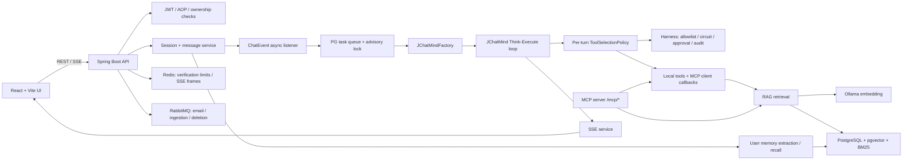

# 系统总览与运行边界

> 页面定位：项目是什么、不是什么、怎么跑起来、怎么验证基线。第一次接触本项目从这里开始。
>
> 最后核对：2026-11-14。总览级事实以架构文档为权威，本页承接并指向模块页。

## 1. 项目定位

JChatMind 是基于[代码随想录 JChatMind](https://github.com/youngyangyang04/JChatMind)（MIT）二次开发的本地 Java Agent 系统，用于学习和工程实践。当前架构是**单个运行时 Agent + 可配置工具集合**，不是多 Agent 编排系统；RAG、记忆、外部 MCP 工具都是 Agent 可调用或可注入的能力。

相对原项目补齐的模块：鉴权体系（Spring Security + JWT + AOP + Redis 限流 + RabbitMQ 异步邮件）、用户记忆系统、Agent Harness（审批/熔断/审计）、MCP 服务端、RAG 多路召回与评测体系。

## 2. 技术栈

| 层 | 技术 | 版本/说明 |
| --- | --- | --- |
| 后端 | Java 17、Spring Boot 3.5.8、Spring AI 1.1.0、MyBatis | `backend_v2/`，Maven wrapper 启动 |
| 前端 | React 19、TypeScript、Vite、Ant Design 6、Tailwind CSS 4 | `ui/` |
| 数据库 | PostgreSQL + pgvector + VectorChord-bm25 | 向量余弦 + BM25 词法同库 |
| 中间件 | Redis（验证码/限流/SSE 帧）、RabbitMQ（邮件/摄入/删除队列） | docker compose 启停 |
| 模型服务 | Ollama（embedding）、可选 TEI reranker、DeepSeek / GLM（ChatClient） | 外部模型配置在本地环境文件，不入库 |

## 3. 已实现能力与事实边界

判断"项目能不能做 X"先看这张表；模块细节进对应 wiki 页。

| 能力 | 状态 | 细节页 |
| --- | --- | --- |
| 对话 Agent（Think-Execute 循环，最多 20 步） | 已实现 | [03](03-Agent核心循环.md) |
| 会话实时反馈（SSE + Last-Event-ID 回放 + 跨实例 Pub/Sub） | 已实现 | [10](10-SSE实时链路.md) |
| 异步 Agent 执行（PG task queue + session advisory lock，至少一次语义） | 已实现 | [04](04-异步任务调度.md) |
| 意图路由与工具选择（规则策略 `intent-policy-v5`，LLM 兜底默认关闭） | 已实现 | [05](05-意图路由与工具选择.md) |
| 工具安全 Harness（allowlist/审批/熔断/审计，部分存储为内存实现） | 已实现 | [06](06-工具Harness.md) |
| RAG（Markdown 分节、pgvector+BM25 多路召回、RRF、可选 BGE rerank） | 已实现 | [07](07-RAG摄入与索引.md)、[08](08-RAG检索与排序.md) |
| 多模态资产（PDF 页文本、Markdown TABLE、文档内 IMAGE 资产关联） | 部分实现（视觉抽取 worker 默认关闭） | [07](07-RAG摄入与索引.md) |
| 用户记忆（抽取/候选/三档自动化/召回/确认式整理） | 部分治理已实现 | [09](09-用户记忆.md) |
| 用户认证与验证码（JWT + AOP + Redis 三层限流 + 异步邮件） | 已实现 | [02](02-认证鉴权与异步邮件.md) |
| MCP 服务端（STREAMABLE 协议，知识库/邮件/数据库工具） | V1 已启用 | [11](11-MCP服务端.md) |
| 内置 Skill（同步受控检索已启用；异步 task 链路默认关闭） | 部分实现 | [12](12-Skill与工作流.md) |
| 显式工作流（Planner→Verifier→Executor，仅显式触发） | 已实现（未接入普通聊天） | [12](12-Skill与工作流.md) |
| 数据库迁移（手搓 manifest/ledger 框架，fail-closed） | 已实现 | [13](13-数据模型与迁移.md) |
| RAG/意图/记忆评测与发布门禁 | 部分完成（多层数据仍 candidate） | [14](14-评测体系与门禁.md) |

**明确不做**（截至最后核对）：多 Agent 协作、跨进程工作流恢复、tenant/共享 ACL/角色授权、KB 删除的通用应用层物理级联、图片 OCR/公式/表格单元格关系检索、工具级重试退避、审计持久化。评审新需求时先对照 [16 设计决策与权衡](16-设计决策与权衡.md)。

### 3.1 接口与前端对应关系

| 业务 | 后端入口 | 前端主要入口 |
| --- | --- | --- |
| 用户注册/登录 | `UserController`、`EmailVerifyController` | `components/auth/`、`api/api.ts` |
| Agent 管理 | `AgentController` | `AgentTabContent`、`AddAgentModal` |
| 会话与消息 | `ChatSessionController`、`ChatMessageController` | `AgentChatView`、`useChatSessions` |
| 会话执行停止 | `ChatSessionController`（`POST /api/chat-sessions/{id}/stop`，`@NeedLogin` + service 层 owner 校验，幂等） | `AgentChatView` 停止按钮 |
| 实时消息 | `SseController`、`SseServiceImpl`、`RedisChatSseEventStore`、`RedisChatSseEventSubscriber` | `AgentChatView` 消费状态/审批/分片/最终消息/错误事件 → [10](10-SSE实时链路.md)、[15](15-前端架构.md) |
| 知识库/文档 | `KnowledgeBaseController`、`DocumentController`、`IngestionTaskController`、`IngestionTaskSseController` | `KnowledgeBaseView`、`useDocuments`（摄入任务优先 SSE，轮询兜底） |
| 内置 Skill | `BuiltinSkillController`、`BuiltinSkillTaskController` | 暂无前端入口，仅供 API 调用 |
| 显式工作流 | `WorkflowController` | 暂无前端入口，仅供 API 调用 |
| 用户记忆 | `UserMemoryController`（候选确认/忽略、编辑、`PATCH .../expiration`、单条删除、清空） | `UserMemoryView`、`api/api.ts` |
| 工具审批 | `HarnessController` | UI 按 SSE 审批事件拉取并提交审批动作 |
| MCP | Spring AI MCP Server `/mcp/*` | 外部 MCP 客户端，不经 React UI → [11](11-MCP服务端.md) |

## 4. 总体架构



| 层 | 组件 | 职责 |
| --- | --- | --- |
| 前端 | React 19 + Vite | 登录、Agent/会话/知识库/记忆界面；REST 调用和 SSE 消费 → [15](15-前端架构.md) |
| Web 层 | Spring MVC Controllers | `/api/**`、`/sse/**`、`/mcp/**` 入口，统一返回 `ApiResponse` → [02](02-认证鉴权与异步邮件.md) |
| 应用层 | Facade Services | 所有权校验、DTO/Entity 转换、CRUD |
| Agent 层 | `JChatMind`、`JChatMindFactory`、`ToolSelectionPolicy` | 装配与运行 → [03](03-Agent核心循环.md)、[05](05-意图路由与工具选择.md) |
| RAG 层 | `DocumentFacadeServiceImpl`、`RagServiceImpl` | 摄入与检索 → [07](07-RAG摄入与索引.md)、[08](08-RAG检索与排序.md) |
| 安全控制层 | Token/AOP、Harness | 保护工具执行而非只依赖模型自律 → [06](06-工具Harness.md) |
| 基础设施 | PostgreSQL/pgvector、Redis、RabbitMQ、Ollama | 持久化、限流、队列、embedding → [13](13-数据模型与迁移.md) |

## 5. 仓库目录

```text
JChatMind/
├── backend_v2/          # Spring Boot 后端（com.kama.jchatmind，约 25 个包）
├── ui/                  # React + Vite 前端
├── sql/                 # 按域组织的增量迁移（auth/chat/ingestion/knowledge-base/mcp/skill/user-memory/webhook/workflow）
│   └── migrations/      # 唯一 manifest + catalog 契约（fail-closed）
├── docs/
│   ├── wiki/            # 本 wiki（模块级深潜，现行唯一文档来源）
│   └── archive/         # 历史方案、记录、专题资料（2026-08-15 / 2026-11-10 / 2026-11-12）
├── specs/               # 特性 spec（如 001-kb-synthetic-eval-dataset）
├── datasets/            # 评测数据集（ecommerce-small-appliances / kb-synthetic-v1 / mmarco）
├── rag-eval/ longmemeval-eval/   # 评测 compose 初始化
├── docker/              # 容器配置（postgres / ollama）
└── docker-compose*.yml  # 基础设施 / RAG 评测 / LongMemEval 三套 compose
```

后端包速查（`backend_v2/src/main/java/com/kama/jchatmind/`）：`agent/`（循环+工具+Harness）、`auth/`、`config/`、`controller/`、`ingestion/`、`intent/`、`mcp/`、`message/`、`migration/`、`rag/`、`service/`、`skill/`、`webhook/`、`workflow/`、`deletion/`、`event/`、`mapper/`、`model/`、`typehandler/`、`util/`。

## 6. 启动与校验

启动顺序：`docker compose up -d`（PG/pgvector + Redis + RabbitMQ + Ollama + 可选 TEI reranker）→ 按 `sql/migrations/manifest.json` 顺序执行迁移（缺批准基线必须 fail-closed，禁止 `IF NOT EXISTS` 掩盖漂移，见 [13](13-数据模型与迁移.md)）→ `backend_v2` 补运行配置（`.env`）→ `mvnw.cmd spring-boot:run` → `ui` 目录 `npm install && npm run dev`。

| 校验 | 命令 | 说明 |
| --- | --- | --- |
| 后端单测基线 | `backend_v2/mvnw.cmd test` | 最近基线 1104 项 0 failures，120 项按条件跳过；跳过不代表真实基础设施验收通过 |
| 前端统一校验 | `ui/npm run check` | lint → Node 契约与 TS 类型契约 → 生产构建，任一步失败即停 |
| 前端 e2e | `ui/npm run test:e2e` | 需要前端服务与 Microsoft Edge；真实后端用例需显式 fixture |
| RAG 评测 | `RagDatasetE2eEvaluationL2Test` 等 | 门控开关见 [14 评测体系与门禁](14-评测体系与门禁.md) |

## 7. 关键设计哲学（速记）

1. **fail-closed**：权限存疑、模型输出不合法、迁移状态未知、低置信检索——一律拒绝或拒答，不做宽松兜底。贯穿鉴权（[02](02-认证鉴权与异步邮件.md)）、意图（[05](05-意图路由与工具选择.md)）、KB 授权、迁移（[13](13-数据模型与迁移.md)）。
2. **错误契约**：HTTP 恒 200，语义走 `ApiResponse.code`；`BizException` 必须带码（401/403）；内部异常细节只进日志不进响应体。
3. **授权分层收敛**：后端硬权限（owner）→ Agent 默认范围 → 会话/模型输入，后层只能收窄前层，模型输出不是授权结果。
4. **防御等级按单机演示校准**：不新增 write-only 审计、零调用协调层、为多实例准备的锁与队列。
5. **事务边界**：事务内不做磁盘 IO；多步破坏性删除必须包 `@Transactional`；文件删除挂 `afterCommit`。

展开与业界对比见 [16 设计决策与权衡](16-设计决策与权衡.md)。

## 8. 关联文档

- 启动与校验声明：[../../README.md](../../README.md)
- 仓库纪律：[../../AGENTS.md](../../AGENTS.md)
- 模块页：见 [00-INDEX](00-INDEX.md) 模块地图。
- 文档维护规则：[00-INDEX](00-INDEX.md) 维护规则节。
