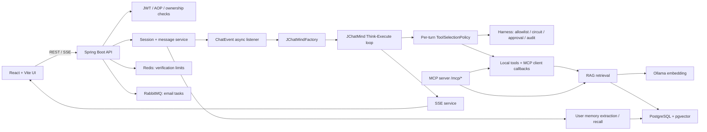
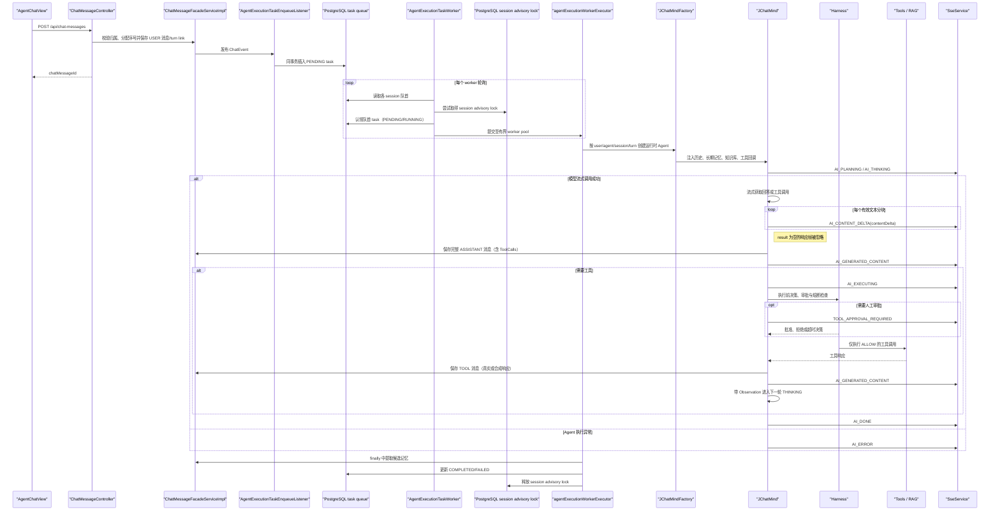
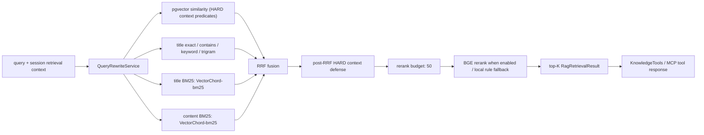
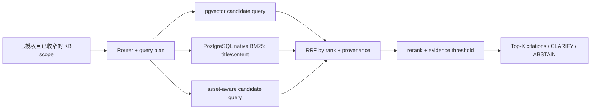
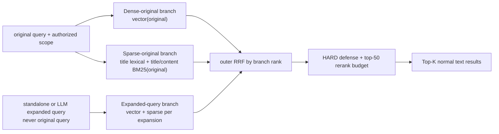
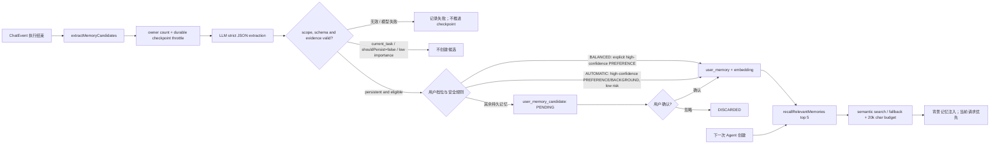
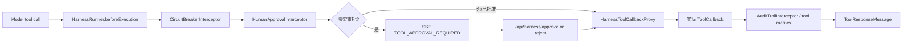

# JChatMind 项目架构与关键链路

> 文档定位：仓库的长期架构总览与源码导航。描述以当前代码为准；历史方案、实验结果和故障复盘不在此重复，统一链接到归档区。修改涉及下列模块时，应同步更新本文件的“关键代码索引”和对应链路。
>
> 最后核对：2026-11-12（按当前代码重整，移除历史核对日志；迁移 manifest 24 项；kb-synthetic-v1 千级 E2E 数据集已冻结）。

## 1. 项目定位与边界

JChatMind 是一个用于学习和二次开发的本地 Java Agent 项目。它提供用户认证、可配置 Agent、会话消息、知识库 RAG、工具调用、人审 Harness、用户记忆、SSE 推送及 MCP 服务端能力。

当前架构是**单个运行时 Agent + 可配置工具集合**，不是多 Agent 编排系统。RAG、记忆和外部 MCP 工具均作为 Agent 可调用或可注入的能力存在。后续是否引入 Verifier、Retriever 等专职 Agent，应以固定评测集上的质量、延迟和成本收益为依据，详见 [RAG 设计与评测分析](archive/2026-08-15/root/RAG设计与评测分析.md)。

### 1.1 已实现能力与事实边界

| 能力 | 当前实现 | 说明 |
| --- | --- | --- |
| 对话 Agent | 已实现 | `JChatMind` 以 Think-Execute 循环驱动模型与工具调用；单次运行记录原始目标、工具步骤和结束原因，在工具预算用尽前额外保留一次仅供消费最后结果的模型决策。 |
| 会话实时反馈 | 已实现 | 后端以会话 ID 管理 SSE 连接，Redis 保存最近 64 帧支持 Last-Event-ID 回放与跨实例 Pub/Sub；前端在 replay-gap 后刷新完整持久化消息，并暂存、合并刷新期间到达的 SSE 消息，避免旧历史响应覆盖实时消息。 |
| RAG | 已实现 | Markdown 分节、embedding、pgvector 向量召回、词法召回、RRF 融合和规则 rerank。 |
| 查询改写 | 已实现 | RAG 检索前生成 query/context 计划；可由评测开关关闭。 |
| 意图与工具选择 | 已实现 | 顶层由 `IntentRouter`（策略 `intent-policy-v5`）生成版本化 `IntentDecision`，结合上一条用户问题识别短追问并按文件具体动作收窄能力；`IntentPolicyEngine` 与当前 callback 求交集，低信息澄清在非 shadow 模式不接受模型升级为工具意图；结构化模型兜底默认关闭。策略只收窄模型可见能力，授权仍由 Harness 执行阶段保证。 |
| 工具安全 Harness | 已实现 | 工具代理、审批、熔断、审计为运行时执行前后链路的一部分。 |
| 内置 Skill 契约 | 部分实现 | `BuiltinSkillRegistry` 固定登记 `technical-decision-comparison@v1`；`POST /api/agents/{agentId}/skills/{skillId}/execute` 校验用户、会话/Agent 归属、工具授权和绑定 KB 所有权后同步执行受控只读知识检索（30 秒超时、并发 2，池满或超时结构化拒答）。异步 task 链路（HTTP submit/status、Rabbit main/retry/DLQ topology、DB dispatch lease、worker）已实现，由环境开关 `BUILTIN_SKILL_TASK_DISPATCH_ENABLED` 默认关闭。 |
| 工作流计划验证 | 已实现（仅显式触发） | `WorkflowPlanner`/`WorkflowPlanVerifier`/`WorkflowPlanExecutor`/`WorkflowFallbackCoordinator` 实现计划生成、校验（预算、工具白名单、证据与矛盾）与受控顺序执行（独立有界 `workflowTaskExecutor`、`timeoutSeconds` 总预算、超时中断）。`WorkflowExecutionService`/`WorkflowController` 提供显式触发入口并写脱敏审计；Planner 未接入普通聊天主路径，普通聊天保持原样。 |
| 记忆模型与事务写入 | [UserMemoryModelClient.java](../backend_v2/src/main/java/com/kama/jchatmind/service/impl/UserMemoryModelClient.java)、[UserMemoryWriteService.java](../backend_v2/src/main/java/com/kama/jchatmind/service/impl/UserMemoryWriteService.java) | 模型调用及响应校验；短事务重验、状态转换、去重和替代关系。 |
| 用户记忆 | 部分治理已实现 | 设置支持 `REVIEW_ALL`、默认 `BALANCED`、`AUTOMATIC`；一次性要求及无效/失败提取 fail-closed，节流检查点和失败状态持久化，候选插入幂等；明确低风险高置信偏好可按档位自动保存，约束/事实/目标及敏感、冲突内容保留确认；管理页展示证据，召回最多 20,000 字符，整理建议需用户确认。 |
| 用户认证与验证码 | 已实现 | JWT 请求上下文、AOP 登录/管理员校验、Redis 限流、RabbitMQ 异步邮件。 |
| MCP 服务端 | V1 已启用（`STREAMABLE` 协议） | 暴露知识库、邮件、数据库工具；仅已解析到内部用户且通过 KB owner 校验的调用可检索私有知识库。 |
| 数据库迁移 | 已实现 | `SchemaMigrationExecutor` 按唯一 manifest 校验增量脚本、批准基线、依赖和 ledger 状态；`JdbcMigrationCatalogVerifier` 按 `catalog-contract.json` 对账。默认不随应用启动运行，真实生产执行仍需发布窗口。 |
| 多模态资产引用与候选 | 部分实现 | PDF 页文本、Markdown `TABLE` 与文档内 IMAGE 资产均与同文档 chunk 关联；`MULTIMODAL_RAG` 可在已授权 KB 与 `HARD` 会话范围内检索 `READY` 资产，Agent/MCP 按表格、PDF、普通候选顺序返回稳定资产 ID 与表格行号或页码。视觉抽取 worker（caption/OCR/实体/关系）与读图证据回答默认关闭。图片/OCR 召回、公式、表格单元格关系与坐标回跳未实现。 |
| 真实 KB RAG 评测 | 部分完成 | `fixture-fast-v1`/`fixture-fast-v2-citation-candidate` 冻结语料的 fixed-chain/Router 双臂检索与 DeepSeek Flash generation/citation runtime 已运行；citation-minimal-v3 双臂 citation 指标全 1.0，检索 A/B 通过；数据集仍为 candidate/release-ineligible，GLM judge 停用，quality/refusal 未测，default-switch inconclusive。 |
| 项目内 Release RAG 集 | 未完成 | 仍需一份未参与调参的完整真实 KB 与 hard/no-answer/permission 样本的人工双人复核；项目授权、答案/引用质量与公开检索分别设门禁，不合并为单一 `release-v1`。 |

## 2. 总体架构



### 2.1 运行组件

| 层 | 组件 | 主要职责 |
| --- | --- | --- |
| 前端 | React 19、Vite、Ant Design | 登录、Agent/会话/知识库/记忆界面；REST 调用和 SSE 消费。 |
| Web 层 | Spring MVC Controllers | 提供 `/api/**`、`/sse/**` 与 `/mcp/**` 入口，统一返回 `ApiResponse`。 |
| 应用层 | Facade Services | 所有权校验、DTO/Entity 转换、会话与资源的 CRUD。 |
| Agent 层 | `JChatMind`、`JChatMindFactory`、`ToolSelectionPolicy` | 装配模型、历史、记忆、知识库、工具；按回合收窄 callback，并执行模型-工具循环。 |
| RAG 层 | `DocumentFacadeServiceImpl`、`RagServiceImpl` | Markdown 解析、分块、向量化、混合检索、融合、重排。 |
| 安全控制层 | Token/AOP、Harness | 建立请求用户上下文；保护工具执行而非只依赖模型自律。 |
| 基础设施 | PostgreSQL/pgvector、Redis、RabbitMQ、Ollama | 业务和向量持久化、缓存与限流、邮件队列、embedding 服务。 |

## 3. 目录与模块职责

```text
backend_v2/
  src/main/java/com/kama/jchatmind/
    agent/           Agent 循环、工具、Harness
    auth/            JWT、请求上下文、权限注解和切面
    config/          Web、安全、模型、消息队列、工具装配
    controller/      REST、SSE 与显式工作流接口
    converter/       DTO/Entity 转换
    deletion/        受控知识库删除任务（发布、消费、审计）
    event/           消息提交后的异步 Agent 事件与任务队列 worker
    exception/       全局异常与业务错误封套
    ingestion/       摄入任务消费者、处理器与进度推送
    intent/          业务意图协议、规则路由和候选能力策略
    mapper/          MyBatis 数据访问接口
    mcp/             MCP 服务端与检索工具
    message/         SSE 消息模型
    migration/       schema manifest、ledger 与迁移执行器
    model/           entity、DTO、request、response、VO
    rag/             RagRouter、视觉证据服务与检索结果缓存
    service/         应用服务接口及实现
    skill/           内置 Skill、受控检索执行与异步 task 链路
    typehandler/     MyBatis 类型处理器（如 pgvector）
    util/            RAG chunk 结构与 metadata 支持
    webhook/         入站 Webhook 验签、ingress 与出站回调投递
    workflow/        工作流 Planner、Verifier、Executor 与审计
  src/test/java/...  RAG/意图/记忆评测、冻结数据集、replay 与候选集治理
ui/src/
  api/               REST 客户端与接口类型
  components/        布局、会话、Agent、知识库、记忆视图
  contexts/          登录态、会话状态
  hooks/             页面数据加载与刷新
  utils/             聊天历史恢复期间合并持久化历史与实时消息
sql/                 按域组织的增量迁移（auth/chat/ingestion/knowledge-base/mcp/skill/user-memory/webhook/workflow），唯一 manifest 在 sql/migrations/
docs/
  项目架构与关键链路.md  当前唯一架构文档
  README.md            docs 目录索引
  archive/             历史方案、记录和专题资料
specs/                特性 spec（如 001-kb-synthetic-eval-dataset）
```

## 4. 关键运行链路

### 4.1 用户提问到 Agent 回复



1. 前端 [AgentChatView.tsx](../ui/src/components/views/AgentChatView.tsx) 要求登录后才创建会话或发送既有会话消息，并通过带 Bearer header 的 `fetch + ReadableStream` 连接 `/sse/connect/{chatSessionId}`；流结束或网络错误后自动重连，4xx 停止重试。它累积 `AI_CONTENT_DELTA` 为临时回答气泡；收到 `AI_GENERATED_CONTENT` 后以持久化消息替换临时内容。无工具调用的 Assistant 最终消息会主动收起状态，避免 SSE 断连丢失 `AI_DONE` 后残留“思考中”；仍有工具调用的中间消息保持执行状态，并继续展示高层执行轨迹、错误状态和审批卡片。[JChatMindLayout.tsx](../ui/src/components/JChatMindLayout.tsx) 对 `/chat` 与 `/chat/{chatSessionId}` 按会话 ID 设置 React `key`，并持有会话 ID 到执行轨迹的内存映射：新会话重挂载时隔离初始化防重标记、SSE 临时分片和审批状态，切回同一会话时恢复此前已收到的轨迹。`SseController` 已校验当前用户和会话 owner；服务端支持按 Last-Event-ID 从 Redis 回放当前会话最近 64 帧，前端保存最后已处理帧 ID并重连时发送 Last-Event-ID、过滤旧帧；Redis Pub/Sub 将实时事件推送到其他实例，过旧游标返回 replay-gap；前端 gap handler 清理不完整分片、刷新持久化会话消息和待审批并推进游标。刷新响应完成前到达的最终 SSE 消息会先暂存，再按消息 ID 与持久化历史合并，避免较旧快照覆盖新消息。
2. [ChatMessageController.java](../backend_v2/src/main/java/com/kama/jchatmind/controller/ChatMessageController.java) 交给 `ChatMessageFacadeServiceImpl`。该服务先校验当前用户拥有会话，保存消息，再同步发布 `ChatEvent`。历史 GET 调用 `selectBySessionId` 并映射全部结果；mapper XML 无 LIMIT，按 turn sequence/created_at/id 稳定排序，旧无 turn 的消息保留在开头。`ChatMessageFacadeServiceImpl.createChatMessage(CreateChatMessageRequest)` 在一个 PostgreSQL 事务内先锁定/分配 session sequence，再插入 USER 消息、`agent_execution_turn_message` 关联并发布 `ChatEvent`；`AgentExecutionTaskEnqueueListener` 以 `Propagation.MANDATORY` 在同一事务写入不含 prompt 的 PENDING task。`AgentExecutionTaskWorker` 轮询每个 session 队首，认领前在 PostgreSQL connection 上取得 session advisory lock，并通过独立 core=2/max=4/queue=0 的 `agentExecutionWorkerExecutor` 运行。执行期间锁连接保持占用；任务正常结束写 COMPLETED，正常 Agent 异常写 FAILED；进程崩溃后 PG 释放 session lock，RUNNING 队首可被其他 worker 重认领，采用至少一次语义，已产生的部分消息或工具副作用可能重复（用户已接受，不做去重）。worker 用 `AgentExecutionTurnContext` 标记 Assistant/Tool 消息；Factory 按 user message 的 turn sequence 读取历史，避免较新的排队输入污染早期上下文，并将前序 Agent 输出排在后续 USER 之前。`AgentExecutionQueueMetrics` 只读 JMX MBean 暴露 worker pool、拒绝数和 PENDING/RUNNING/FAILED 数量；`ChatSessionExecutionCoordinator` 对会话删除也取得同一阻塞 PG advisory lock，跨实例删除会等待活动 turn 释放。
3. `AgentExecutionTaskWorker` 在持有 session advisory lock 时调用 [ChatEventListener.runPersistedTask](../backend_v2/src/main/java/com/kama/jchatmind/event/listener/ChatEventListener.java) 创建并运行 Agent；finally 中继续尝试候选记忆提取，记忆失败只记日志。工具、文档索引和 Webhook 投递的专用执行器尚未实现。
4. [JChatMindFactory.java](../backend_v2/src/main/java/com/kama/jchatmind/agent/JChatMindFactory.java) 加载 Agent 配置、最近会话消息、相关长期记忆、允许访问的 KB、固定/可选/外部工具，并用 Harness 代理包装每个工具回调；外部 callback 只有与 Agent `allowedTools` 精确匹配时才注入，空配置不注入外部工具。
5. [JChatMind.java](../backend_v2/src/main/java/com/kama/jchatmind/agent/JChatMind.java) 运行最多 20 步的 Think-Execute 循环。模型内部工具执行被关闭，工具由应用显式执行，便于审批、超时、审计和 SSE 反馈。每轮模型调用使用流式 `ChatResponse`；仅有效 `AssistantMessage` 分块可产生 `AI_CONTENT_DELTA`，`result == null` 空帧被忽略，最终完整文本和工具调用再聚合为持久化消息。
6. [SseController.java](../backend_v2/src/main/java/com/kama/jchatmind/controller/SseController.java) 要求有效 Bearer 对应登录用户，并通过 `ChatSessionFacadeService` 校验会话 owner；未登录返回 `401`，非 owner/不存在会话返回 `404`；Controller 接受可选 `Last-Event-ID`。[SseServiceImpl.java](../backend_v2/src/main/java/com/kama/jchatmind/service/impl/SseServiceImpl.java) 按会话 ID 保存 emitter 集合并向已授权连接广播序列化 `SseMessage`；单连接发送失败只清理该 emitter，不影响其他连接。运行时由 `RedisChatSseEventStore` 通过 Lua 为会话分配递增 SSE id、追加并裁剪最近 64 帧，序号与历史键 30 分钟 TTL；重连用 Lua 原子读取最新序号与历史快照。`RedisMessageListenerContainer` 订阅 session channel pattern，将 Redis Pub/Sub 事件转发给接收实例的本地 emitter，实现跨实例实时推送。`SseServiceImpl` 收到跳过本地序号的事件时会读取历史快照并补发连续遗漏帧；若 Redis 快照序号低于本地状态，则发 replay-gap、重建本地历史和序号。该链路不提供持久化事件、生产网络分区或宿主机故障下的恢复保证。前端消费 `AI_PLANNING`、`AI_THINKING`、`AI_EXECUTING`、`AI_CONTENT_DELTA`、`AI_GENERATED_CONTENT`、`AI_DONE`、`AI_ERROR` 与 `TOOL_APPROVAL_REQUIRED`。发生 replay-gap 时前端先同步将 Last-Event-ID 游标设为 gap 帧 ID，再刷新完整持久化历史并暂存、合并刷新期间的新消息。断开、超时或发送失败后清理对应连接。

`TC-G0-02` 以最小 Spring 容器的真实 `ApplicationEventPublisher` 覆盖上述消息边界：消息服务保存用户消息后，`ChatEventListener` 创建并运行 Agent，随后提取记忆候选，历史消息按 Mapper 返回顺序读取。该 L1 测试替换外部模型、数据库与专用任务执行器，直接运行提交任务；这不代表生产有界线程池的并发调度。

### 4.2 Agent 内部状态与工具执行

`JChatMind` 维护 `IDLE -> PLANNING -> THINKING -> EXECUTING -> FINISHED/ERROR` 状态。它实现的是**应用显式编排的 Function-calling ReAct**，而不是解析 `Thought / Action / Observation` 自由文本协议：模型只决定“直接回答”或返回 `ToolCall`，项目把工具结果以 `ToolResponseMessage` 作为 Observation 写回消息窗口，再让模型进行下一轮决策。`AI_THINKING` 仅为前端状态，不暴露或持久化模型的独立 reasoning content。

工具选择补强后，`JChatMind` 在每轮模型请求前使用 `ToolSelectionPolicy` 根据最新用户消息获取 `IntentDecision`，再由 `IntentPolicyEngine` 与当前可用 callback 求交集：闲聊和阻断请求不暴露工具，知识类请求只暴露 `KnowledgeTool`，明确动作只暴露对应 callback，复合或需澄清请求不暴露副作用工具。该策略只控制模型可见能力，不能替代执行阶段的 Harness 授权。

当前项目的意图判断不是由一个独立模型完成，而是分层处理：

1. **顶层工具意图**：`IntentRouter` 使用 Java 规则生成 `BusinessIntent`、独立的 `QueryIntent`、路由、风险等级、置信度、margin、原因码和候选能力；当前策略版本为 `intent-policy-v5`，只把上一条用户问题作为有限上下文识别短追问，不将完整历史传入意图分类；同时支持知识导航、文件读取与列目录区分、明确的外部查询及低信息优先澄清。结构化模型兜底需满足配置的输入/输出上限、confidence 与 margin 门槛，并受最多 2 次重试控制；该路径默认关闭，默认阈值还需经冻结 release 集校准。`IntentPolicyEngine` 只保留候选能力与当前 callback 的交集，并对复合/澄清/非副作用风险决策再次剔除副作用工具。`ToolSelectionPolicy` 负责接入 `JChatMind`。候选集合确定后，`JChatMind` 使用 Agent 配置的 `ChatClient`（当前模型类型为 `deepseek-chat` 或 `glm-4.6`）决定直接生成回答，或返回结构化 `ToolCall`。模型输出的意图和工具名不是授权结果。
2. **RAG 路由意图**：`KnowledgeTools` 已经收到 `KnowledgeTool` 调用后，才交给确定性的 `RagRouter` 判断 `DIRECT`、`PRIVATE_RAG`、`HYBRID_RAG`、`MULTIMODAL_RAG`、`CLARIFY` 或 `ABSTAIN`；它不负责决定顶层 Agent 是否调用 `KnowledgeTool`。
3. **检索查询意图**：`QueryRewriteServiceImpl` 识别 `FACTOID`、`ANALYTICAL`、`FOLLOW_UP`、`NAVIGATION`，用于查询改写和上下文过滤；可选的 LLM 只改写检索 query，不授予工具权限。

意图准确性的运行时契约是“高风险误调用优先为零”，而不是宣称分类 100% 正确：规则与模型判断冲突、请求处于解释/教程语气、或没有明确能力信号时，候选工具收窄为空或只保留低风险工具；模型即使返回未在本轮白名单中的 `ToolCall`，也会在 Harness 前被拒绝。`sendEmail`、文件写入/删除等副作用工具还必须继续满足 Agent 显式配置和审批策略。准确性评测除总体命中率外，必须单独统计副作用工具误调用率、越权执行率、拒答准确率和澄清率。

- 会话消息窗口默认 20 条；总字符达到 8000 时压缩旧消息并保留最近 8 条。`conversationSummary` 最多 4000 字符，超出时丢弃较旧前缀、保留末尾的新近内容；决策提示和下一轮摘要提示都只读取这个受限值。
- 压缩时会调整边界，避免把一次 Assistant tool call 与对应 `ToolResponseMessage` 拆开。
- 每个有效模型文本分块先以 `AI_CONTENT_DELTA` 发送；流结束后才聚合、持久化完整 Assistant 消息并发出 `AI_GENERATED_CONTENT`。中转站产生的空响应帧不得中断后续分块或工具调用聚合。
- 工具执行使用 30 秒默认超时；工具回包和合成的审批/熔断拒绝结果同样作为 `TOOL` 消息持久化。
- 相同工具调用签名会被记录；同一 Agent 运行中的重复签名会在 Harness 前拒绝，并作为下一轮 prompt 的拒绝 Observation。
- `AI_THINKING` 仅表达 Agent 状态。当前链路不承诺向前端暴露或持久化独立模型 `reasoning_content`，流式正文取自 `AssistantMessage.getText()`。

#### ReAct 循环、Harness 与复杂任务边界

每轮 `think()` 先构造包含系统提示、近期会话消息、相关长期记忆、可访问 KB 摘要、上一轮工具签名提醒及受限对话摘要的 Prompt；`DefaultToolCallingChatOptions.internalToolExecutionEnabled` 固定为 `false`，因此 Spring AI 不会绕过应用自行执行工具。模型流结束后，完整 Assistant 文本和最后一个包含工具调用列表的响应合并为 `AssistantMessage`，先写入内存和消息表；无 `ToolCall` 时本轮即完成。存在 `ToolCall` 时，`execute()` 将全部调用交给 `HarnessRunner`，仅执行 `ALLOW` 项；审批拒绝、审批超时或熔断打开的调用会转成与真实工具返回同形的合成 `ToolResponseMessage`。真实或合成结果均写入内存与消息表，作为下一轮模型调用的 Observation；真实与合成结果混合时，合并结果会按模型原始调用顺序排序。

Harness 在工具真正执行前先校验本轮 callback 白名单和重复调用，再按顺序应用熔断、人工审批和审计上下文；批准的调用由 `AgentToolExecutor` 在独立、最多 4 个线程且不排队的工具池中执行，保留请求上下文及 Harness ThreadLocal，并在退出时清理。默认等待 30 秒；超时或等待线程中断时取消批次、向任务发出中断并终止本轮 Agent，记录 `TOOL_OUTCOME_UNKNOWN` 和未确认结果的 Observation/SSE，不再让模型继续调用工具。代理在每次回调前后检查持久取消标记，因此吞掉中断的工具也不能启动同批后续工具；已经发出的外部操作无法由 Java 中断撤回。线程池满时调用未执行，本轮以 `TOOL_EXECUTOR_BUSY` 结束。应用关闭时先取消活动批次再关闭线程池。每个 ToolCallback 均由 `HarnessToolCallbackProxy` 代理，成功与异常分别触发后置审计和熔断统计；任何新工具都不得绕过该代理。`KnowledgeTools` 则由 Factory 每会话 fork，并绑定已授权 KB 范围，模型传入的 `kbIds` 只能继续收窄，不能扩大权限。

当前循环可执行短链路的多轮工具调用，但其控制边界必须明确：

- 循环总预算固定为最多 20 步；最后一步即使刚产生 Observation，也不会额外获得一轮模型调用来消费该结果并生成最终答案。
- 相同 `tool + arguments` 在同一 `JChatMind` 运行实例中只允许首次执行，重复调用会在 Harness 前被拒绝并写入 Observation；当前仍没有连续失败上限、工具级重试/退避或持久化停止原因。
- 当前主链路的 `IntentRouter` 仍是轻量规则路由，不是完整语义分类器；普通教程不开放工具，复合/澄清/阻断请求在策略层 fail-closed。每次 Agent run 生成独立 `traceId`，每次意图决策有 correlation ID；当前 `InMemoryAuditStore` 的 `ToolCallRecord` 可保存受限的意图元数据但尚未持久化。Shadow 只记录哈希化结构化差异并返回规则决策。意图候选集仍是合成待审数据，离线评测与发布门禁见第 8 节“意图离线评测”。任何升级仍必须复用本轮 callback 白名单和 Harness 门禁。
- 运行时没有持久化的目标、子任务、依赖、已完成证据或恢复点；进程/运行失败后只能由后续会话消息重新装配上下文，不能从中断步骤自动恢复。
- `conversationSummary` 只存在于当前 `JChatMind` 实例。压缩保护工具调用与结果配对，却不能替代复杂任务的结构化工作状态。
- `TerminateTool` 仍有执行器结束分支，但生产 Factory 会从本地运行时工具集中移除 `terminate`；普通 Agent 的 Prompt 不再提示调用它，常规结束语义是模型输出不带 `ToolCall` 的最终回答。

复杂任务不应只把 20 步上限调大或要求模型输出更多隐藏推理。当前仓库已在现有 ReAct 与 Harness 外层实现 `Planner -> Executor -> Verifier` 显式工作流：Planner 输出有限的结构化计划，Verifier 校验证据、矛盾、权限和完成条件，Executor 逐步执行已验证且受 Harness 保护的工具，整个计划使用 `workflowTaskExecutor` 专用有界池并按 `timeoutSeconds` 取消超时执行；规划拒绝时由 `WorkflowFallbackCoordinator` 回退单 Agent。该路径仅通过 `POST /api/workflows/execute` 显式触发，普通聊天保持原路径；跨进程恢复与多 Agent 协作仍未实现。具体阶段边界以[已归档总计划](archive/2026-11-10/plans/terminated/trusted-knowledge-agent-roadmap.md)和[实施 Spec](archive/2026-11-10/spec/trusted-knowledge-agent-spec.md)为准。

关键入口：[`JChatMind.run`](../backend_v2/src/main/java/com/kama/jchatmind/agent/JChatMind.java)、[`JChatMind.think`](../backend_v2/src/main/java/com/kama/jchatmind/agent/JChatMind.java)、[`JChatMind.execute`](../backend_v2/src/main/java/com/kama/jchatmind/agent/JChatMind.java)。

### 4.3 文档上传与索引构建

```mermaid
flowchart LR
    A["POST /api/documents/upload"] --> B["DocumentFacadeServiceImpl"]
    B --> C["DocumentStorageService: data/documents/<kb>/<doc>"]
    C --> D["IngestionTaskService: create/replay task"]
    D --> E["after-commit publish"]
    E --> F["RabbitMQ ingestion queue"]
    F --> G["IngestionTaskConsumer: claim QUEUED"]
    G --> H["DefaultIngestionTaskProcessor transaction"]
    H --> I["MarkdownParserService / RagChunkSupport"]
    I --> J["RagService.embed -> Ollama /api/embed"]
    J --> K["replace chunk_bge_m3 + pgvector"]
```



- [DocumentController.java](../backend_v2/src/main/java/com/kama/jchatmind/controller/DocumentController.java) 接收 KB ID、文件和必填 `Idempotency-Key`。
- [DocumentFacadeServiceImpl.java](../backend_v2/src/main/java/com/kama/jchatmind/service/impl/DocumentFacadeServiceImpl.java) 在一个上传事务内先校验 owner 和非空幂等键，再保存文档记录与文件；它不再在 HTTP 请求中同步解析或 embedding，而是提交摄入任务并返回 `documentId`、`taskId`。
- [DocumentStorageServiceImpl.java](../backend_v2/src/main/java/com/kama/jchatmind/service/impl/DocumentStorageServiceImpl.java) 在 `Files.copy` 中途失败时立即删除该次尚未返回给上层的目标文件，并仅删除为空的文档和 KB 目录；任务/数据库异常发生在文件已成功写入后，则仍由上传门面按返回的相对路径补偿。两条分支都不删除已有成功上传文件。
- [IngestionTaskServiceImpl.java](../backend_v2/src/main/java/com/kama/jchatmind/service/impl/IngestionTaskServiceImpl.java) 以任务 owner + 幂等键创建或重放同一任务：预检先取得 PostgreSQL 事务级 advisory lock，再查询既有任务，因此同一 owner+key 的并发上传不会在文档/文件副作用前同时越过预检。它校验文档属于已授权 KB，并在事务提交后发布消息。取消只允许 `QUEUED` 或 `RETRYING`；已领取的 `RUNNING` 任务必须通过完成、失败或重试收束，避免“已取消仍写入”。任务查询、取消和重试仅允许 owner，经 [IngestionTaskController.java](../backend_v2/src/main/java/com/kama/jchatmind/controller/IngestionTaskController.java) 输出时不暴露 `ownerId` 或幂等键。
- [IngestionTaskConsumer.java](../backend_v2/src/main/java/com/kama/jchatmind/ingestion/IngestionTaskConsumer.java) 从独立 RabbitMQ 摄入队列领取任务，并显式使用 `ingestionRabbitListenerContainerFactory`：工厂先应用现有 Spring Boot Listener 配置，再固定每实例两个消费者、每消费者预取一条未确认消息，因此阻塞解析或 embedding 不会使同一消费者囤积更多消息。该本地并发限制不实现任务超时、动态扩缩、队列监控或跨实例协调。RabbitTemplate 的 JSON 字符串任务 ID 在消费者入口解包后才进入 UUID 查询，避免带引号值使任务永久停在 `QUEUED`。[DefaultIngestionTaskProcessor.java](../backend_v2/src/main/java/com/kama/jchatmind/ingestion/DefaultIngestionTaskProcessor.java) 在数据库事务内重建目标文档的 chunk，任一 `insert` 未落库即抛错回滚本次数据库替换。Markdown 保留既有 section 分块；HTML 由同一解析服务提取标题结构；PDF 由 PDFBox 逐页提取非空文本并把 `pageNumber` 写入 chunk metadata。PDF 每页还会在同一事务内创建 `PDF_PAGE_TEXT` 资产和同文档关系，并将相同资产 ID、类型与页码 locator 写回该 chunk metadata；`txt` 或无章节内容作为单文档原文 chunk。

  摄入阶段同时提取文档内图片资产：Markdown/HTML 解析相对图片引用（跳过外链与 data URI，记录章节路径、行号与 originalRef），PDF 用 PDFBox 流引擎提取内嵌图片（记录页码、bbox 并将 PNG 写入 `kb/docId/derived/image-<hash>.png`），统一落为 IMAGE 资产并按章节/页关联 chunk；重跑时派生文件按内容 hash 命名，不产生残留。配套三张表 document_asset_extraction/entity/relation（migration order 240）和默认关闭的 DocumentImageExtractionWorker（`rag.visual-extraction.enabled`，30s 轮询、单线程并发、超时与 max-attempts 重试上限、按 hash+prompt/model/parser 版本天然缓存）：启用后调用 deepseek-chat 多模态生成 caption/OCR/实体/关系 JSON，经契约校验后事务内落库（ACTIVE 唯一、旧结果 SUPERSEDED、失败置 FAILED）并写入含实体关系摘要的视觉 chunk 与 document_asset_chunk 关联。意图与路由同步打通：IntentDecision/IntentDecisionMetadata 增加可选 `requiresVisualEvidence`/`visualTask`（LLM 意图输出解析，规则路径保持 null），IntentModelClient 支持附加授权范围内视觉资产摘要（VisualAssetSummaryService 查询 ACTIVE 抽取结果，`rag.visual-extraction.intent-summary-enabled` 默认关闭），RagRouter 支持 VisualEvidenceHint：意图判定需要图片证据时路由 MULTIMODAL_RAG，授权范围内无图片资产时进入 CLARIFY，无 hint 时保留现有关键词规则兜底；MCP 检索入口不经过 Agent 意图层，仍走关键词规则。`RagService.retrieveImageAssets`（asset_image 候选通道，metadata.asset 含 id/type/locator/visualKind）已接入 KnowledgeTools 与 MCP 多模态合并；VisualEvidenceAnswerService（`rag.visual-extraction.answer-enabled` 默认关闭）在 Agent 检索结果上对 top-k 图片加载派生 PNG 调用 ImageEvidenceClient（deepseek-chat）生成读图证据块，强制输出 [assetId=...] 引用标记，失败单图跳过不影响整体检索。
- [IngestionTaskSseController.java](../backend_v2/src/main/java/com/kama/jchatmind/controller/IngestionTaskSseController.java) 提供 `GET /sse/ingestion/{taskId}`，先通过 `IngestionTaskServiceImpl.getTask` 复用任务 owner 校验，再交给 [IngestionTaskProgressServiceImpl.java](../backend_v2/src/main/java/com/kama/jchatmind/ingestion/IngestionTaskProgressServiceImpl.java) 管理单实例任务级 emitter 集合、最新事件和有限事件历史。消费者在领取、成功、重试、死信时发布带单调 `id` 的 `ingestion-progress`；任务级锁串行化回放、连接注册和实时发送，Controller 接受 `Last-Event-ID` 并回放当前进程内的后续事件。每个任务最多保留 64 条事件，终态且没有连接 30 分钟后在后续任务活动中清理；四参生产构造器由 Spring 注入真实进度服务。前端已实现 `fetch + ReadableStream` 消费任务事件，只接受递增序号后断线重连，切换 KB、卸载或终态时取消连接，并保留轮询作为跨实例/长断线兜底。该服务不持久化事件，也不提供多实例分发或进程重启后的恢复。
- 文档列表、创建、上传、更新和删除均先校验当前用户拥有所属 KB；删除获授权文档时会先删除关联 `chunk_bge_m3` 记录，再删除文件和文档记录。
- [RagChunkSupport.java](../backend_v2/src/main/java/com/kama/jchatmind/util/RagChunkSupport.java) 负责将 section 标题、层级路径、来源等信息组装为 embedding 输入和 metadata；[RagServiceImpl.java](../backend_v2/src/main/java/com/kama/jchatmind/service/impl/RagServiceImpl.java) 调用 Ollama `/api/embed` 获取向量，并由 `ChunkBgeM3Mapper` 写入 `chunk_bge_m3`。

#### 分块、清洗与索引数据契约

摄入支持 `md`、`markdown`、`txt`、`html` 与 `pdf`。Markdown/TXT 使用 Flexmark AST 解析：每个标题与其到下一个标题前的直属内容组成一个 section，标题前内容单独成为“文档前言”，全文无标题时回退为单个“文档” section。section 保留 `title`、`contentPath`、`parentContentPath`、标题层级、路径深度、父节点标记和本地内容长度；父标题不会继承子标题正文。Markdown 表格保留原始 Markdown，并额外创建 `TABLE` 资产及其与 chunk 的关系。

HTML 解析会移除注释及 `script/style/noscript/template/head`，将常见块级标签转换为换行、删除其余标签、解码常见实体并合并多余空白后，再按 `h1`–`h6` 组织 section。PDF 使用 PDFBox 逐页提取非空文本，写入 `pageNumber` 并创建 `PDF_PAGE_TEXT` 资产；扫描件或无可提取文本的 PDF 当前没有 OCR 回退，会作为摄入失败处理。

分块采用“结构优先、字符长度兜底”：内容不超过 `2,000` 字符时一个 section 对应一个 chunk；超过时从 `2,000` 字符向前寻找换行或 `。！？.!?；;`，优先保留约 `1,000` 字符以上的自然边界，找不到才硬切。子块继承相同结构 metadata，且**不使用 overlap**。当前清洗边界限于结构提取、HTML 噪声标签/空白规整、空 PDF 页跳过和标题/内容 trim；没有页眉页脚、目录、模板话术或重复 chunk 的专门识别，也没有乱码修复、语言识别或敏感信息清洗。

每个 chunk 持久化 `kb_id`、`doc_id`、正文、JSONB metadata、embedding、标题/正文 BM25 投影和索引版本。metadata 至少包含 `title`、`retrievableTitle`、`contentPath`、`parentContentPath`、`sourceType`、`sourceName`、`sectionIndex`、`headingLevel`、`hasChildren`、`sectionType`、`pathDepth` 与 `localContentLength`；PDF 增加 `pageNumber`，关联资产时增加资产 ID、类型和 locator。embedding 输入是 `contentPath + title + content`，因此章节上下文参与语义召回，而不只对正文向量化。

同一文档再次摄入时，处理器会在同一数据库事务内删除该 `docId` 的旧 chunk，再解析、向量化并写入整篇文档的新 chunk；任一写入失败会回滚本次替换。因此当前是“**文档级全量重建**”，不是基于内容哈希的未变更跳过，也不是只重算变化 section 的 chunk 级增量更新。PDF/Markdown 资产会同步删除后重建；资产的 `content_hash` 用于资产内容标识，尚未承担文档增量判定。

物理检索索引由 PostgreSQL 承担：`chunk_bge_m3.embedding` 为 `vector(1024)`，使用 pgvector `ivfflat (embedding vector_cosine_ops) WITH (lists = 100)`，查询以 `embedding <=> queryVector` 按余弦距离排序；定义见 [cosine_index.sql](../sql/user-memory/cosine_index.sql)。VectorChord-bm25 扩展则为 `title_bm25_vector` 与 `content_bm25_vector` 分别建立 BM25 索引，定义见 [2026-08-22-add-vchord-bm25-index.sql](../sql/knowledge-base/2026-08-22-add-vchord-bm25-index.sql)。BM25 标题投影来自标题、路径、父路径和文件名，正文投影来自 chunk 内容；词典为 token 分配稳定 ID，中文按相邻双字切分，非中文 token 至少两个字符。向量和 BM25 投影随 chunk 一次写入，BM25 的 `index_version` 用于避免不同投影规则混检。

**维护约束：** 任何影响 Markdown 解析、chunk 边界、metadata、embedding 模型或输入拼接方式的改动，必须升级 RAG 评测数据集/索引版本，不能直接与旧 chunk UUID 的结果对比。

### 4.3.1 G1 知识库硬权限范围

G1 当前实现为单用户私有 KB 的 owner-only 模型：`knowledge_base.owner_id` 是后端授权依据，创建 KB 时由 `RequestScopeData.userId` 写入；列表、读取、更新、删除、文档 CRUD、上传和索引副作用均通过 `KnowledgeBaseAccessService` 校验 owner。不存在、历史无 owner 或非 owner 的 KB 均返回统一拒绝，不把资源存在性暴露给调用方。

范围按以下顺序收敛，后层只能缩小前层：

1. **后端硬权限**：owner 必须等于当前用户。当前本地库已验证 `owner_id` 外键、检查约束和 `NOT NULL`；不存在无 owner 的默认放行路径。
2. **Agent 默认范围**：`agent_knowledge_base` 是绑定的唯一持久化事实来源。API DTO/VO 的 `allowedKbs` 只是该关系表的读写投影，创建和更新时服务端校验 KB 存在、可访问并去重；它不是资源授权模型。
3. **会话/工具临时范围**：`KnowledgeTools` 只能从已注入的默认集合继续收窄，传入任意 `kbIds` 不会扩大范围。带 RRF 信号的候选还要通过最低分 `0.02` 和 Top-1/Top-2 差值 `0.002` 的置信度门禁；低置信度结果收束为证据不足，不更新会话 context，MCP 同步记录 `ABSTAIN/no_evidence`。

`JChatMindFactory` 会先校验 Agent owner，再从关系表读取绑定并按运行时用户过滤；失权或已删除 KB 不会进入 `JChatMind.availableKbs` 或 `KnowledgeTool`。`agent_knowledge_base` 的 `agent_id`、`kb_id` 均有 `ON DELETE CASCADE`，删除 Agent 或 KB 时会清理当前绑定。表内 `bound_by_user_id`、`bound_at` 仅记录当前绑定的操作者和时间，尚不是保留历史事件的完整审计。

摄入任务也遵循同一硬权限层：上传和任务提交均先由当前用户的 KB owner 权限约束，任务记录再以 `owner_id` 限制查询、取消和重试。前端只显示当前 KB 任务，对 SSE 事件与轮询结果均再次核对 `kbId`；活动任务优先尝试携带 `Last-Event-ID` 的 Bearer SSE，轮询仅作跨实例或长断线兜底；取消和重试失败保留本地任务状态并提示错误。

当前唯一迁移顺序与 SHA-256 清单为 [`sql/migrations/manifest.json`](../sql/migrations/manifest.json)，托管对象契约为 [`sql/migrations/catalog-contract.json`](../sql/migrations/catalog-contract.json)；它要求先提供仓库外经批准的原始基线 schema，缺少基线或发现未知/部分状态时 fail-closed。`SchemaMigrationExecutor`、`JdbcMigrationStore` 与 `MigrationReleaseApplication` 已提供显式执行和脱敏发布记录，默认不随应用启动运行，真实生产执行仍需发布窗口。

当前未实现 tenant、共享 ACL、角色授权、完整绑定历史审计，以及 KB 删除时文件的通用应用层物理级联。MCP V1 的调用者到本地用户映射已完成；真实主体仅映射单一内部用户，凭据只以指纹落库。共享、角色授权或 tenant 出现前，必须先扩展授权模型；不得把关系表或 API `allowedKbs` 投影误作 KB 授权模型。

### 4.3.2 受控知识库删除

`DELETE /api/knowledge-bases/{knowledgeBaseId}` 不再直接只删除 KB 行。`KnowledgeBaseDeletionTaskServiceImpl` 先按当前用户和稳定幂等键取得 PostgreSQL advisory lock；同 owner 的重放返回既有删除任务，即使 KB 已不存在。首次请求在同一事务中写入 `knowledge_base_deletion_task` 和 `knowledge_base_deletion_audit`，再以 `id + owner_id` 删除 KB，由现有外键清理绑定、文档、chunk 和摄入任务；任务表不引用 KB，因此文件清理状态不会随级联删除而丢失。

提交后 [RabbitKnowledgeBaseDeletionTaskPublisher.java](../backend_v2/src/main/java/com/kama/jchatmind/deletion/RabbitKnowledgeBaseDeletionTaskPublisher.java) 投递独立 queue。[KnowledgeBaseDeletionTaskConsumer.java](../backend_v2/src/main/java/com/kama/jchatmind/deletion/KnowledgeBaseDeletionTaskConsumer.java) 在单消费者、单预取下领取任务，调用 [DocumentStorageServiceImpl.java](../backend_v2/src/main/java/com/kama/jchatmind/service/impl/DocumentStorageServiceImpl.java) 仅删除 `document.storage.base-path/<kbId>` 下的规范化目录；目录不存在成功，越出基目录拒绝。失败的清理依次进入重试和死信，查询 `GET /api/knowledge-base-deletion-tasks/{taskId}` 只向任务 owner 返回状态。前端 `KnowledgeBaseTabContent` 提供二次确认删除按钮，Hook 会等待删除任务终态并刷新列表。

### 4.4 RAG 检索与排序



[RagServiceImpl.java](../backend_v2/src/main/java/com/kama/jchatmind/service/impl/RagServiceImpl.java) 是当前检索核心：

职责已按变化原因拆分：`RagServiceImpl` 保留查询改写接入、候选召回和分支编排；`RagEmbeddingClient` 管理 embedding 请求与缓存；`RagFusion` 管理通道去重、RRF 与来源追踪；`RagRetrievalSignals` 处理结果复制与信号合并；`RagReranker` 管理本地评分及 BGE 重排；`RagRetrievalContextPolicy` 管理上下文归一化、候选范围及硬过滤；`RagRetrievalMetadata` 负责 metadata 字段解析。内部协作类保持包可见，不新增 Spring Bean 或对外 API。

1. 清洗 KB 范围，调用 [QueryRewriteServiceImpl.java](../backend_v2/src/main/java/com/kama/jchatmind/service/impl/QueryRewriteServiceImpl.java) 生成检索 query 与可选会话上下文约束。
2. 构造多个候选通道：向量相似度、标题精确/包含/关键词/Trigram、标题 BM25 和正文 BM25。两个 BM25 现经 `VchordBm25QueryService` 与 PostgreSQL VectorChord-bm25 查询，应用层只接收候选 rank、必要展示字段和 provenance，不再调用 `selectLexicalCandidatesByKbIds` / `selectContentLexicalCandidatesByKbIds` 将整库文本拉回 JVM 打分。`RagServiceImpl` 委托 `RagEmbeddingClient` 调用 Ollama 并管理 embedding 向量：使用按规范化文本建 key 的实例内 LRU，写入和命中均复制向量，容量为 0 时旁路。KnowledgeTools/MCP/Workflow 另接入每入口有界 RAG 结果缓存（256 条，`RagRetrievalResultCache`），key 含 requester、授权 KB 集、每 KB 数据库 index revision、query、session context、route、limit 和 RAG/rewrite/reranker fingerprint；每次先做授权检查，命中返回深拷贝。order-190 migration 触发器跟踪 chunk、document、asset 和 asset-chunk changes，缓存以该 revision 感知失效。
3. 用 RRF 合并不同分数空间的候选，再按上下文约束过滤。向量与两个 BM25 通道均将 `HARD` 的 KB、来源、类型和路径过滤下推到数据库 `LIMIT` 前；标题精确/包含/关键词/Trigram 保持独立行为。
4. 在 RRF 和 `HARD` 过滤后只对前 50 个候选执行 rerank；默认使用既有规则 rerank，显式开启 `rag.rerank.enabled` 后改为调用本地 TEI 的 `BAAI/bge-reranker-v2-m3` cross-encoder。TEI 超时、不可用或响应非法时回退规则 rerank；候选排名 penalty 封顶为 `0.15`，预算外候选保留原 RRF 顺序，再输出最终 Top-K。
5. [KnowledgeTools.java](../backend_v2/src/main/java/com/kama/jchatmind/agent/tools/KnowledgeTools.java) 只在已由 Factory owner 过滤后的 Agent 默认范围内检索，模型提供的 `kbIds` 只能继续收窄；[McpKnowledgeTool.java](../backend_v2/src/main/java/com/kama/jchatmind/mcp/McpKnowledgeTool.java) 只以服务端解析出的 MCP 主体 `user_id` 走同一 owner 校验，调用方传入的 `kbIds` 不能扩权；无主体、无有效凭据或越权均不进入 RAG。两个入口先在该授权范围内执行 `RagRouter` 计划；仅 `MULTIMODAL_RAG` 调用 `RagService.retrieveMarkdownTableAssets` 和 `retrievePdfPageAssets`，两个服务均通过 `chunk_bge_m3 -> document_asset_chunk -> document_asset` 只检索 `READY` 的相应资产，并在 SQL `LIMIT` 前保留 KB、来源、类型和路径的 `HARD` 过滤。表格候选 SQL 以当前关系行的资产 ID、类型和 locator 覆盖输出 metadata。入口按表格、PDF、普通检索优先级、chunk ID 去重、运行时异常回退和 `route.topK()` 截断合并结果。metadata 包含完整 `asset.id` 与 `asset.type` 时，chunk 引用后附加 `资产: <type>:<id>`；PDF 继续显示页码。文档内图片的 IMAGE 资产已在摄入阶段提取（locator 可回跳页码/章节/行号），但图片 OCR/caption 抽取、视觉 chunk 检索与实体坐标回跳尚未实现。

`KnowledgeTools` 会将 `RagRouteDecision.searchScope` 与 Agent 已授权 KB 求交，`McpKnowledgeTool` 会与 owner 已授权 KB 求交，再执行普通检索和 PDF/表格资产检索；`KnowledgeTools` 会按收窄后的范围重新校验会话检索上下文，MCP 检索及成功/无证据审计记录使用实际路由范围。

`QueryRewriteServiceImpl` 保留原问和最多一个受控 standalone query；向量与标题通道的 query/source provenance 会写入 `RagRetrievalResult.retrievalProvenance`，同源标题和多 query 向量通道在参与跨组 RRF 前已组内去重。`RagRouter` 已在 Agent 与 MCP 生产入口执行 route、拒答、外部许可和 `topK` 计划；`MULTIMODAL_RAG` 的表格与 PDF 候选 provenance 分别为 `asset_table_<query-source>` 与 `asset_pdf_page_text_<query-source>`。当前没有受控外部工具，也未通过冻结集证明相对固定链路或资产优先合并的质量、p95 或成本收益。

当前 G2 的主要生产边界是：PDF 页文本与 Markdown `TABLE` 资产已进入独立的资产感知向量候选通道，并仅在多模态路由下优先合并；Markdown 表格以原始表格所在 chunk 和行号定位，不提供单元格级语义或坐标回跳。图片/OCR、公式和坐标回跳均未实现。默认未传 `kbIds` 时搜索 Agent 全部授权 KB，历史 context 只作为本次 `SOFT` 排序偏置；短新标题、API/Windows 路径、同源通道校准和低置信 Top-1 的 context 污染均已有回归保护。G2 的其余质量、延迟和成本结论仍须由后续冻结集验收，当前不以局部单测宣称阶段完成。

G2 的目标架构如下，已实现 Router 入口计划、原生 BM25、PDF 页文本与 Markdown `TABLE` 资产候选和基础引用；evidence threshold、受控外部工具、图片/OCR、表格单元格关系、公式及冻结集验收仍未实施：



其中原生 BM25 已按 `kb_id` 和 `HARD` 上下文过滤再取 Top-N，应用层只融合 rank/provenance，业务事实仍保留在 `chunk_bge_m3`。PDF 页文本与 Markdown 表格资产候选均通过关系表读取同一 chunk 事实，分别使用 `asset_pdf_page_text_*` 与 `asset_table_*` provenance 的向量 RRF，不与普通通道的原始分数混算；仅由多模态入口按表格、PDF、普通结果顺序合并。唯一生产 provider 为 VectorChord-bm25；其选型和迁移门禁见[已归档总计划](archive/2026-11-10/plans/terminated/trusted-knowledge-agent-roadmap.md)与[实施 Spec](archive/2026-11-10/spec/trusted-knowledge-agent-spec.md)。对 [RAG-Anything](https://github.com/HKUDS/RAG-Anything) 的借鉴限定为层级/位置保留、图表公式分流和模态感知证据检索；当前系统未接入 LightRAG 图谱，PDF 和 Markdown 表格已实现稳定资产引用与候选，尚没有图片/OCR、表格单元格关系或公式资产检索。它不替代本项目既有的用户记忆生命周期。

#### 4.4.1 独立三路召回实现与默认放行边界（G2-3b）

G2-3b 已将普通文本检索从平铺候选通道重构为三个有明确输入、组内排序和输出边界的分支；资产候选仍由 `MULTIMODAL_RAG` 按既有资产优先规则单独合并：



1. **Dense-original** 只对原问执行 pgvector 检索，输出 chunk 去重后的单一分支排名。
2. **Sparse-original** 只对原问执行标题精确/包含/关键词/Trigram、标题 BM25 和正文 BM25；分支内只按 rank 融合，不混合 lexical score 与 vector distance，并对同一 chunk 输出一次最佳分支排名。
3. **Expanded-query** 只消费 `retrievalQuerySources != original` 的受控扩展 query。当前规则最多提供一个 standalone 或 LLM query，因此本阶段不增加新的高扇出生成器；每个扩展 query 可同时调用向量和 sparse 检索，先按 query、再按整个分支去重。无扩展 query 时该分支为空，不能回填原问。
4. 外层 RRF 只接收三个分支的标准化 rank list；同一 chunk 在同一分支最多贡献一次，在不同分支最多贡献三次。保留 `RRF_K=60` 作为初始可比参数，所有通道和分支 provenance 必须保留到 `RagRetrievalResult` 及评测报告。
5. 所有叶子查询都必须在数据库 `LIMIT` 前执行已授权 KB 与 `HARD` 的来源、类型、路径过滤。三个分支共享总候选和 rerank 预算，不能以三倍候选量绕过现有前 50 条 rerank 上限；具体候选配额只能通过冻结 development split 决定。

该节描述已实现的检索架构，不将多 Query 误称为独立索引或新的检索算法。TC-G2-10 的结构消融尚未满足默认放行门禁，因此当前默认检索仍保持 R0；是否切换默认结构只由与当前链路可比的冻结评测决定。

检索质量不以单次回答主观判断为准，评测口径、数据集版本及 L1/L2/L3 分层见已归档的 [RAG 评测与数据集规范化推进计划](archive/2026-08-15/plans/active/rag-evaluation-dataset-governance-plan.md)。当前执行门禁以[已归档总计划](archive/2026-11-10/plans/terminated/trusted-knowledge-agent-roadmap.md)和[实施 Spec](archive/2026-11-10/spec/trusted-knowledge-agent-spec.md)为准。

### 4.5 用户记忆生命周期



- [UserMemoryFacadeServiceImpl.java](../backend_v2/src/main/java/com/kama/jchatmind/service/impl/UserMemoryFacadeServiceImpl.java) 编排抽取与保存策略；`UserMemoryModelClient` 负责模型选择、提示词、提取和整理建议响应校验，只接受严格的模型 JSON，必需字段包括 `scope`、记忆类型、重要度、置信度、`should_persist` 和有效的来源消息序号。模型不可用、空响应、结构错误或 evidence 无效时 fail-closed，不用关键词回退写入；一次性表达还会由确定性过滤器拦截，即使模型误标 `persistent` 也不会落库。
- 每次提取先由 [ChatMessageFacadeServiceImpl.java](../backend_v2/src/main/java/com/kama/jchatmind/service/impl/ChatMessageFacadeServiceImpl.java) 在 owner 校验后统计会话全部 `user` 消息。首次非空会话立即提取，之后每累计 3 条新用户消息才再次进入模型；通过后才读取最近 8 条消息。owner/session checkpoint、失败类型及失败计数持久化在 PostgreSQL；候选 evidence/message/type/content 唯一索引使队列重放幂等。当前实例仍使用 session 锁减少重复调用；删除会话由外键级联清理 checkpoint。
- 用户可通过 `GET/PATCH /api/users/memory-automation` 选择 `REVIEW_ALL`、默认 `BALANCED` 或 `AUTOMATIC`。平衡档只自动保存明确表达、高置信、非敏感、无冲突的 `PREFERENCE`；更多自动保存档另允许符合相同安全条件的 `BACKGROUND`。`GOAL`、`FACT`、`CONSTRAINT`、敏感内容和冲突始终进入人工确认路径。`current_task`、不持久化结果和低重要度结果不创建候选；需确认的信息先成为 `PENDING`，确认后才参与召回。
- `ChatEventListener` 在 Agent 执行的 finally 中处理抽取异常；失败不阻断聊天主链路。持久状态只记录异常类型，不记录异常 message、提示词、模型回复或用户正文。失败不推进成功 checkpoint，后续会话事件可以重试。
- 候选确认与整理确认入口以 `NOT_SUPPORTED` 在事务外准备 embedding，再调用独立 `UserMemoryWriteService` 的事务方法。写入前重读候选/建议并检查准备期间字段和状态是否变化；候选状态、记忆写入和冲突替代关系同事务提交或回滚。整理来源只在短事务内按 ID 加锁并复验有效性与指纹。
- 普通候选确认时，在精确文本去重后只比较当前用户、同一记忆类型的已有长期记忆；候选正文向量与已有同维、分量有限且非零向量余弦距离 `<= 0.05` 时不再新插入长期记忆，但候选仍完成确认。不同类型、超阈值、无效向量或 embedding/读取失败保持正常写入；正文向量只生成一次并复用于去重和写入。`更新：` 候选仍替代同类型、当前最新记忆，但先插入新行，再由旧行的 `superseded_by_memory_id` 指向新行；`selectByIdAndUserId`、列表、精确去重和向量召回均排除已替代行，因此 UI 与 Agent 只见当前记忆。替代标记未成功会回滚确认事务；关系以自引用 `ON DELETE CASCADE` 保持删除当前记忆时旧行不重新可见。本项不自动删除候选、不保存候选向量，也不建立跨类型关系。
- 新确认的普通候选、`更新：` 产生的新当前版本和手动正文编辑均将当前记忆有效期重置为操作时间后 365 天；历史 `expires_at IS NULL` 行不自动回填。创建 Agent 时，`JChatMindFactory` 对最新用户 query 召回最多 5 条未过期的已确认记忆，系统消息明确它们只作背景且当前请求优先；总召回字符数不超过 20,000，单条记忆不截断。向量召回异常时回退到最近未过期记忆，全部失败则空集合继续对话。
- 用户记忆管理页可展开查看证据和来源会话。至少 10 条有效记忆后，用户可主动生成整理建议；proposal 存储 source IDs 与内容 fingerprint，确认时锁定并重验全部来源，事务内插入新行并标记来源为已替代。来源变更时 proposal 转 `STALE`，没有自动调用或自动应用。
- order 230 迁移位于 manifest/catalog，包含 automation settings、抽取 checkpoint/failure state、候选幂等索引和 consolidation proposal；新代码部署前仍须按项目发布流程应用该迁移。

**当前集成观察：** 前端与后端均使用 `POST /api/users/memory-candidates/{candidateId}/confirm` 与 `/discard`。`UserMemoryController` 按当前用户委派确认或忽略；只有 `PENDING` 可通过 owner + PENDING 条件更新。编辑、过期、删除、清空沿用 owner 隔离。用户记忆设置和整理建议 API 也按当前 owner 持久化。

### 4.6 工具 Harness、人审与审计



- `JChatMindFactory` 以 [HarnessToolCallbackProxy.java](../backend_v2/src/main/java/com/kama/jchatmind/agent/harness/proxy/HarnessToolCallbackProxy.java) 包装本地工具与外部工具回调，避免仅依赖 Agent prompt 判断权限。
- [HarnessRunner.java](../backend_v2/src/main/java/com/kama/jchatmind/agent/harness/HarnessRunner.java) 汇总执行前决策、等待审批和工具结果。
- [HarnessInterceptorChain.java](../backend_v2/src/main/java/com/kama/jchatmind/agent/harness/interceptor/HarnessInterceptorChain.java) 按 order 执行拦截器；[HumanApprovalInterceptor.java](../backend_v2/src/main/java/com/kama/jchatmind/agent/harness/interceptor/HumanApprovalInterceptor.java) 会将同一步、同名工具调用合并为一个审批请求。
- [HarnessController.java](../backend_v2/src/main/java/com/kama/jchatmind/controller/HarnessController.java) 通过所属会话校验审批请求归属，再执行 approve/reject 或查询待审批项。
- `AgentChatView` 收到 `TOOL_APPROVAL_REQUIRED` 后读取待审批项，展示工具名称、参数和批准/拒绝操作；决策提交失败时保留卡片并提示错误。
- Harness 的审批、审计、熔断存储当前包含内存实现，服务重启不保证待审批和审计数据继续存在；持久化方案属于后续演进项。

### 4.7 认证、验证码与异步邮件

1. [TokenInterceptor.java](../backend_v2/src/main/java/com/kama/jchatmind/auth/TokenInterceptor.java) 从 `Authorization: Bearer <JWT>` 解析 token，并填充 `RequestScopeData`。
2. [NeedLoginAspect.java](../backend_v2/src/main/java/com/kama/jchatmind/auth/aspect/NeedLoginAspect.java) 与 `NeedAdminAspect` 在标注处执行登录和管理员检查；业务 Facade 也通过当前用户和资源所属关系控制访问。
3. [EmailServiceImpl.java](../backend_v2/src/main/java/com/kama/jchatmind/service/impl/EmailServiceImpl.java) 在 Redis 中执行邮箱冷却、IP、邮箱+IP 三层限流与失败次数控制，然后将验证码邮件任务投递到 RabbitMQ。
4. 消费端发送邮件并处理失败/死信，失败记录映射位于 `EmailFailureMapper`。

**安全边界：** [SecurityConfig.java](../backend_v2/src/main/java/com/kama/jchatmind/config/SecurityConfig.java) 当前允许 `/api/**` 与 `/sse/**` 进入 Spring MVC，以便 TokenInterceptor/AOP 与业务层自行决策；因此新增接口不得假设 SecurityFilterChain 已经默认保护它，必须明确使用既有 AOP 注解或服务层的用户与资源归属校验。

### 4.8 MCP 服务端

- [McpServerConfig.java](../backend_v2/src/main/java/com/kama/jchatmind/mcp/McpServerConfig.java) 将 `McpKnowledgeTool`、邮件工具和数据库工具注册为 MCP ToolCallback，并以最高优先级为 `STREAMABLE` `/mcp` 与 `/mcp/*` 配置 API Key 过滤器；`SecurityConfig` 仅放行到该过滤器，避免 Security 先返回 `403` 而跳过 MCP `401` 与审计。
- `X-API-Key` 仅用于计算 SHA-256 指纹并查找启用、未撤销、有效期内的主体凭据及其单一有效 `user_id` grant；它不再作为共享配置的授权来源。Filter 为成功请求写入主体和关联 ID，为认证允许/拒绝追加 `AUTHENTICATE` 审计；不记录原始凭据。
- `McpKnowledgeTool` 使用该请求主体的 `user_id` 调用 `KnowledgeBaseAccessService`。允许检索和 owner 校验拒绝分别追加 `KNOWLEDGE_QUERY/ALLOW` 或 `KNOWLEDGE_QUERY/DENY`，仅记录目标 KB ID、决定、原因码和关联 ID，不记录查询正文；无主体或无效凭据时不查询 KB/RAG。
- V1 迁移 [2026-08-18-create-mcp-principal-access.sql](../sql/mcp/2026-08-18-create-mcp-principal-access.sql) 定义 `mcp_principal`、仅存凭据指纹/状态的 `mcp_principal_credential`、每主体至多一个未撤销内部用户 grant 的 `mcp_principal_user_grant`，以及只追加的 `mcp_access_audit`。生产业务库已执行该迁移并建立主体 `1 -> user_id=10`；真实 `STREAMABLE` MCP 协议已验证主体认证、grant、owner 范围、工具调用和审计。审计查询、保留策略、审批工作流与 tenant/共享 ACL 不在 V1 范围。
- 当前没有 tenant 模型，V1 不伪造 tenant 字段。调用方不得自报用户或扩大 KB 范围；未来引入共享、角色或 tenant 前，必须先迁移独立的授权与审计模型。
- 历史 MCP 双向集成方案见 [归档区](archive/2026-08-15/plans/active/mcp.md)。

## 5. 数据、持久化与运行依赖

| 资源 | 主要数据 | 代码入口 / 说明 |
| --- | --- | --- |
| PostgreSQL + pgvector | 用户、Agent、会话、消息、知识库、文档、chunk、记忆、工具指标 | MyBatis `mapper/`；向量由 `PgVectorTypeHandler` 处理。 |
| 本地文档目录 | 上传原文件 | `DocumentStorageServiceImpl`；目录结构以 `data/documents/<kbId>/<documentId>/` 为主。 |
| Redis | 验证码、限流计数 | `RedisKey`、`EmailServiceImpl`。 |
| RabbitMQ | 验证码邮件任务、重试/死信 | `RabbitMQConfig`、`EmailConsumer`、`EmailDeadLetterConsumer`。 |
| Ollama | RAG 与记忆 embedding | `RagServiceImpl` 委托 `RagEmbeddingClient` 访问 `/api/embed`。 |
| TEI reranker | 可选 cross-encoder 重排序 | `BgeRerankerService` 访问本地 `/rerank`；Compose 使用已验证摘要 `ghcr.io/huggingface/text-embeddings-inference@sha256:ad950d30878eceb72aaf32024d26fa2b1d04a75304fa0b4776b49aa1941fea07` 和 `BAAI/bge-reranker-v2-m3`，后端默认关闭。 |
| 外部模型 | DeepSeek、智谱 ChatClient | `MultiChatClientConfig` 和 `ChatClientRegistry`。 |

[docker-compose.yml](../docker-compose.yml) 可启动 PostgreSQL/pgvector、Redis、RabbitMQ、Ollama 和默认不接入后端的本地 TEI reranker。密码、API Key、数据库地址和模型配置属于本地敏感配置，位于环境文件/运行配置中，不应写入文档或提交到仓库。

## 6. 接口与前端对应关系

| 业务 | 后端入口 | 前端主要入口 |
| --- | --- | --- |
| 用户注册/登录 | `UserController`、`EmailVerifyController` | `components/auth/`、`api/api.ts` |
| Agent 管理 | `AgentController` | `AgentTabContent`、`AddAgentModal` |
| 会话与消息 | `ChatSessionController`、`ChatMessageController` | `AgentChatView`、`useChatSessions`；历史 GET 返回 Mapper 查询的全部消息，`selectBySessionId` XML 无 LIMIT 且按 turn sequence/`created_at` 稳定排序 |
| 实时消息 | `SseController`、`SseServiceImpl`、`RedisChatSseEventStore`、`RedisChatSseEventSubscriber` | `AgentChatView` 使用 Bearer fetch 流消费状态/审批、回答分片、最终消息与错误事件；Last-Event-ID 回放、跨实例 Pub/Sub、gap 刷新与暂存合并见 4.1 第 1/6 条 |
| 知识库/文档 | `KnowledgeBaseController`、`DocumentController`、`IngestionTaskController`、`IngestionTaskSseController` | `KnowledgeBaseView`、`useDocuments`；摄入任务优先 Bearer SSE，轮询兜底 |
| 内置 Skill | `BuiltinSkillController`、`BuiltinSkillTaskController` | 暂无前端入口，仅供 API 调用 |
| 显式工作流 | `WorkflowController` | 暂无前端入口，仅供 API 调用 |
| 用户记忆 | `UserMemoryController`：候选确认/忽略、`PATCH /api/users/memories/{memoryId}` 本人编辑、单条删除与 `DELETE /api/users/memories` 本人清空 | `UserMemoryView`、`api/api.ts` |
| 工具审批 | `HarnessController` | UI 需按 SSE 审批事件拉取并提交审批动作 |
| MCP | Spring AI MCP Server `/mcp/*` | 外部 MCP 客户端，不经当前 React UI |

## 7. RAG 评测体系与当前状态

| 层级 | 目的 | 当前状态 | 入口 |
| --- | --- | --- | --- |
| L0 | 指标公式和边界单测 | 已完成 | `RagAsMetricsTest` |
| L1 | 冻结 replay 快速回归 | 已完成，20 case | `RagFastRegressionEvaluatorTest` |
| L2 | 当前 fixture 运行时评测 | `fixture-fast-v1`/`fixture-fast-v2-citation-candidate` 的 fixed-chain/Router retrieval A/B 与 DeepSeek Flash generation/citation runtime 已运行；citation-minimal-v3 双臂 citation 指标全 1.0；数据仍 candidate/release-ineligible | `G2CurrentFixtureRuntimeImportL2Test` |
| L3 | G2 与 Release 阶段门禁 | 未完成：quality/refusal judge 未测（GLM 已停用），default-switch inconclusive，多模态候选数据仍 candidate | 已归档总计划与 Spec |
| L4 | 公开检索诊断 | mMARCO v3 本机抽样诊断已完成；不代表全量公开基准，也不替代项目权限、答案或引用评测 | 已归档总计划 |
| 千级自建 E2E | kb-synthetic-v1 企业知识库端到端评测（语料/case/答案级 gold 全自合成） | 已冻结并跑通全量基线：1990 case（六类 queryType + `_en` 英文维度 159 条）、100 份合成文档、617 chunk、180 条答案级 gold；全量 Recall@5=0.798 / MRR@3=0.673，judge 冒烟 faithfulness=0.977 / relevancy=0.95；分维度报告与已知边界（follow_up 0.426 为最弱维度、abstention 信号为 Router 代理）见 `specs/001-kb-synthetic-eval-dataset/tasks.md` 执行状态节与 `target/rag-dataset-e2e/` 报告 | `RagDatasetE2eEvaluationL2Test`（`-Drag.eval.dataset.e2e.enabled=true`） |

当前项目将公开检索与内部知识协作评测分开：mMARCO v3 用于公开检索诊断，`fixture-fast-v1`/`v2-citation-candidate` 用于项目 Router、授权、拒答和引用契约，多模态能力另用独立扩展 fixture，kb-synthetic-v1 覆盖企业知识库端到端。旧 `regression-v1` 内部来源路线已退役。详细阶段目标和验收条件见[已归档总计划](archive/2026-11-10/plans/terminated/trusted-knowledge-agent-roadmap.md)与[实施 Spec](archive/2026-11-10/spec/trusted-knowledge-agent-spec.md)。

### 7.1 后端测试基线

2026-10-26 完整基线：`backend_v2/mvnw.cmd test` 共 1058 项，0 failures/errors，118 项跳过（仅额外启用 `QUALITY_MEMORY_JDBC_URL` 指向随机临时 PostgreSQL）。跳过的真实数据库、Redis、模型及评测运行不视为已验收；默认入口包含纯逻辑/mock、loopback HTTP、Spring 接线等测试，不能仅按测试类名中的 L2 判定其外部依赖。改动前应先复跑该入口确认基线未坏。

## 8. 关键代码索引

| 主题 | 核心文件 | 修改时必须关注 |
| --- | --- | --- |
| Agent 调度 | [JChatMind.java](../backend_v2/src/main/java/com/kama/jchatmind/agent/JChatMind.java) | 状态转换、每轮工具收窄、重复调用、消息持久化、工具超时、压缩时工具对完整性。 |
| Agent 装配 | [JChatMindFactory.java](../backend_v2/src/main/java/com/kama/jchatmind/agent/JChatMindFactory.java) | 运行时 KB/工具范围、外部 callback 显式授权、记忆注入、Harness 包装、模型选择。 |
| 消息异步启动 | [ChatMessageFacadeServiceImpl.java](../backend_v2/src/main/java/com/kama/jchatmind/service/impl/ChatMessageFacadeServiceImpl.java)、[AgentExecutionTaskEnqueueListener.java](../backend_v2/src/main/java/com/kama/jchatmind/event/listener/AgentExecutionTaskEnqueueListener.java)、[AgentExecutionTaskWorker.java](../backend_v2/src/main/java/com/kama/jchatmind/event/listener/AgentExecutionTaskWorker.java)、[AgentExecutionSessionLockManager.java](../backend_v2/src/main/java/com/kama/jchatmind/event/listener/AgentExecutionSessionLockManager.java) | USER 消息、turn sequence/link 和 PENDING task 同事务持久化；worker 只认领 session 队首并持 PG advisory lock 执行；RUNNING 崩溃后至少一次重放，turn-bound history 隔离排队输入；用户已接受可能重复副作用，不做去重。 |
| 工具执行与历史压缩 | [AgentToolExecutor.java](../backend_v2/src/main/java/com/kama/jchatmind/agent/AgentToolExecutor.java)、[AgentMemoryCompressor.java](../backend_v2/src/main/java/com/kama/jchatmind/agent/AgentMemoryCompressor.java) | 有界执行、取消和上下文清理；摘要上限与工具消息配对。 |
| RAG 检索 | [RagServiceImpl.java](../backend_v2/src/main/java/com/kama/jchatmind/service/impl/RagServiceImpl.java) | 通道变更、RRF、rerank、query rewrite、开关与报告可比性。 |
| RAG embedding | [RagEmbeddingClient.java](../backend_v2/src/main/java/com/kama/jchatmind/service/impl/RagEmbeddingClient.java) | Ollama HTTP 请求、响应校验及实例内 LRU；由 RagServiceImpl 持有。 |
| RAG 融合 | [RagFusion.java](../backend_v2/src/main/java/com/kama/jchatmind/service/impl/RagFusion.java)、[RagRetrievalSignals.java](../backend_v2/src/main/java/com/kama/jchatmind/service/impl/RagRetrievalSignals.java) | 通道去重、RRF、信号及 provenance 合并。 |
| RAG 重排 | [RagReranker.java](../backend_v2/src/main/java/com/kama/jchatmind/service/impl/RagReranker.java) | 本地评分、BGE 调用与既有回退、候选排序。 |
| RAG 范围边界 | [RagRetrievalContextPolicy.java](../backend_v2/src/main/java/com/kama/jchatmind/service/impl/RagRetrievalContextPolicy.java)、[RagRetrievalMetadata.java](../backend_v2/src/main/java/com/kama/jchatmind/service/impl/RagRetrievalMetadata.java) | 上下文与 metadata 解析、硬范围限制。 |
| RAG 评测（G2 fixture） | `backend_v2/src/test/java/com/kama/jchatmind/rag/`（`G2CurrentFixture*` evaluators、loader、pipeline、gate） | 双臂 A/B 比较检索质量并拒绝任一臂 external call；citation evaluator 校验引用属于当前检索结果；quality/refusal judge 与答案生成默认关闭（`g2.current.fixture.answer-generation.enabled` / `...answer-quality.judge.enabled`）；default-switch gate fail-closed，任何子 gate 非 eligible 都阻断切换。 |
| RAG 评测（多模态与候选治理） | `G2CurrentMultimodal*`、`G2CurrentFixtureCitationCandidate*`、`rag-eval/init/003-document-assets.sql` | candidate 数据集必须显式批准才能进入 runtime；通用 frozen loader 拒绝 `releaseEligible=false` 的候选；route/permission/external mismatch 先落报告并阻断生成。 |
| RAG 入库 | [DocumentFacadeServiceImpl.java](../backend_v2/src/main/java/com/kama/jchatmind/service/impl/DocumentFacadeServiceImpl.java)、[RagChunkSupport.java](../backend_v2/src/main/java/com/kama/jchatmind/util/RagChunkSupport.java) | chunk schema、metadata、embedding 输入、索引版本。 |
| KB 授权 | [KnowledgeBaseAccessService.java](../backend_v2/src/main/java/com/kama/jchatmind/service/KnowledgeBaseAccessService.java)、[KnowledgeBaseFacadeServiceImpl.java](../backend_v2/src/main/java/com/kama/jchatmind/service/impl/KnowledgeBaseFacadeServiceImpl.java) | owner-only 判定、历史无 owner 的 fail-closed 语义、Agent 默认范围与会话收窄不得扩大硬权限。 |
| 用户记忆 | [UserMemoryFacadeServiceImpl.java](../backend_v2/src/main/java/com/kama/jchatmind/service/impl/UserMemoryFacadeServiceImpl.java)、[UserMemoryView.tsx](../ui/src/components/views/UserMemoryView.tsx) | 严格模型提取、按用户自动化档位保存、fail-closed checkpoint、证据/来源、召回预算、确认式整理、用户隔离；schema 由 order-230 migration 管理。 |
| LongMemEval 记忆评测 | `backend_v2/src/test/java/com/kama/jchatmind/memory/`（schema/replay/blind-review 等）、[docker-compose.longmemeval-eval.yml](../docker-compose.longmemeval-eval.yml)、[001-memory-evaluation-schema.sql](../longmemeval-eval/init/001-memory-evaluation-schema.sql) | 独立 compose 与隔离 schema（独立库名、55433 端口、独立 volume）；所有写入在事务内回滚，测试后相关表为空；preflight gate 在证据就绪前阻断回调。真实 extraction、M2 人审与官方评测未执行，不代表生产记忆已验收。 |
| 内置 Skill | [BuiltinSkillController.java](../backend_v2/src/main/java/com/kama/jchatmind/controller/BuiltinSkillController.java)、[BuiltinSkillExecutionService.java](../backend_v2/src/main/java/com/kama/jchatmind/skill/BuiltinSkillExecutionService.java)、[BuiltinSkillExecutor.java](../backend_v2/src/main/java/com/kama/jchatmind/skill/BuiltinSkillExecutor.java) | `POST /api/agents/{agentId}/skills/{skillId}/execute` 以当前请求用户验证 session-Agent 归属、Agent owner、`KnowledgeTool` 授权及 Agent-bound accessible KB；KB 只能在授权范围内收窄。只执行服务端固定模板；放行后的只读检索必须继续经过 Harness 代理，预算实现为同步超时与并发上限。 |
| 工作流 | [WorkflowPlanner.java](../backend_v2/src/main/java/com/kama/jchatmind/workflow/WorkflowPlanner.java)、[WorkflowPlanVerifier.java](../backend_v2/src/main/java/com/kama/jchatmind/workflow/WorkflowPlanVerifier.java)、[WorkflowPlanExecutor.java](../backend_v2/src/main/java/com/kama/jchatmind/workflow/WorkflowPlanExecutor.java)、[WorkflowFallbackCoordinator.java](../backend_v2/src/main/java/com/kama/jchatmind/workflow/WorkflowFallbackCoordinator.java)、[WorkflowExecutionService.java](../backend_v2/src/main/java/com/kama/jchatmind/workflow/WorkflowExecutionService.java)、[WorkflowExecutionAuditRecorder.java](../backend_v2/src/main/java/com/kama/jchatmind/workflow/WorkflowExecutionAuditRecorder.java) | Planner 输出严格 JSON schema，计划工具经 allowlist 校验、evidence 必须与输入三元组完全匹配并由 verifier 二次验证，输入/输出上限各 16,384 字符；已验证步骤只能通过 Harness 代理执行；拒绝、异常或总时限超时都停止后续步骤（Future cancel/interruption）。审计只存请求/计划/输出 SHA-256 与步骤元数据，不存原始 query 或 tool I/O，90 天过期由 `WorkflowExecutionAuditRetentionJob` 清理。Planner 未接入普通聊天主路径，普通聊天保持原样。 |
| 入站 Webhook | [InboundWebhookController.java](../backend_v2/src/main/java/com/kama/jchatmind/webhook/InboundWebhookController.java)、[InboundWebhookVerifier.java](../backend_v2/src/main/java/com/kama/jchatmind/webhook/InboundWebhookVerifier.java)、[WebhookIngressService.java](../backend_v2/src/main/java/com/kama/jchatmind/webhook/WebhookIngressService.java)、[WebhookDeliveryDispatcher.java](../backend_v2/src/main/java/com/kama/jchatmind/webhook/WebhookDeliveryDispatcher.java)、[WebhookSignature.java](../backend_v2/src/main/java/com/kama/jchatmind/webhook/WebhookSignature.java)、[WebhookProperties.java](../backend_v2/src/main/java/com/kama/jchatmind/webhook/WebhookProperties.java) | 入站：来源 owner/KB 白名单 + HMAC-SHA256 签名（正负 5 分钟时间窗）+ Redis event ID 幂等预留；验签、inbox 写入与 afterCommit 预留同一事务。出站：`FOR UPDATE SKIP LOCKED` lease 领取 outbox row，独立出站 key 签名，1–60 分钟有界指数退避，最终 DEAD_LETTER；审批事件由 `WebhookApprovalOutboxService` 生成。签名必须复用 `WebhookSignature` length-prefixed helper，不得自行实现。 |
| 工具安全 | [HarnessRunner.java](../backend_v2/src/main/java/com/kama/jchatmind/agent/harness/HarnessRunner.java)、[HarnessToolCallbackProxy.java](../backend_v2/src/main/java/com/kama/jchatmind/agent/harness/proxy/HarnessToolCallbackProxy.java) | 不得绕过代理；审批、熔断和审计需要保持同一条执行路径。 |
| 工具选择 | [ToolSelectionPolicy.java](../backend_v2/src/main/java/com/kama/jchatmind/agent/ToolSelectionPolicy.java) | 闲聊/低信息请求不暴露工具；按明确能力信号收窄 callback；策略只减少可见能力，不替代 Harness 授权。 |
| 意图协议 | [IntentDecision.java](../backend_v2/src/main/java/com/kama/jchatmind/intent/IntentDecision.java)、[IntentRouter.java](../backend_v2/src/main/java/com/kama/jchatmind/intent/IntentRouter.java)、[IntentPolicyEngine.java](../backend_v2/src/main/java/com/kama/jchatmind/intent/IntentPolicyEngine.java) | 版本化业务意图、查询意图、路由、风险、置信度和候选能力；候选能力只能收窄，不能授予权限。 |
| 意图模型兜底 | [IntentFallbackRouter.java](../backend_v2/src/main/java/com/kama/jchatmind/intent/IntentFallbackRouter.java)、[ChatClientIntentModelClient.java](../backend_v2/src/main/java/com/kama/jchatmind/intent/ChatClientIntentModelClient.java)、[IntentRoutingProperties.java](../backend_v2/src/main/java/com/kama/jchatmind/intent/IntentRoutingProperties.java) | 低置信度时可解析受约束 JSON；非法输出、超时、越权字段和模型副作用意图 fail-closed；`intent.routing.llm.enabled` 默认关闭。 |
| 意图遥测 | [IntentDecisionEvent.java](../backend_v2/src/main/java/com/kama/jchatmind/intent/IntentDecisionEvent.java)、[InMemoryIntentDecisionTelemetry.java](../backend_v2/src/main/java/com/kama/jchatmind/intent/InMemoryIntentDecisionTelemetry.java) | shadow/模型兜底只记录输入 SHA-256 与结构化决策差异；有界内存存储不保存原始问题，遥测异常不得影响路由。 |
| 意图离线评测与发布门禁 | `backend_v2/src/test/java/com/kama/jchatmind/intent/`（loader/expander/evaluator/report、`IntentEvaluationReleaseGate`） | 校验 seed SHA-256 与 manifest sidecar；报告绑定实际 router 配置、数据集哈希与 split 分布，输出逐意图 Precision/Recall/F1、混淆矩阵与安全指标；coverage、accuracy、Macro-F1、拒答/澄清准确率和副作用安全指标未同时通过时拒绝发布，frozen dataset 的 test split 必须独立过线。候选措辞由有限模板生成，仍需人工复核，不能直接视为 release 测试集。 |
| 权限 | [TokenInterceptor.java](../backend_v2/src/main/java/com/kama/jchatmind/auth/TokenInterceptor.java)、[WebConfig.java](../backend_v2/src/main/java/com/kama/jchatmind/config/WebConfig.java) | 新接口必须有请求用户与资源归属控制。 |
| Git 与 manifest 边界契约 | [RepositoryGitBoundaryContractTest.java](../backend_v2/src/test/java/com/kama/jchatmind/governance/RepositoryGitBoundaryContractTest.java)、[.gitignore](../.gitignore)、[backend_v2/.gitignore](../backend_v2/.gitignore) | 用 `git check-ignore` 验证数据集缓存、后端生成报告及 `.env` 路径规则，并以 `README.md` 验证普通源码/文档不被忽略。 |
| MCP | [McpServerConfig.java](../backend_v2/src/main/java/com/kama/jchatmind/mcp/McpServerConfig.java)、[McpKnowledgeTool.java](../backend_v2/src/main/java/com/kama/jchatmind/mcp/McpKnowledgeTool.java) | API Key、KB 范围与高风险工具权限。 |

## 9. 文档维护规则

### 9.1 文档职责

| 位置 | 保存什么 | 不保存什么 |
| --- | --- | --- |
| `docs/项目架构与关键链路.md` | 当前实现、关键链路、源码导航、已知边界 | 历史实验全过程、未落地设计细节。 |
| `docs/archive/2026-11-10/plans/terminated/trusted-knowledge-agent-roadmap.md` | 已终止跨模块计划、风险、下一步和决策 | 第二份平行总计划或已完成方案。 |
| `docs/archive/2026-11-10/spec/trusted-knowledge-agent-spec.md` | 已归档实施范围、SDD/TDD 契约、数据 schema、配置和验收标准 | 过程日志与历史实验记录。 |
| `docs/archive/2026-08-15/` | 历史方案、完成计划、records 和专题资料 | 当前实现或当前计划的唯一依据。 |

### 9.2 必须同步更新的触发条件

| 代码变化 | 最低文档动作 |
| --- | --- |
| 新增/删除 Controller 或变更请求契约 | 更新本文件第 6 节和第 3 节目录树。 |
| 改变 Agent 循环、工具执行或 Harness | 更新第 4.1、4.2、4.6 节。 |
| 改变 chunk、embedding、检索通道、rerank 或 query rewrite | 更新第 4.3、4.4、7 节。 |
| 改变记忆 schema、候选状态或召回逻辑 | 更新第 4.5 节和迁移说明。 |
| 增加外部服务或环境变量 | 更新根 README 的启动说明和第 5 节；不得把敏感值写进文档。 |
| 阶段完成或方案废弃 | 历史细节移入归档区，不新增第二份 active 计划。 |

### 9.3 推荐检查顺序

1. 新成员：本文件 -> 根 [README](../README.md) -> 对应 Controller/Service/测试。
2. RAG 改动：本文件第 4.3、4.4、7 节 -> 相关 `rag` 测试。
3. 生产故障：在架构文档备注影响和决策；需要保留的详细复盘放入归档区，持续有效的结论回填本文件。

## 10. 关联文档

- 已终止计划：[trusted-knowledge-agent-roadmap.md](archive/2026-11-10/plans/terminated/trusted-knowledge-agent-roadmap.md)。
- 已归档 Spec：[trusted-knowledge-agent-spec.md](archive/2026-11-10/spec/trusted-knowledge-agent-spec.md)。
- 历史 RAG、记忆、MCP、Harness、故障和评测资料：[归档区](archive/2026-08-15/)。
