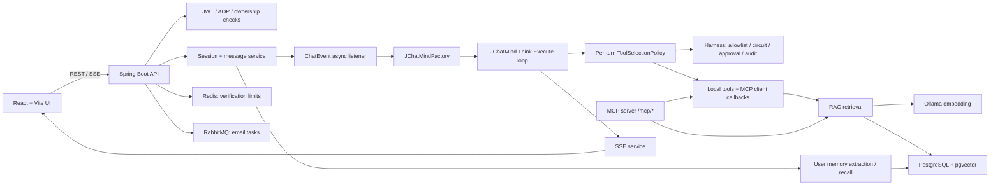
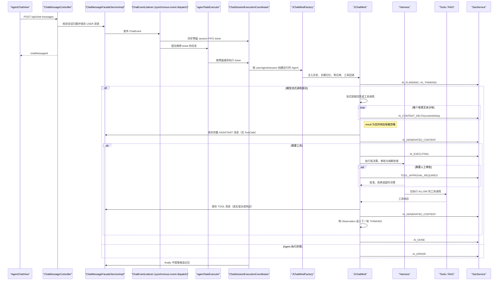
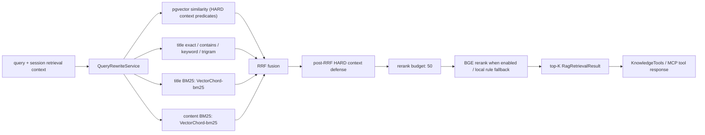
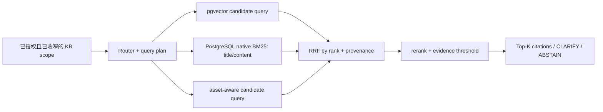
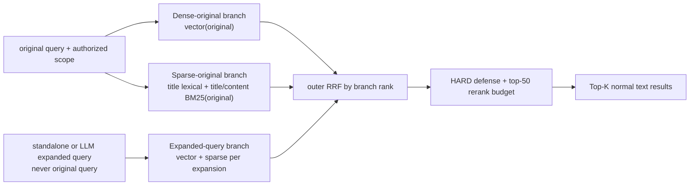
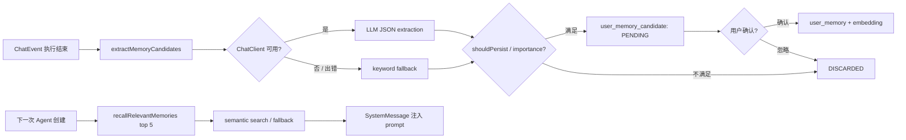
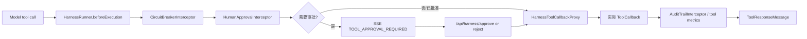

# JChatMind 项目架构与关键链路

> 文档定位：仓库的长期架构总览与源码导航。描述以当前代码为准；计划、实验结果和历史故障不在此重复，统一链接到相应专题文档。
>
> 最后核对：2026-10-11（复核 G2 current fixture A/B、answer generation/context/citation/quality/refusal evaluator 契约、paired quality/refusal comparer 报告一致性与 pipeline integration、双臂 external-call gate、opt-in runtime answer/citation/quality/refusal 接线、dual-arm pipeline 完整配对标记、default-switch fail-closed gate 接线和条件 ChatClient 装配；G3 LongMemEval source/evaluator pins、memory/replay schema、M1 confirmation plan 和 replay importer；candidate persistence 与 history-import L2 均通过（共 3 项 gated tests，mock-only/rollback，测试后 5 张表为空）；LongMemEval preflight gate 3 项、official input adapter 3 项、scoring input preparation 2 项通过；test-side only，完整 runner/评分未执行；LongMemEval 默认离线回归 44 项、0 失败/错误、9 项跳过；此前 current fixture、多模态和 LongMemEval 联合回归 117 项、0 失败/错误、11 项跳过；多模态及 runtime config 定向测试 34 项、0 失败/错误、1 项 L2 默认跳过；retrieval/answer generation/citation/refusal 已接入 opt-in L2；真实 multimodal retrieval L2 已通过：4 cases，gate=eligible_for_multimodal_retrieval_l2，所有 route/permission/chunk/asset/evidence mismatch 为 0；candidate-only、release-ineligible。答案生成关闭，citation/refusal 未测量；fixed-chain/Router retrieval A/B L2 已实测并 gate eligible；答案生成、citation、quality/refusal judge 未调用；default-switch gate 实际结果为 inconclusive，R0/rerank 不变；意图/工具选择与 RAG Router 范围链路沿用 2026-10-08 核对，其他模块沿用 2026-09-05 的核对记录）。修改涉及下列模块时，应同步更新本文件的“关键代码索引”和对应链路。

> 最近局部核对：2026-10-13（G5 SSE replay-gap 历史刷新期间，前端暂存并合并新到达的消息并在 replay-gap 时同步重置回退游标；契约、70 条历史与游标回退 Edge mock 浏览器用例、lint 与 build 通过；临时 Vite 已停止。`SseSequenceGapRecoveryTest` 两项以合成快照验证序号缺口补发和 Redis 序号回退后的 gap/本地状态重置，2 项通过；listener 暂停/恢复及 Redis keys 丢失后序号回退隔离 L2 各 1 项通过，临时容器均已停止；`ChatMessageHistoryWindowTest` 两项 L1 验证 70 条内存 mapper 全量响应及 mapper XML 无 LIMIT/升序资源契约；`ChatMessageHistoryWindowRuntimeL2Test` standalone MockMvc 调实际 Controller/service/Mapper 于临时 PostgreSQL 返回 70 条 L2 通过；同一 opt-in 用例对同 session 验到 Redis 70 帧 replay-gap ID=70 后，实际历史 HTTP endpoint 返回全部 70 条；未启动完整 Spring Boot；新增 opt-in 隔离 Redis 7/AOF L2：两个轻量 Spring 上下文验证优雅重启及 SIGKILL 后 AOF 恢复、Last-Event-ID=0 回放 seq=1、Docker bridge 断开/接回后 listener 恢复并接收新事件（1 test, 0 failures/errors/skips）；生产网络分区、主机断电/磁盘故障、完整 Spring Boot 部署重启和窗口外历史端到端恢复仍未验收。）

> 2026-10-13 G5 HTTP 局部核对：`G5ChatHttpRecoveryRuntimeL2Test` 以隔离目标 Bean 图启动两个顺序 Spring Boot HTTP 上下文；首个上下文签发的同一 JWT 在第二个上下文继续使用，owner Mapper 对非 owner SSE 返回 404，第二上下文对游标 0 返回 Redis replay-gap ID=70，历史 GET 经 Controller/Service/MyBatis/PostgreSQL 返回同 session 有序 70 条（1 test，0 failures/errors/skips）。测试关闭 emitter 与上下文并清理临时数据库/Redis；完整 `JchatmindApplication` 部署仍待，隔离 Edge 证据见下段。

> 2026-10-13 G5 Edge 局部核对：`chat-sse-real-backend-recovery.spec.ts` 在隔离 HTTP/Redis/PostgreSQL 上通过（Edge 1 passed）。初次和重连 SSE 均经 Playwright 路由访问真实 `SseController`；浏览器先收到实时事件 ID=71，断流后携带 `Last-Event-ID: 71`。浏览器两次历史 GET 均经 `route.continue` 直达实际 Controller/MyBatis/PostgreSQL，各返回 70 条并显示首尾。随后用同一游标直连后端 SSE，首帧确认为 Redis 窗口外的 replay-gap ID=141。其他导航接口使用测试响应。`g5-vite-server.mjs` 禁止加载 .env，测试结束时清理 Vite、Spring 上下文和临时容器；完整 `JchatmindApplication` 浏览器旅程仍待。

> 2026-10-14 G5 Edge 局部核对：临时 Vite 将 `/mock-sse` 和 `/mock-api/chat-messages` 代理至隔离 Spring Boot，浏览器 SSE 与历史请求不经 Playwright 路由；导航接口仍使用测试响应。浏览器首次连接无游标、重连携带 `Last-Event-ID: 71`，两次历史 GET 均收到 70 条并显示首尾；后端同游标直连首帧为 replay-gap ID=141（Edge 1 passed、Surefire 1 test）。完整 `JchatmindApplication` Bean 图与无需测试代理的部署旅程仍待。

> 2026-10-14 G5 HTTP/Redis 局部核对：隔离目标 Bean 图的第二个 Spring Boot HTTP 上下文保持运行，第三个上下文在临时 Redis 7/AOF 容器重启后跨实例发布事件；原 HTTP SSE 连接经 Pub/Sub 收到 ID=71。旧游标 0 的实际 HTTP 响应为 gap ID=70，游标 70 可回放 ID=71，PostgreSQL 历史仍为 70 条（Surefire 1 test，0 failures/errors/skips）。此项覆盖同一隔离容器重启后的跨实例在线流及 HTTP 请求恢复；完整 `JchatmindApplication` Bean 图及生产故障仍待。

> 2026-10-14 G5 HTTP/Redis SIGKILL 局部核对：同一隔离目标 Bean 图中，临时 AOF Redis 容器被 SIGKILL 后启动，接收端原 HTTP SSE 流继续收到另一 Boot 上下文经 Pub/Sub 发布的 ID=71；实际 HTTP 仍返回旧游标 gap ID=70、事件回放 ID=71 和 70 条 PostgreSQL 历史（Surefire 1 test，0 failures/errors/skips）。宿主机/磁盘故障、生产网络分区及完整应用部署仍待。

> 2026-10-14 G5 HTTP/Redis bridge 局部核对：仅断开并接回专用临时 Redis 容器的默认 Docker bridge；两个隔离目标 Bean 图 Boot 上下文和原 HTTP SSE 流保持运行。Redis 序号 70 保留，跨实例首个消息 ID=71 到达原连接；实际 HTTP 仍返回旧游标 gap ID=70、事件回放 ID=71 和 70 条 PostgreSQL 历史（Surefire 1 test，0 failures/errors/skips）。生产网络分区/丢包、宿主机/磁盘故障和完整应用部署仍待。

> 2026-10-14 G5 完整应用启动局部核对：`G5FullApplicationHttpPreflightL2Test` 在隔离 PostgreSQL/Redis、mock 模型和禁用 Rabbit 消费者/MCP 的配置下启动完整 `JchatmindApplication` 组件扫描；实际 HTTP 的未登录 SSE 返回 401，聊天历史 Controller 与 Redis SSE store 已装配（Surefire 1 test，0 failures/errors/skips）。owner 历史证据见下段；Redis 回放/故障恢复及浏览器旅程仍待。

> 2026-10-14 G5 完整应用历史局部核对：完整 `JchatmindApplication` 隔离上下文使用已有 Mapper XML 与向量类型处理器，在核对数据库身份后向临时 PostgreSQL 写入单会话 70 条有序消息；真实 owner JWT HTTP 返回成功封套和完整 70 条首尾历史（Surefire 1 test，0 failures/errors/skips），测试表已清理。完整应用 replay-gap 证据见下段；窗口内回放另见 2026-10-15 记录；Redis 故障及浏览器旅程仍待。

> 2026-10-14 G5 完整应用 replay-gap 局部核对：完整 `JchatmindApplication` 在隔离 Redis 中为同 session 写入 70 帧后，实际 owner JWT SSE HTTP 对游标 0 返回 gap ID=70；随后实际历史 HTTP 从隔离 PostgreSQL 返回按序完整 70 条（Surefire 1 test，0 failures/errors/skips）。测试清理 emitter、会话 Redis 事件和数据库表；窗口内回放另见 2026-10-15 记录；完整应用 AOF 优雅重启后的请求恢复见下段；原连接推送证据见下段；强故障及浏览器旅程仍待。

> 2026-10-15 G5 完整应用窗口内回放局部核对：完整 `JchatmindApplication` 的实际 owner JWT SSE HTTP 在同 session Redis 有 70 帧时，以游标 69 回放普通事件 ID=70；游标 0 仍得到 replay-gap ID=70，历史 HTTP 返回全部 70 条（Surefire 1 test，0 failures/errors/skips）。完整应用 AOF 优雅重启后的请求恢复见下段；原连接推送证据见下段；强故障与浏览器旅程仍待。

> 2026-10-15 G5 完整应用 Redis 重启局部核对：完整 `JchatmindApplication` 上下文运行期间，隔离 Redis 7/AOF 容器优雅重启后同 session 序号 70 保留；owner SSE HTTP 的旧游标仍返回 gap ID=70，重启前已连接的同一 HTTP SSE 流收到新事件 ID=71，实际历史 API 继续返回有序 70 条（Surefire 1 test，0 failures/errors/skips）。SIGKILL 证据见下段；生产部署中的两个独立 JVM 完整应用实例的恢复与生产故障仍待。

> 2026-10-15 G5 完整应用 Redis SIGKILL 局部核对：专用临时 AOF Redis 容器被 SIGKILL 后启动，完整 `JchatmindApplication` 上下文与原 HTTP SSE 连接保持运行；序号 70、owner 旧游标 gap ID=70、原连接新事件 ID=71 和 70 条 PostgreSQL 历史均通过（Surefire 1 test，0 failures/errors/skips）。生产部署中的两个独立 JVM 完整应用实例的恢复、生产网络/宿主机/磁盘故障与浏览器旅程仍待。

> 2026-10-15 G5 跨上下文局部核对：独立轻量 Spring 上下文使用生产 SSE service/store 在 Redis AOF 优雅重启后发布，完整 `JchatmindApplication` 接收端原 HTTP SSE 流收到首个消息 ID=71，旧游标 gap 与 70 条历史继续通过（Surefire 1 test，0 failures/errors/skips）。发布端不是第二个完整应用实例，生产网络故障与生产部署中的两个独立 JVM 完整应用实例的恢复仍待。

> 2026-10-15 G5 跨上下文 SIGKILL 局部核对：专用 AOF Redis 容器 SIGKILL/start 后，独立轻量 Spring 发布上下文通过 Pub/Sub 向完整 `JchatmindApplication` 接收端原 HTTP SSE 流推送首个事件 ID=71；旧游标 gap ID=70 和 70 条历史请求继续通过（Surefire 1 test，0 failures/errors/skips）。生产部署中的两个独立 JVM 完整应用实例及生产故障仍待验收。

> 2026-10-15 G5 同进程双完整应用局部核对：两个完整 `JchatmindApplication` 上下文用测试侧独立 MBeanServer 在同一 JVM 运行；隔离 Redis AOF 优雅重启后，第二个上下文发布的事件 ID=71 到达第一个上下文原 HTTP SSE 流，旧游标 gap ID=70 和 70 条历史继续通过（Surefire 1 test，0 failures/errors/skips）。生产 JMX 名称未改；生产部署下的独立 JVM与生产网络故障仍待。

> 2026-10-15 G5 同进程双完整应用 SIGKILL 局部核对：隔离 AOF Redis 容器 SIGKILL/start 后，第二个完整 `JchatmindApplication` 发布的 ID=71 到达第一个完整应用原 HTTP SSE 流，旧游标 gap ID=70 与 70 条历史继续通过（Surefire 1 test，0 failures/errors/skips）。两个完整 Bean 图仍在同一 JVM，生产部署下的独立进程与生产故障仍待。

> 2026-10-15 G5 独立 JVM 局部核对：主 JVM 完整 `JchatmindApplication` 接收端跨隔离 Redis AOF 优雅重启保持原 owner SSE 连接；子 JVM 启动第二个完整应用并发布 20 帧，原连接首个消息 ID=71，游标 0 gap ID=70 与 70 条历史继续通过（Surefire 1 test，0 failures/errors/skips）。两个完整 Bean 图已在同一主机的独立 JVM 中验证；生产部署网络、宿主机/磁盘故障和浏览器旅程仍待。

> 2026-10-15 G5 独立 JVM SIGKILL 局部核对：隔离 AOF Redis 容器 SIGKILL/start 后，子 JVM 完整应用发布 20 帧，主 JVM 完整应用原 HTTP SSE 流首个消息 ID=71，旧游标 gap ID=70 和 70 条历史继续通过（Surefire 1 test，0 failures/errors/skips）。同主机独立 JVM 已验收，生产网络/宿主机/磁盘故障及浏览器旅程仍待。

> 2026-10-15 G5 完整应用 Edge 局部核对：浏览器 SSE 直连完整 `JchatmindApplication`，先收到实时 ID=71，重连携带游标 71 后消费窗口外 gap ID=141；历史 GET 经临时 Vite 代理访问实际 PostgreSQL 接口并显示 70 条首尾（Edge 1 passed、Surefire 1 test）。导航接口仍为测试响应，历史直连证据见下段；全真实浏览器旅程仍待。

> 2026-10-15 G5 完整应用 Edge 直连局部核对：浏览器 SSE 与两次历史 GET 均直接请求隔离完整 `JchatmindApplication` HTTP；实时 ID=71、重连游标 71、窗口外 gap ID=141 和实际 PostgreSQL 历史 70 条页面显示通过（Edge 1 passed、Surefire 1 test）。会话列表/详情后续已改为浏览器直连；其他导航接口仍使用带跨域头的测试响应。原隔离目标 Bean 图 Vite 代理模式回归也通过（Edge 1 passed、Surefire 1 test）。完整真实用户旅程与生产部署仍待。

> 2026-10-15 G5 完整应用会话导航 Edge 局部核对：浏览器直连实际会话列表和详情 GET，均返回成功且包含目标 session ID；既有 SSE/历史直连、重连游标 71、gap ID=141 与 70 条历史继续通过（Edge 1 passed、Surefire 1 test）。whoami 真实响应见下段；Agent 真实列表见下段；知识库真实列表见下段；待审批真实空列表见 2026-10-15 后续记录，完整真实用户旅程仍待。

> 2026-10-15 G5 完整应用 whoami Edge 局部核对：浏览器直连实际 `GET /api/users/whoami`，隔离用户 7 返回成功与新 JWT；后续 SSE/历史请求使用初始或真实刷新令牌，实际会话列表/详情、窗口外 gap ID=141 和 70 条历史继续通过（Edge 1 passed、Surefire 1 test）。用户表及临时容器清理；Agent、知识库和待审批导航仍为测试响应。

> 2026-10-15 G5 完整应用 Agent 导航 Edge 局部核对：浏览器直连实际 `/api/agents`，返回用户 7 的合成 Agent，ID 与真实会话详情一致；whoami、会话、SSE/历史直连与窗口外恢复继续通过（Edge 1 passed、Surefire 1 test）。隔离测试的 Agent 只读取配置和空 KB 绑定，不调用模型；知识库与待审批导航仍为测试响应。

> 2026-10-15 G5 完整应用 KB 导航 Edge 局部核对：隔离库有 owner 7/8 各一条 KB，浏览器直连实际 `/api/knowledge-bases` 仅收到 owner 7 的目标 ID；真实 whoami、会话、Agent、SSE/历史直连与窗口外恢复继续通过（Edge 1 passed、Surefire 1 test）。未调用摄入或模型；待审批真实空列表见 2026-10-15 后续记录。

> 2026-10-15 G5 完整应用 Edge 页面 API 局部核对：聊天页加载/窗口外恢复所触发的 whoami、会话、Agent、KB、待审批、Tool 元数据、SSE 与历史请求均直连隔离完整 `JchatmindApplication`；Playwright API 测试路由 0 命中，浏览器重连游标 71、gap ID=141 与 70 条历史通过（Edge 1 passed、Surefire 1 test）；原目标 Bean 图 Vite 代理模式回归也通过（Edge 1 passed、Surefire 1 test）。该结果使用合成用户/令牌与数据，尚未覆盖注册登录、发送消息、Agent/工具执行及生产部署故障。

> 2026-10-15 G5 完整应用登录令牌局部核对：隔离用户 7 的随机口令经实际 `POST /api/users/login` 与 `PasswordEncoder` 校验后签发 JWT；完整应用 owner SSE/历史和浏览器页面 API 全直连恢复沿用该令牌（Surefire 1 test、`G5_BROWSER_L3_PASS`）。浏览器仍由测试注入令牌，尚未走登录弹窗；临时容器已清理。

> 2026-10-15 G5 浏览器登录局部核对：无令牌首页的 Edge 实际填写登录弹窗，真实 `/api/users/login` 签发用户 7 JWT 并由前端保存；进入聊天页后 whoami、会话、Agent、KB、待审批、Tool 元数据、SSE/历史全直连，登录后测试 API 路由 0 命中，窗口外 gap ID=141 与 70 条历史继续通过（Edge 1 passed、Surefire 1 test）。未登录首页的 KB 请求收到业务错误封套，需单独核查；注册、发送消息及生产故障旅程仍待。

> 2026-10-15 G5 未登录 KB 局部修复：`useKnowledgeBases` 只在已登录时请求列表，按用户 ID 保存结果并隐藏退出登录或切换账号后的旧数据。Edge RED 在未登录首页记录到 2 次 KB GET，GREEN 为 0；真实弹窗登录、侧栏会话导航、owner KB、SSE gap ID=141 与 70 条历史继续通过（Edge 1 passed、Surefire 1 test；前端 lint/build、后端 test-compile 通过）。Tool 元数据仍在首页初次挂载时读取；临时容器已清理并核对。

> 2026-10-15 G5 退出登录 Edge 局部核对：浏览器先看到 owner 7 的侧栏 KB 条目，使用账号菜单退出后条目和本地 JWT 均消失，网络静止前没有新的 KB GET；既有真实登录、SSE gap ID=141 与 70 条历史仍通过（Edge 1 passed、Surefire 1 test）。第二账号切换及生产部署未验收。

> 2026-10-15 G5 第二账号 Edge 局部核对：同浏览器中用户 7 退出后，真实弹窗登录用户 8；隔离完整应用的 KB GET 仅返回 owner 8 的 ID，侧栏只显示其 `G5 other KB`，不显示用户 7 的条目。先前 SSE/历史恢复保持通过（Edge 1 passed、Surefire 1 test），页面 API 测试路由 0 命中；生产及并发会话仍待。

> 2026-10-15 G5 会话列表退出隔离：`ChatSessionsProvider` 的会话列表按用户 ID 保存，只对匹配的当前登录用户可见。Edge RED 复现用户 7 退出后侧栏仍有其会话；GREEN 在退出和登录用户 8 后会话均为 0，KB owner 隔离及 SSE/历史恢复继续通过（完整应用 Edge 1 passed、Surefire 1 test；前端 lint/build 通过）。原目标 Bean 图 Vite 代理模式也回归通过（Edge 1 passed、Surefire 1 test）。并发会话和生产部署尚未验收。

> 2026-10-16 G5 完整应用跨 owner 局部核对：隔离用户 8 的真实登录 JWT 请求用户 7 会话，历史接口返回 HTTP 200/业务错误且无消息数据，SSE 接口返回 HTTP 404；owner 历史/游标恢复与浏览器两账号隔离仍通过（Surefire 1 test、Edge 1 passed）。当前历史接口沿用统一异常封套，生产部署未验收。

> 2026-10-16 G5 跨 owner 浏览器 URL 局部核对：用户 8 直接打开用户 7 会话 URL，真实历史为业务错误且无数据、SSE 为 HTTP 404，页面不显示首尾历史；owner 窗口外恢复与两账号侧栏隔离继续通过（Edge 1 passed、Surefire 1 test）。证据限于隔离完整应用。

> 2026-10-16 G5 跨 owner 写入局部核对：用户 8 向用户 7 会话提交真实消息创建 HTTP，请求被会话归属校验拒绝，返回业务错误且无数据；同 session PostgreSQL 消息数和 Redis SSE 序号未变。隔离完整应用定向 Surefire 1 test、既有 Edge 1 passed；owner 发送消息与 Agent 执行尚未验收。

> 2026-10-16 G5 owner 写入局部核对：用户 7 的真实消息 POST 返回成功和数据库生成的 ID，隔离 PostgreSQL 可按 ID 读回内容，owner 历史 GET 也包含该消息；fixture ID 默认值与 UUID insert 映射一致。DeepSeek/智谱均为 Mockito mock，Agent 执行池排空后清理（Surefire 1 test、既有 Edge 1 passed）。浏览器输入与 Agent 回答/工具执行未验收。

> 2026-10-16 G5 owner 浏览器发送局部核对：用户 7 在重新登录后经侧栏打开会话并提交输入；真实 POST 成功，历史 GET 与页面都呈现随机消息，Java 再确认 PostgreSQL 对应行唯一。模型 Bean 是测试 mock，Agent 执行池已排空；Edge 1 passed、Surefire 1 test，外部模型未调用。Agent 回答与工具执行未验收。

> 2026-10-16 G5 mock Agent 回复局部核对：DeepSeek `call/stream` 返回固定文本，记忆 service 是空结果 mock，测试日志没有 Ollama endpoint 请求；真实 owner POST 触发 Agent 事件监听器，assistant 行落 PostgreSQL 后经真实 SSE 显示在浏览器。新增 SSE 帧令旧游标 71 收到 latest gap；Edge 1 passed、Surefire 1 test。此结果是 mock 模型下的链路验证，不代表真实模型/工具质量。

> 2026-10-16 G5 浏览器活跃 SSE Redis AOF 重启局部核对：浏览器收到 SSE ID=71 后，隔离 Redis 经端口/AOF 配置核对并优雅重启，完整应用读回 seq=71；继续写入超出 64 帧窗口的事件后，浏览器重连获 gap ID=141，历史 GET 恢复 70 条。owner 消息及 mock Agent assistant SSE 显示同轮通过（Edge 1 passed、Surefire 1 test），无 Ollama 请求痕迹；只覆盖隔离优雅重启，不代表生产或 SIGKILL 浏览器流。

> 2026-10-16 G5 浏览器活跃 SSE Redis SIGKILL 局部核对：浏览器已确认 ID=71 时 SIGKILL 专用 AOF Redis 并启动同一容器，完整应用恢复 seq=71；窗口外 gap ID=141 和 70 条历史恢复通过，owner 输入/mock assistant SSE 同轮通过（Edge 1 passed、Surefire 1 test），无 Ollama 请求日志。证据限于同机隔离容器进程死亡。

## 1. 项目定位与边界

JChatMind 是一个用于学习和二次开发的本地 Java Agent 项目。它提供用户认证、可配置 Agent、会话消息、知识库 RAG、工具调用、人审 Harness、用户记忆、SSE 推送及 MCP 服务端能力。

当前架构是**单个运行时 Agent + 可配置工具集合**，不是多 Agent 编排系统。RAG、记忆和外部 MCP 工具均作为 Agent 可调用或可注入的能力存在。后续是否引入 Verifier、Retriever 等专职 Agent，应以固定评测集上的质量、延迟和成本收益为依据，详见 [RAG 设计与评测分析](archive/2026-08-15/root/RAG设计与评测分析.md)。

### 1.1 已实现能力与事实边界

| 能力 | 当前实现 | 说明 |
| --- | --- | --- |
| 对话 Agent | 已实现 | `JChatMind` 以 Think-Execute 循环驱动模型与工具调用。 |
| 会话实时反馈 | 已实现 | 后端以会话 ID 管理 SSE 连接；前端在 replay-gap 后刷新完整持久化消息，并暂存、合并刷新期间到达的 SSE 消息，避免旧历史响应覆盖实时消息。隔离目标 Bean 图浏览器恢复已通过，完整应用部署仍待端到端验收。 |
| RAG | 已实现 | Markdown 分节、embedding、pgvector 向量召回、词法召回、RRF 融合和规则 rerank。 |
| 查询改写 | 已实现 | RAG 检索前生成 query/context 计划；可由评测开关关闭。 |
| 意图与工具选择 | 已实现 | 顶层由 `IntentRouter`（决策协议 `intent-v2`、策略 `intent-policy-v5`）生成版本化 `IntentDecision`，含可选 confidence margin；结合上一条用户问题识别短追问、区分知识导航并按文件具体动作收窄能力；`IntentPolicyEngine` 与当前 callback 求交集，Harness 审计用 run trace 与决策 ID 关联实际工具结果；结构化模型兜底有输入/输出、confidence/margin 和重试上限且默认关闭，阈值尚未由冻结 release 集校准。 |
| 工具安全 Harness | 已实现 | 工具代理、审批、熔断、审计为运行时执行前后链路的一部分。 |
| 内置 Skill 契约 | L0/L1 部分实现 | `BuiltinSkillRegistry` 固定登记 `technical-decision-comparison@v1` 的输入、授权 KB 收窄、工具白名单、声明预算和结构化输出校验；`BuiltinSkillExecutor` 仅在 Harness 放行后经 `HarnessToolCallbackProxy` 执行绑定范围的只读知识检索，并将无证据或受阻执行收束为拒答。尚无 HTTP/队列入口、模型总结或独立预算调度。 |
| 工作流计划验证 | L0/L1 部分实现 | `WorkflowPlanVerifier` 校验 Planner 输出的预算、工具白名单、工具名无首尾空白、证据和矛盾；通过的工具名与 Harness 策略精确匹配。`WorkflowPlanExecutor` 在独立有界 `workflowTaskExecutor` 中执行整个已验证计划并沿用 RequestContext TaskDecorator，按 `timeoutSeconds` 作为总预算；线程池饱和时返回忙碌结果且不进入 Harness；到期时 cancel Future 并中断当前步骤，返回 `TIMED_OUT` 且停止后续步骤。步骤需响应线程中断，忽略中断的外部副作用无法被强制终止。Planner、任务映射、结果持久化、fallback 和协作执行仍待。 |
| 用户记忆 | 部分治理已实现 | 对话结束后异步提取候选记忆；中高重要度候选须由用户确认后才写入长期记忆并参与召回，用户可忽略候选、编辑或删除单条长期记忆，或清空自己的长期记忆；编辑会更新 matching embedding，提取失败不阻断对话。冲突历史和可选到期时间已落地；LongMemEval-S pins、schema、metadata-only selector、candidate manifest、replay/import plans、history importer、M1 confirmation 和 synthetic blind-review contracts 已实现。candidate persistence 与 history-import L2 已在专用隔离库通过（3 项 gated tests、mock-only/rollback，测试后无残留行）；preflight gate 3 项、official input adapter 3 项、scoring input preparation 2 项测试通过；test-side preparation 已连接两者，真实 runner 仍待；真实提取与 M2 人工审核、完整 replay runner/official evaluator、memory L3、G3 反思和真实 Playwright 旅程仍待完成。 |
| 用户认证与验证码 | 已实现 | JWT 请求上下文、AOP 登录/管理员校验、Redis 限流、RabbitMQ 异步邮件。 |
| MCP 服务端 | V1 生产主体映射与 `STREAMABLE` 协议已启用 | 暴露知识库、邮件、数据库工具；仅已解析到内部用户且通过 KB owner 校验的调用可检索私有知识库。 |
| 数据库迁移 | L0/L2 已验收 | `SchemaMigrationExecutor` 按唯一 manifest 校验增量脚本、批准基线、依赖和 ledger 状态；`JdbcMigrationStore` 对 PostgreSQL ledger catalog、事务执行和失败状态进行 fail-closed 管理；`MigrationReleaseApplication` 通过显式确认运行迁移，`JdbcMigrationCatalogVerifier` 按 `catalog-contract.json` 完成托管对象对账并写脱敏记录。真实隔离 clean install/upgrade、前缀升级、重放、失败恢复和 release entry 已通过；真实生产执行仍需发布窗口。 |
| 多模态资产引用与候选 | 部分实现 | PDF 页文本和 Markdown `TABLE` 资产均与同文档 chunk 关联；`MULTIMODAL_RAG` 可在已授权 KB 与 `HARD` 会话范围内检索 `READY` 资产，Agent/MCP 按表格、PDF、普通候选顺序返回稳定资产 ID 与表格行号或页码。独立 `g2-current-multimodal-v1` 已有待审核的表格与生成式 PDF 页候选样本；candidate loader 校验路由/gold/locator，按 manifest SHA-256 派生稳定 runtime KB/document/chunk/asset UUID，并生成基于生产 `RagChunkSupport` 的 document/chunk payload、纯内存 KB/document/chunk/asset rows、relations 和 metadata patch；测试侧 runtime builder 可将 1024 维 embedding 与 BM25 projection 按逻辑 chunk 配对，并保持 candidate-only 标记。隔离评测初始化脚本、candidate 专用事务 SQL importer 和显式 opt-in 的导入/重放 L2 测试已实现；L2 会先检查资产表及关键关系约束。实际数据库写入/重放、真实 embedding/BM25 服务调用与检索验收未执行。图片/OCR、公式、表格单元格关系与坐标回跳未实现。 |
| 真实 KB L2 RAG 评测 | 部分完成 | `fixture-fast-v1` 测试侧运行器已具备冻结语料校验、gold/source 映射、受限导入和 fixed-chain/Router 双臂检索，Router 臂已接入生产 `KnowledgeTools` 入口；引用 evaluator 目前只验证合成答案，尚未接入真实答案生成。current fixture 与多模态 retrieval L2 已在专用 PostgreSQL/Ollama 通过；20 case fixed/Router A/B Recall@5=1.0、MRR@10=0.9444、gold coverage@10=1.0，p95 3.081s/2.753s、上下文 436.7/141.95 字符，route/permission/external=0；多模态 gate eligible。答案/引用/质量/拒答未测量，default-switch inconclusive。旧 `regression-v1` 来源路线已退役，不再是前置。 |
| 项目内 Release RAG 集 | 未完成 | 仍需一份未参与调参的完整真实 KB 与 hard/no-answer/permission 样本的人工双人复核；项目授权、答案/引用质量与公开检索分别设门禁，不合并为单一 `release-v1`。 |

## 2. 总体架构



### 2.1 运行组件

| 层 | 组件 | 主要职责 |
| --- | --- | --- |
| 前端 | React 19、Vite、Ant Design | 登录、Agent/会话/知识库/记忆界面；REST 调用和 SSE 消费。 |
| Web 层 | Spring MVC Controllers | 提供 `/api/**`、`/sse/**` 与 `/mcp/**` 入口，统一返回 `ApiResponse`。 |
| 应用层 | Facade Services | 所有权校验、DTO/Entity 转换、会话与资源的 CRUD。 |
| Agent 层 | `JChatMind`、`JChatMindFactory`、`ToolSelectionPolicy` | 装配模型、历史、记忆、知识库、工具；按回合收窄 callback，并执行模型-工具循环。 |
| RAG 层 | `DocumentFacadeServiceImpl`、`RagServiceImpl` | Markdown 解析、分块、向量化、混合检索、融合、重排。 |
| 安全控制层 | Token/AOP、Harness | 建立请求用户上下文；保护工具执行而非只依赖模型自律。 |
| 基础设施 | PostgreSQL/pgvector、Redis、RabbitMQ、Ollama | 业务和向量持久化、缓存与限流、邮件队列、embedding 服务。 |

## 3. 目录与模块职责

```text
backend_v2/
  src/main/java/com/kama/jchatmind/
    agent/           Agent 循环、工具、Harness
    intent/          业务意图协议、规则路由和候选能力策略
    auth/            JWT、请求上下文、权限注解和切面
    config/          Web、安全、模型、消息队列、工具装配
    controller/      REST 与 SSE 接口
    event/           消息提交后的异步 Agent 事件
    mapper/          MyBatis 数据访问接口
    mcp/             MCP 服务端与检索工具
    migration/       schema manifest、ledger 与迁移执行器
    model/           entity、DTO、request、response、VO
    service/         应用服务接口及实现
    skill/           内置 Skill 模板、受控检索执行及输入/输出契约校验
    util/            RAG chunk 结构与 metadata 支持
    workflow/        受限工作流计划及其验证器
  src/test/java/.../rag/
                   RAG 指标、冻结数据集、replay、候选集治理与运行期评测
ui/src/
  api/              REST 客户端与接口类型
  components/       布局、会话、Agent、知识库、记忆视图
  contexts/         登录态、会话状态
  hooks/            页面数据加载与刷新
    utils/            聊天历史恢复期间合并持久化历史与实时消息
sql/
  auth/             用户与邮件失败表迁移
  user-memory/      记忆字段、状态、向量索引迁移
docs/
  项目架构与关键链路.md  当前唯一架构文档
  plans/active/      当前唯一跨模块计划
  spec/              当前唯一实施 Spec
  archive/           历史方案、记录和专题资料
```

## 4. 关键运行链路

### 4.1 用户提问到 Agent 回复



1. 前端 [AgentChatView.tsx](../ui/src/components/views/AgentChatView.tsx) 要求登录后才创建会话或发送既有会话消息，并通过带 Bearer header 的 `fetch + ReadableStream` 连接 `/sse/connect/{chatSessionId}`；流结束或网络错误后自动重连，4xx 停止重试。它累积 `AI_CONTENT_DELTA` 为临时回答气泡；收到 `AI_GENERATED_CONTENT` 后以持久化消息替换临时内容。无工具调用的 Assistant 最终消息会主动收起状态，避免 SSE 断连丢失 `AI_DONE` 后残留“思考中”；仍有工具调用的中间消息保持执行状态，并继续展示高层执行轨迹、错误状态和审批卡片。[JChatMindLayout.tsx](../ui/src/components/JChatMindLayout.tsx) 对 `/chat` 与 `/chat/{chatSessionId}` 按会话 ID 设置 React `key`，并持有会话 ID 到执行轨迹的内存映射：新会话重挂载时隔离初始化防重标记、SSE 临时分片和审批状态，切回同一会话时恢复此前已收到的轨迹。`SseController` 已校验当前用户和会话 owner；服务端支持按 Last-Event-ID 从 Redis 回放当前会话最近 64 帧，前端保存最后已处理帧 ID并重连时发送 Last-Event-ID、过滤旧帧；Redis Pub/Sub 将实时事件推送到其他实例，过旧游标返回 replay-gap；前端 gap handler 清理不完整分片、刷新持久化会话消息和待审批并推进游标。刷新响应完成前到达的最终 SSE 消息会先暂存，再按消息 ID 与持久化历史合并，避免较旧快照覆盖新消息；该 UI 契约与 lint/build 已通过。关闭并重建 Spring 上下文、以及独立 JVM 写入进程退出后再回放 Redis 历史均已验证；完整 Spring Boot 部署重启、宿主机/磁盘故障和真实网络断连、隔离目标 Bean 图的窗口外完整历史浏览器恢复已通过；完整应用部署下的端到端恢复和刷新页面后的游标/轨迹恢复仍未验收。
2. [ChatMessageController.java](../backend_v2/src/main/java/com/kama/jchatmind/controller/ChatMessageController.java) 交给 `ChatMessageFacadeServiceImpl`。该服务先校验当前用户拥有会话，保存消息，再同步发布 `ChatEvent`。历史 GET 调用 `selectBySessionId` 并映射全部结果；mapper XML 无 LIMIT 且按 `created_at ASC`，70 条内存 mapper 与 SQL 资源契约 L1、standalone MockMvc 调实际 Controller/service/Mapper 与临时 PostgreSQL 的 70 条 L2 通过；同 session 的 opt-in Redis replay-gap ID=70 + 实际历史 endpoint 70 条组合 L2 通过；隔离 Spring Boot HTTP 双上下文重启另验证真实 JWT/owner、gap 与 70 条历史；隔离 Edge 已经临时 Vite 代理消费真实 SSE/历史 API，验证窗口外恢复；完整 JchatmindApplication 隔离 HTTP 已验证 owner 70 条历史；完整应用部署与非测试路由的浏览器旅程仍待。[ChatEventListener.java](../backend_v2/src/main/java/com/kama/jchatmind/event/listener/ChatEventListener.java) 在事件线程内先向 [ChatSessionExecutionCoordinator.java](../backend_v2/src/main/java/com/kama/jchatmind/event/listener/ChatSessionExecutionCoordinator.java) 预留 FIFO session ticket，再提交到独立的 `agentTaskExecutor`（core=2、max=4、queue=50、`agent-event-` 前缀）。同一会话按事件发布顺序互斥执行 Agent 与 finally 中的候选记忆提取；不同会话可以并行。首次 executor 拒绝时立即重投一次；再次拒绝会取消 ticket，后续任务不会因序号缺口阻塞。固定负载测试提交 54 个不同会话任务，占满 4 个活动线程和 50 个队列槽位，第 55 个提交在重试后拒绝；释放阻塞任务后 54 项完成、队列排空，同一被拒绝会话的新事件成功；同一池连续 20 轮重复满载/排空恢复通过；另有 opt-in 120 秒 soak 检查提交期线程/队列上限、排空及恢复。两者仍不等同于更长生产代表性 soak。listener 提供进程内拒绝计数及 pool/active/queue/remaining 快照，并记录不含用户/会话标识的告警。`AgentTaskExecutorMetrics` 以只读 JMX MBean `com.kama.jchatmind:type=AgentTaskExecutorMetrics` 暴露这些指标，并在上下文关闭时注销；远程 JMX 接入由部署配置决定。该池与邮件所用通用 `taskExecutor` 分离，并沿用请求上下文装饰器；协调器在等待前保留会话引用，最后一个执行或等待任务退出后释放。跨实例、长时间持续负载、重启恢复或持久化队列尚未实现。
3. [ChatEventListener.java](../backend_v2/src/main/java/com/kama/jchatmind/event/listener/ChatEventListener.java) 使用该专用池创建 Agent 并执行；无论主执行是否结束，都会尝试提取候选记忆，记忆失败只记日志。工具、文档索引和 Webhook 投递的专用执行器尚未实现。
4. [JChatMindFactory.java](../backend_v2/src/main/java/com/kama/jchatmind/agent/JChatMindFactory.java) 加载 Agent 配置、最近会话消息、相关长期记忆、允许访问的 KB、固定/可选/外部工具，并用 Harness 代理包装每个工具回调；外部 callback 只有与 Agent `allowedTools` 精确匹配时才注入，空配置不注入外部工具。
5. [JChatMind.java](../backend_v2/src/main/java/com/kama/jchatmind/agent/JChatMind.java) 运行最多 20 步的 Think-Execute 循环。模型内部工具执行被关闭，工具由应用显式执行，便于审批、超时、审计和 SSE 反馈。每轮模型调用使用流式 `ChatResponse`；仅有效 `AssistantMessage` 分块可产生 `AI_CONTENT_DELTA`，`result == null` 空帧被忽略，最终完整文本和工具调用再聚合为持久化消息。
6. [SseController.java](../backend_v2/src/main/java/com/kama/jchatmind/controller/SseController.java) 要求有效 Bearer 对应登录用户，并通过 `ChatSessionFacadeService` 校验会话 owner；未登录返回 `401`，非 owner/不存在会话返回 `404`；Controller 接受可选 `Last-Event-ID`。[SseServiceImpl.java](../backend_v2/src/main/java/com/kama/jchatmind/service/impl/SseServiceImpl.java) 按会话 ID 保存 emitter 集合并向已授权连接广播序列化 `SseMessage`；单连接发送失败只清理该 emitter，不影响其他连接。运行时由 `RedisChatSseEventStore` 通过 Lua 为会话分配递增 SSE id、追加并裁剪最近 64 帧；重连用 Lua 原子读取最新序号与历史快照，关闭并重建 Spring 上下文后的历史回放、独立 JVM 写入后由第二 JVM 回放均已通过隔离 L2。`RedisMessageListenerContainer` 订阅 session channel pattern，将 Redis Pub/Sub 事件转发给接收实例的本地 emitter；独立连接的跨实例实时推送也已通过隔离 L2；70 帧后游标 0 收到 ID=70 的 replay-gap 也已通过 Redis L2。`SseServiceImpl` 收到跳过本地序号的事件时会读取历史快照并补发连续遗漏帧；若 Redis 快照序号低于本地状态，则发 replay-gap、重建本地历史和序号；`SseSequenceGapRecoveryTest` 两项合成快照 L1 验证均通过。listener 暂停/恢复与 Redis keys 丢失后序号回退 L2 均通过；keys 丢失时实例会发 gap 并重新同步本地序号。新增 opt-in `RedisChatSseEventStoreTest#shouldRecoverSseHistoryAndPublishAfterRedisAofContainerRestart`，以独立临时 Redis 7 容器/卷和 AOF `appendfsync=always` 验证优雅重启后 seq=1 历史恢复，再 SIGKILL 并启动同一容器后已确认序号仍从 AOF 恢复；原 Spring 上下文的 Pub/Sub listener 自动重连并收到后续事件（1 test, 0 failures/errors/skips）。此外以 docker network disconnect/connect 断开并接回隔离 Redis 容器的 bridge，验证 Redis 状态保留且原 Pub/Sub listener 重连后收到新事件。该项不覆盖生产网络分区/丢包、宿主机断电/磁盘故障或完整 Spring Boot 部署重启。序号与历史键的 30 分钟 TTL 已由隔离 Redis L2 验证；完整 Spring Boot 部署重启、宿主机/磁盘故障和真实网络断连、完整应用部署下窗口外完整历史端到端恢复仍待验收。前端消费 `AI_PLANNING`、`AI_THINKING`、`AI_EXECUTING`、`AI_CONTENT_DELTA`、`AI_GENERATED_CONTENT`、`AI_DONE`、`AI_ERROR` 与 `TOOL_APPROVAL_REQUIRED`。发生 replay-gap 时前端先同步将 Last-Event-ID 游标设为 gap 帧 ID，再刷新完整持久化历史并暂存、合并刷新期间的新消息；该 UI 契约与 lint/build 已通过，Edge mock-API 浏览器用例模拟 70 条历史（超过 Redis 64 帧）与游标 71 回退至 1，覆盖延迟历史响应期间的实时消息保留；隔离后端的窗口外完整历史恢复已由浏览器验证，完整应用部署仍待。断开、超时或发送失败后清理对应连接。

`TC-G0-02` 以最小 Spring 容器的真实 `ApplicationEventPublisher` 覆盖上述消息边界：消息服务保存用户消息后，`ChatEventListener` 创建并运行 Agent，随后提取记忆候选，历史消息按 Mapper 返回顺序读取。该 L1 测试替换外部模型、数据库与专用任务执行器，直接运行提交任务；这不代表生产有界线程池的并发调度。

### 4.2 Agent 内部状态与工具执行

`JChatMind` 维护 `IDLE -> PLANNING -> THINKING -> EXECUTING -> FINISHED/ERROR` 状态。它实现的是**应用显式编排的 Function-calling ReAct**，而不是解析 `Thought / Action / Observation` 自由文本协议：模型只决定“直接回答”或返回 `ToolCall`，项目把工具结果以 `ToolResponseMessage` 作为 Observation 写回消息窗口，再让模型进行下一轮决策。`AI_THINKING` 仅为前端状态，不暴露或持久化模型的独立 reasoning content。

工具选择补强后，`JChatMind` 在每轮模型请求前使用 `ToolSelectionPolicy` 根据最新用户消息获取 `IntentDecision`，再由 `IntentPolicyEngine` 与当前可用 callback 求交集：闲聊和阻断请求不暴露工具，知识类请求只暴露 `KnowledgeTool`，明确动作只暴露对应 callback，复合或需澄清请求不暴露副作用工具。该策略只控制模型可见能力，不能替代执行阶段的 Harness 授权。

当前项目的意图判断不是由一个独立模型完成，而是分层处理：

1. **顶层工具意图**：`IntentRouter` 使用 Java 规则生成 `BusinessIntent`、独立的 `QueryIntent`、路由、风险等级、置信度、margin、原因码和候选能力；当前策略版本为 `intent-policy-v5`，只把上一条用户问题作为有限上下文识别短追问，不将完整历史传入意图分类；同时支持知识导航、文件读取与列目录区分、明确的外部查询及低信息优先澄清。结构化模型兜底需满足配置的输入/输出上限、confidence 与 margin 门槛，并受最多 2 次重试控制；该路径默认关闭，默认阈值还需经冻结 release 集校准。`IntentPolicyEngine` 只保留候选能力与当前 callback 的交集，并对复合/澄清/非副作用风险决策再次剔除副作用工具。`ToolSelectionPolicy` 负责接入 `JChatMind`。候选集合确定后，`JChatMind` 使用 Agent 配置的 `ChatClient`（当前模型类型为 `deepseek-chat` 或 `glm-4.6`）决定直接生成回答，或返回结构化 `ToolCall`。模型输出的意图和工具名不是授权结果。
2. **RAG 路由意图**：`KnowledgeTools` 已经收到 `KnowledgeTool` 调用后，才交给确定性的 `RagRouter` 判断 `DIRECT`、`PRIVATE_RAG`、`HYBRID_RAG`、`MULTIMODAL_RAG`、`CLARIFY` 或 `ABSTAIN`；它不负责决定顶层 Agent 是否调用 `KnowledgeTool`。
3. **检索查询意图**：`QueryRewriteServiceImpl` 识别 `FACTOID`、`ANALYTICAL`、`FOLLOW_UP`、`NAVIGATION`，用于查询改写和上下文过滤；可选的 LLM 只改写检索 query，不授予工具权限。

意图准确性的运行时契约是“高风险误调用优先为零”，而不是宣称分类 100% 正确：规则与模型判断冲突、请求处于解释/教程语气、或没有明确能力信号时，候选工具收窄为空或只保留低风险工具；模型即使返回未在本轮白名单中的 `ToolCall`，也会在 Harness 前被拒绝。`sendEmail`、文件写入/删除等副作用工具还必须继续满足 Agent 显式配置和审批策略。准确性评测除总体命中率外，必须单独统计副作用工具误调用率、越权执行率、拒答准确率和澄清率。

- 会话消息窗口默认 20 条；总字符达到 8000 时压缩旧消息并保留最近 8 条。`conversationSummary` 最多 4000 字符，超出时丢弃较旧前缀、保留末尾的新近内容；决策提示和下一轮摘要提示都只读取这个受限值。
- 压缩时会调整边界，避免把一次 Assistant tool call 与对应 `ToolResponseMessage` 拆开。
- 每个有效模型文本分块先以 `AI_CONTENT_DELTA` 发送；流结束后才聚合、持久化完整 Assistant 消息并发出 `AI_GENERATED_CONTENT`。中转站产生的空响应帧不得中断后续分块或工具调用聚合。
- 工具执行使用 30 秒默认超时；工具回包和合成的审批/熔断拒绝结果同样作为 `TOOL` 消息持久化。
- 相同工具调用签名会被记录；同一 Agent 运行中的重复签名会在 Harness 前拒绝，并作为下一轮 prompt 的拒绝 Observation。
- `AI_THINKING` 仅表达 Agent 状态。当前链路不承诺向前端暴露或持久化独立模型 `reasoning_content`，流式正文取自 `AssistantMessage.getText()`。

#### ReAct 循环、Harness 与复杂任务边界

每轮 `think()` 先构造包含系统提示、近期会话消息、相关长期记忆、可访问 KB 摘要、上一轮工具签名提醒及受限对话摘要的 Prompt；`DefaultToolCallingChatOptions.internalToolExecutionEnabled` 固定为 `false`，因此 Spring AI 不会绕过应用自行执行工具。模型流结束后，完整 Assistant 文本和最后一个包含工具调用列表的响应合并为 `AssistantMessage`，先写入内存和消息表；无 `ToolCall` 时本轮即完成。存在 `ToolCall` 时，`execute()` 将全部调用交给 `HarnessRunner`，仅执行 `ALLOW` 项；审批拒绝、审批超时或熔断打开的调用会转成与真实工具返回同形的合成 `ToolResponseMessage`。真实或合成结果均写入内存与消息表，作为下一轮模型调用的 Observation；真实与合成结果混合时，合并结果会按模型原始调用顺序排序。

Harness 在工具真正执行前先校验本轮 callback 白名单和重复调用，再按顺序应用熔断、人工审批和审计上下文；批准的调用在保留请求上下文及 Harness ThreadLocal 绑定的异步任务中交给 `ToolCallingManager.executeToolCalls`，默认 30 秒后将异常或超时转为错误 Observation。每个 ToolCallback 均由 `HarnessToolCallbackProxy` 代理，成功与异常分别触发后置审计和熔断统计；任何新工具都不得绕过该代理。`KnowledgeTools` 则由 Factory 每会话 fork，并绑定已授权 KB 范围，模型传入的 `kbIds` 只能继续收窄，不能扩大权限。

当前循环可执行短链路的多轮工具调用，但其控制边界必须明确：

- 循环总预算固定为最多 20 步；最后一步即使刚产生 Observation，也不会额外获得一轮模型调用来消费该结果并生成最终答案。
- 相同 `tool + arguments` 在同一 `JChatMind` 运行实例中只允许首次执行，重复调用会在 Harness 前被拒绝并写入 Observation；当前仍没有连续失败上限、工具级重试/退避或持久化停止原因。
- 当前主链路的 `IntentRouter` 仍是轻量规则路由，不是完整语义分类器；普通教程不开放工具，复合/澄清/阻断请求在策略层 fail-closed。每次 Agent run 生成独立 `traceId`，每次意图决策有 correlation ID；当前 `InMemoryAuditStore` 的 `ToolCallRecord` 可保存受限的意图元数据但尚未持久化。Shadow 只记录哈希化结构化差异并返回规则决策。冻结 fixture v1 对 policy v5 的业务意图分类为 20/20、Macro-F1 为 `1.0`，完整 decision-contract match 为 `0.90`，gate 因契约不匹配与 fixture-only 被阻断；候选集仍是合成待审数据。合成集 stateless/context p95、同 case hash 成对比较和固定 baseline 的多版本配置矩阵已实现；代表性 release p95、人工复核 release 集与灰度仍待完成，详见[意图识别专项计划](plans/active/intent-recognition-enterprise-plan.md)。任何升级仍必须复用本轮 callback 白名单和 Harness 门禁。
- 运行时没有持久化的目标、子任务、依赖、已完成证据或恢复点；进程/运行失败后只能由后续会话消息重新装配上下文，不能从中断步骤自动恢复。
- `conversationSummary` 只存在于当前 `JChatMind` 实例。压缩保护工具调用与结果配对，却不能替代复杂任务的结构化工作状态。
- `TerminateTool` 仍有执行器结束分支，但生产 Factory 会从本地运行时工具集中移除 `terminate`；普通 Agent 的 Prompt 不再提示调用它，常规结束语义是模型输出不带 `ToolCall` 的最终回答。

复杂任务不应只把 20 步上限调大或要求模型输出更多隐藏推理。应在现有 ReAct 与 Harness 外层引入可校验的 `Planner -> Executor -> Verifier`：Planner 输出有限的结构化计划，Executor 逐步执行已验证且受 Harness 保护的工具，Verifier 检查证据、矛盾、权限和完成条件。当前仓库的 `WorkflowPlanVerifier` 与 `WorkflowPlanExecutor` 已完成本地 L0/L1 的计划校验和顺序执行接线；整个计划使用 `workflowTaskExecutor` 专用有界池，并按 `timeoutSeconds` 取消超时执行。Planner、状态持久化、fallback、跨进程恢复与多 Agent 协作仍未实现；具体阶段边界以[当前总计划](plans/active/trusted-knowledge-agent-roadmap.md)和[实施 Spec](spec/trusted-knowledge-agent-spec.md)为准。

关键入口：[`JChatMind.run`](../backend_v2/src/main/java/com/kama/jchatmind/agent/JChatMind.java)、[`JChatMind.think`](../backend_v2/src/main/java/com/kama/jchatmind/agent/JChatMind.java)、[`JChatMind.execute`](../backend_v2/src/main/java/com/kama/jchatmind/agent/JChatMind.java)。

### 4.3 文档上传与索引构建

```mermaid
flowchart LR
    A["POST /api/documents/upload"] --> B["DocumentFacadeServiceImpl"]
    B --> C["DocumentStorageService: data/documents/<kb>/<doc>"]
    C --> D["IngestionTaskService: create/replay task"]
    D --> E["after-commit publish"]
    E --> F["RabbitMQ ingestion queue"]
    F --> G["IngestionTaskConsumer: claim QUEUED"]
    G --> H["DefaultIngestionTaskProcessor transaction"]
    H --> I["MarkdownParserService / RagChunkSupport"]
    I --> J["RagService.embed -> Ollama /api/embed"]
    J --> K["replace chunk_bge_m3 + pgvector"]
```



- [DocumentController.java](../backend_v2/src/main/java/com/kama/jchatmind/controller/DocumentController.java) 接收 KB ID、文件和必填 `Idempotency-Key`。
- [DocumentFacadeServiceImpl.java](../backend_v2/src/main/java/com/kama/jchatmind/service/impl/DocumentFacadeServiceImpl.java) 在一个上传事务内先校验 owner 和非空幂等键，再保存文档记录与文件；它不再在 HTTP 请求中同步解析或 embedding，而是提交摄入任务并返回 `documentId`、`taskId`。
- [DocumentStorageServiceImpl.java](../backend_v2/src/main/java/com/kama/jchatmind/service/impl/DocumentStorageServiceImpl.java) 在 `Files.copy` 中途失败时立即删除该次尚未返回给上层的目标文件，并仅删除为空的文档和 KB 目录；任务/数据库异常发生在文件已成功写入后，则仍由上传门面按返回的相对路径补偿。两条分支都不删除已有成功上传文件。
- [IngestionTaskServiceImpl.java](../backend_v2/src/main/java/com/kama/jchatmind/service/impl/IngestionTaskServiceImpl.java) 以任务 owner + 幂等键创建或重放同一任务：预检先取得 PostgreSQL 事务级 advisory lock，再查询既有任务，因此同一 owner+key 的并发上传不会在文档/文件副作用前同时越过预检。它校验文档属于已授权 KB，并在事务提交后发布消息。取消只允许 `QUEUED` 或 `RETRYING`；已领取的 `RUNNING` 任务必须通过完成、失败或重试收束，避免“已取消仍写入”。任务查询、取消和重试仅允许 owner，经 [IngestionTaskController.java](../backend_v2/src/main/java/com/kama/jchatmind/controller/IngestionTaskController.java) 输出时不暴露 `ownerId` 或幂等键。
- [IngestionTaskConsumer.java](../backend_v2/src/main/java/com/kama/jchatmind/ingestion/IngestionTaskConsumer.java) 从独立 RabbitMQ 摄入队列领取任务，并显式使用 `ingestionRabbitListenerContainerFactory`：工厂先应用现有 Spring Boot Listener 配置，再固定每实例两个消费者、每消费者预取一条未确认消息，因此阻塞解析或 embedding 不会使同一消费者囤积更多消息。该本地并发限制不实现任务超时、动态扩缩、队列监控或跨实例协调。RabbitTemplate 的 JSON 字符串任务 ID 在消费者入口解包后才进入 UUID 查询，避免带引号值使任务永久停在 `QUEUED`。[DefaultIngestionTaskProcessor.java](../backend_v2/src/main/java/com/kama/jchatmind/ingestion/DefaultIngestionTaskProcessor.java) 在数据库事务内重建目标文档的 chunk，任一 `insert` 未落库即抛错回滚本次数据库替换。2026-08-20 的独立 PostgreSQL/RabbitMQ 真实测试在旧 chunk 删除 trigger 失败时观察到该事务回滚，消费者将任务推进到 `RETRYING`，三次后投递 DLQ；文档、任务、chunk 和物理文件没有重复或残留。Markdown 保留既有 section 分块；HTML 由同一解析服务提取标题结构；PDF 由 PDFBox 逐页提取非空文本并把 `pageNumber` 写入 chunk metadata。PDF 每页还会在同一事务内创建 `PDF_PAGE_TEXT` 资产和同文档关系，并将相同资产 ID、类型与页码 locator 写回该 chunk metadata；`txt` 或无章节内容作为单文档原文 chunk。独立 PostgreSQL/RabbitMQ/Ollama 测试中，两页 PDF 直调断言两个 chunk、非空 embedding 与 `pageNumber=1/2`；Rabbit 摄入另验证 `sourceType=pdf`、1024 维 embedding 和 `SUCCEEDED`。损坏 PDF 首次投递进入 retry queue，测试手工重投到真实消费者后观察第二次重试和最终死信，DLQ 有消息，且 document/task/物理文件保持单份、chunk 无残留；未验证 retry TTL/DLX 自动回投。
- [IngestionTaskSseController.java](../backend_v2/src/main/java/com/kama/jchatmind/controller/IngestionTaskSseController.java) 提供 `GET /sse/ingestion/{taskId}`，先通过 `IngestionTaskServiceImpl.getTask` 复用任务 owner 校验，再交给 [IngestionTaskProgressServiceImpl.java](../backend_v2/src/main/java/com/kama/jchatmind/ingestion/IngestionTaskProgressServiceImpl.java) 管理单实例任务级 emitter 集合、最新事件和有限事件历史。消费者在领取、成功、重试、死信时发布带单调 `id` 的 `ingestion-progress`；任务级锁串行化回放、连接注册和实时发送，Controller 接受 `Last-Event-ID` 并回放当前进程内的后续事件。每个任务最多保留 64 条事件，终态且没有连接 30 分钟后在后续任务活动中清理；四参生产构造器由 Spring 注入真实进度服务。真实成功摄入已观察最终 `SUCCEEDED`，独立 HTTP/JWT 测试也验证同一 owner 的两条连接均收到后续 `RUNNING`，另一 owner 不获得资源标识。前端已实现 `fetch + ReadableStream` 消费任务事件，只接受递增序号后断线重连，切换 KB、卸载或终态时取消连接，并保留轮询作为跨实例/长断线兜底；Edge 严格用例已签收预先建立的第二条 Bearer SSE 在真实重试后收到 `RUNNING`。该服务不持久化事件，也不提供多实例分发或进程重启后的恢复。
- 文档列表、创建、上传、更新和删除均先校验当前用户拥有所属 KB；删除获授权文档时会先删除关联 `chunk_bge_m3` 记录，再删除文件和文档记录。
- [RagChunkSupport.java](../backend_v2/src/main/java/com/kama/jchatmind/util/RagChunkSupport.java) 负责将 section 标题、层级路径、来源等信息组装为 embedding 输入和 metadata；[RagServiceImpl.java](../backend_v2/src/main/java/com/kama/jchatmind/service/impl/RagServiceImpl.java) 调用 Ollama `/api/embed` 获取向量，并由 `ChunkBgeM3Mapper` 写入 `chunk_bge_m3`。

#### 分块、清洗与索引数据契约

摄入支持 `md`、`markdown`、`txt`、`html` 与 `pdf`。Markdown/TXT 使用 Flexmark AST 解析：每个标题与其到下一个标题前的直属内容组成一个 section，标题前内容单独成为“文档前言”，全文无标题时回退为单个“文档” section。section 保留 `title`、`contentPath`、`parentContentPath`、标题层级、路径深度、父节点标记和本地内容长度；父标题不会继承子标题正文。Markdown 表格保留原始 Markdown，并额外创建 `TABLE` 资产及其与 chunk 的关系。

HTML 解析会移除注释及 `script/style/noscript/template/head`，将常见块级标签转换为换行、删除其余标签、解码常见实体并合并多余空白后，再按 `h1`–`h6` 组织 section。PDF 使用 PDFBox 逐页提取非空文本，写入 `pageNumber` 并创建 `PDF_PAGE_TEXT` 资产；扫描件或无可提取文本的 PDF 当前没有 OCR 回退，会作为摄入失败处理。

分块采用“结构优先、字符长度兜底”：内容不超过 `2,000` 字符时一个 section 对应一个 chunk；超过时从 `2,000` 字符向前寻找换行或 `。！？.!?；;`，优先保留约 `1,000` 字符以上的自然边界，找不到才硬切。子块继承相同结构 metadata，且**不使用 overlap**。当前清洗边界限于结构提取、HTML 噪声标签/空白规整、空 PDF 页跳过和标题/内容 trim；没有页眉页脚、目录、模板话术或重复 chunk 的专门识别，也没有乱码修复、语言识别或敏感信息清洗。

**2026-08-31 分块/overlap 实验。** `rag-eval/run-chunking-overlap-experiment.ps1` 在隔离 PostgreSQL/VectorChord 与本机 Ollama `bge-m3:latest` 上，对同一份 SHA-256 为 `c712fcbd3ac3c6bee0ff278f741d8ad6a5369c6c829a4aa5ab875ee8ac07671c` 的长 Markdown fixture 执行 9 组组合：结构不设上限，以及 `1,000/1,500/2,000/3,000` 字符分别配 `overlap=0` 和 10% overlap。固定上限的正文改写与跨边界 `Recall@5` 均为 `1.0`；10% overlap 没有召回收益，重复字符开销约 `5.98%`～`8.73%`，且 `1,000/100`、`1,500/150` 和 `3,000/300` 出现 Context Precision 或 MRR 下降，`2,000/200` 仅与 `2,000/0` 持平。该受控 fixture 不足以证明真实 KB 泛化，当前维持生产默认 `2,000/0`；结构不设上限和 `3,000/0` 作为后续更大真实 KB 的候选对照。原始结果位于 `backend_v2/target/rag-eval/chunking-overlap/summary.json`。

每个 chunk 持久化 `kb_id`、`doc_id`、正文、JSONB metadata、embedding、标题/正文 BM25 投影和索引版本。metadata 至少包含 `title`、`retrievableTitle`、`contentPath`、`parentContentPath`、`sourceType`、`sourceName`、`sectionIndex`、`headingLevel`、`hasChildren`、`sectionType`、`pathDepth` 与 `localContentLength`；PDF 增加 `pageNumber`，关联资产时增加资产 ID、类型和 locator。embedding 输入是 `contentPath + title + content`，因此章节上下文参与语义召回，而不只对正文向量化。

同一文档再次摄入时，处理器会在同一数据库事务内删除该 `docId` 的旧 chunk，再解析、向量化并写入整篇文档的新 chunk；任一写入失败会回滚本次替换。因此当前是“**文档级全量重建**”，不是基于内容哈希的未变更跳过，也不是只重算变化 section 的 chunk 级增量更新。PDF/Markdown 资产会同步删除后重建；资产的 `content_hash` 用于资产内容标识，尚未承担文档增量判定。

物理检索索引由 PostgreSQL 承担：`chunk_bge_m3.embedding` 为 `vector(1024)`，使用 pgvector `ivfflat (embedding vector_cosine_ops) WITH (lists = 100)`，查询以 `embedding <=> queryVector` 按余弦距离排序；定义见 [cosine_index.sql](../sql/user-memory/cosine_index.sql)。VectorChord-bm25 扩展则为 `title_bm25_vector` 与 `content_bm25_vector` 分别建立 BM25 索引，定义见 [2026-08-22-add-vchord-bm25-index.sql](../sql/knowledge-base/2026-08-22-add-vchord-bm25-index.sql)。BM25 标题投影来自标题、路径、父路径和文件名，正文投影来自 chunk 内容；词典为 token 分配稳定 ID，中文按相邻双字切分，非中文 token 至少两个字符。向量和 BM25 投影随 chunk 一次写入，BM25 的 `index_version` 用于避免不同投影规则混检。

**维护约束：** 任何影响 Markdown 解析、chunk 边界、metadata、embedding 模型或输入拼接方式的改动，必须升级 RAG 评测数据集/索引版本，不能直接与旧 chunk UUID 的结果对比。

### 4.3.1 G1 知识库硬权限范围

G1 当前实现为单用户私有 KB 的 owner-only 模型：`knowledge_base.owner_id` 是后端授权依据，创建 KB 时由 `RequestScopeData.userId` 写入；列表、读取、更新、删除、文档 CRUD、上传和索引副作用均通过 `KnowledgeBaseAccessService` 校验 owner。不存在、历史无 owner 或非 owner 的 KB 均返回统一拒绝，不把资源存在性暴露给调用方。

范围按以下顺序收敛，后层只能缩小前层：

1. **后端硬权限**：owner 必须等于当前用户。当前本地库已验证 `owner_id` 外键、检查约束和 `NOT NULL`；不存在无 owner 的默认放行路径。
2. **Agent 默认范围**：`agent_knowledge_base` 是绑定的唯一持久化事实来源。API DTO/VO 的 `allowedKbs` 只是该关系表的读写投影，创建和更新时服务端校验 KB 存在、可访问并去重；它不是资源授权模型。
3. **会话/工具临时范围**：`KnowledgeTools` 只能从已注入的默认集合继续收窄，传入任意 `kbIds` 不会扩大范围。带 RRF 信号的候选还要通过最低分 `0.02` 和 Top-1/Top-2 差值 `0.002` 的置信度门禁；低置信度结果收束为证据不足，不更新会话 context，MCP 同步记录 `ABSTAIN/no_evidence`。

`JChatMindFactory` 会先校验 Agent owner，再从关系表读取绑定并按运行时用户过滤；失权或已删除 KB 不会进入 `JChatMind.availableKbs` 或 `KnowledgeTool`。`agent_knowledge_base` 的 `agent_id`、`kb_id` 均有 `ON DELETE CASCADE`，删除 Agent 或 KB 时会清理当前绑定。表内 `bound_by_user_id`、`bound_at` 仅记录当前绑定的操作者和时间，尚不是保留历史事件的完整审计。

摄入任务也遵循同一硬权限层：上传和任务提交均先由当前用户的 KB owner 权限约束，任务记录再以 `owner_id` 限制查询、取消和重试。前端只显示当前 KB 任务，对 SSE 事件与轮询结果均再次核对 `kbId`；活动任务优先尝试携带 `Last-Event-ID` 的 Bearer SSE，轮询仅作跨实例或长断线兜底；取消和重试失败保留本地任务状态并提示错误。2026-08-19 的独立 Docker PostgreSQL、RabbitMQ vhost 和 `18080` 后端实际执行五份 G1 迁移：当时不支持的 PDF 经真实消费者进入 `RETRYING`、三次后 `DEAD_LETTER`，隔离 DLQ 有消息；现在损坏或无文本 PDF 具有相同的稳定失败语义，正常 PDF 可按页入库。删除测试 KB 后无 orphan 任务、文档、chunk 或 Agent 绑定。两名临时用户经 JWT 验证了文档读/写/删/上传、任务和 Agent 绑定的 owner-only 拒绝且无资源泄露。advisory lock 的真实映射曾触发 MyBatis 500，现返回锁哨兵值；独立 PostgreSQL 已进一步验收高并发持锁等待、回滚释放与无持久化残留。任务创建失败后的已落盘文件补偿，以及 `Files.copy` 中途失败后的部分文件和空目录补偿也均已在独立目录验证。该历史运行时检查曾发现业务库缺少任务/MCP 表，现已由本轮受控生产迁移 supersede，当前 `ingestion_task` 与 MCP 主体/审计表均已存在；跨组件恢复仍未验收。

本地迁移已按顺序执行 [2026-08-18-add-knowledge-base-owner.sql](../sql/knowledge-base/2026-08-18-add-knowledge-base-owner.sql)、[2026-08-18-migrate-agent-knowledge-base.sql](../sql/knowledge-base/2026-08-18-migrate-agent-knowledge-base.sql) 与 [2026-08-18-enforce-knowledge-base-owner-not-null.sql](../sql/knowledge-base/2026-08-18-enforce-knowledge-base-owner-not-null.sql)。当前唯一迁移顺序与 SHA-256 清单为 [`sql/migrations/manifest.json`](../sql/migrations/manifest.json)，托管对象契约为 [`sql/migrations/catalog-contract.json`](../sql/migrations/catalog-contract.json)；它要求先提供仓库外经批准的原始基线 schema，缺少基线或发现未知/部分状态时 fail-closed。`SchemaMigrationExecutor`、`JdbcMigrationStore` 与 `MigrationReleaseApplication` 已提供显式执行和脱敏发布记录；真实 VectorChord PostgreSQL 隔离 clean install/upgrade、重放、失败恢复、全量契约对象对账和已声明关键定义漂移负向已通过，默认不随应用启动运行，真实生产执行仍需发布窗口。确认保留评测 KB 后，已删除其余 17 个候选 KB 及其 46,979 条文档、49,152 个 chunk 和本地候选文件目录；唯一保留的 `RAG Recall Fixture KB`（`a57df226-122b-481f-992a-935c5cc72a81`）归属测试账号 `user_id=9`。该账号不在文档记录密码、JWT 或其他凭据。

当前未实现 tenant、共享 ACL、角色授权、完整绑定历史审计，以及 KB 删除时文件的通用应用层物理级联。MCP V1 的调用者到本地用户映射、生产迁移和 `STREAMABLE` `/mcp` 协议已完成；真实主体仅映射单一内部用户，凭据只以指纹落库，协议已验证主体认证、工具发现、owner 范围检索和审计。共享、角色授权或 tenant 出现前，必须先扩展授权模型；不得把关系表或 API `allowedKbs` 投影误作 KB 授权模型。补充的隔离 Spring 运行时探针以真实 PostgreSQL 关系数据调用 `JChatMindFactory.create`，确认 A 的运行时只含 A1/A2，B 的 KB 不会进入 `availableKbs`；从 Factory 生成的本地 `KnowledgeTool` 获取的会话范围默认收窄到 A1，A2/B 请求只保留 A2，空绑定或 B-only 请求均在调用 RAG 前停止。该探针先暴露 `ChatSessionMapper.selectByIdAndUserId` 对 `BIGINT user_id` 使用字符串参数的 PostgreSQL 类型错误，现将该 owner 参数显式转换为 `BIGINT`。真实模型运行时已完成 Agent 工具调用与会话临时范围收窄验收；跨组件恢复、多实例 SSE 和重连恢复仍未验收。

**2026-08-21 模型驱动范围补充验收。** `G1ModelDrivenSessionScopeRuntimeL2Test` 在安全复审后两次使用真实 DS、真实 `JChatMindFactory`/Harness/`KnowledgeTools` 和临时 PostgreSQL：A1/A2 同时绑定而会话锁定 A1 时，模型实际工具参数只含 `query`，记录到的后端有效范围仅为 A1，持久化顺序至少为 `user -> assistant(tool call) -> tool -> assistant`，最后一个工具消息后的最终 Assistant 含 A1 标记且不含 A2 标记。数据源只接受回环地址的动态端口 `49152-65535` 与 `g1_model_scope_<12 位十六进制 nonce>` 数据库，数据库名后缀必须与本次 `g1.pg.nonce` 精确匹配；临时 Docker 以 trust 认证运行，不读取 PostgreSQL 凭据。记录型 `RagService` 仅用于固定授权边界，未替代真实向量召回质量、模型显式越权参数、跨组件恢复或多实例 SSE 的验收。

### 4.3.2 受控知识库删除

`DELETE /api/knowledge-bases/{knowledgeBaseId}` 不再直接只删除 KB 行。`KnowledgeBaseDeletionTaskServiceImpl` 先按当前用户和稳定幂等键取得 PostgreSQL advisory lock；同 owner 的重放返回既有删除任务，即使 KB 已不存在。首次请求在同一事务中写入 `knowledge_base_deletion_task` 和 `knowledge_base_deletion_audit`，再以 `id + owner_id` 删除 KB，由现有外键清理绑定、文档、chunk 和摄入任务；任务表不引用 KB，因此文件清理状态不会随级联删除而丢失。

提交后 [RabbitKnowledgeBaseDeletionTaskPublisher.java](../backend_v2/src/main/java/com/kama/jchatmind/deletion/RabbitKnowledgeBaseDeletionTaskPublisher.java) 投递独立 queue。[KnowledgeBaseDeletionTaskConsumer.java](../backend_v2/src/main/java/com/kama/jchatmind/deletion/KnowledgeBaseDeletionTaskConsumer.java) 在单消费者、单预取下领取任务，调用 [DocumentStorageServiceImpl.java](../backend_v2/src/main/java/com/kama/jchatmind/service/impl/DocumentStorageServiceImpl.java) 仅删除 `document.storage.base-path/<kbId>` 下的规范化目录；目录不存在成功，越出基目录拒绝。失败的清理依次进入重试和死信，查询 `GET /api/knowledge-base-deletion-tasks/{taskId}` 只向任务 owner 返回状态。该实现已有 L0/L1 契约和单元覆盖，并已在 2026-08-30 的隔离 PostgreSQL/RabbitMQ L2 验证数据库级联、审计、文件清理和第二账号隔离；`KnowledgeBaseTabContent` 现提供二次确认删除按钮，Hook 会等待删除任务终态并刷新列表，`g1-runtime.spec.ts` 已加入对应 Edge 旅程；2026-08-31 的动态端口隔离全栈 Edge 删除旅程已通过，显式迁移发布入口与 catalog 对账另由迁移 L2 验收，真实生产执行仍须发布窗口。

### 4.4 RAG 检索与排序



[RagServiceImpl.java](../backend_v2/src/main/java/com/kama/jchatmind/service/impl/RagServiceImpl.java) 是当前检索核心：

1. 清洗 KB 范围，调用 [QueryRewriteServiceImpl.java](../backend_v2/src/main/java/com/kama/jchatmind/service/impl/QueryRewriteServiceImpl.java) 生成检索 query 与可选会话上下文约束。
2. 构造多个候选通道：向量相似度、标题精确/包含/关键词/Trigram、标题 BM25 和正文 BM25。两个 BM25 现经 `VchordBm25QueryService` 与 PostgreSQL VectorChord-bm25 查询，应用层只接收候选 rank、必要展示字段和 provenance，不再调用 `selectLexicalCandidatesByKbIds` / `selectContentLexicalCandidatesByKbIds` 将整库文本拉回 JVM 打分。`RagServiceImpl` 仅缓存 embedding 向量，不缓存检索结果；LRU 按规范化文本建 key，按实例持有固定 `embeddingModel`，缓存写入副本且命中返回副本；容量设为 0 时关闭缓存。`RagServiceEmbeddingCacheTest` 两项验证首次写入、同实例命中、不同模型实例不共享和零容量旁路。G5-03 的用户/KB/索引/检索配置结果缓存隔离仍未验收。
3. 用 RRF 合并不同分数空间的候选，再按上下文约束过滤。向量与两个 BM25 通道均将 `HARD` 的 KB、来源、类型和路径过滤下推到数据库 `LIMIT` 前；标题精确/包含/关键词/Trigram 保持独立行为。
4. 在 RRF 和 `HARD` 过滤后只对前 50 个候选执行 rerank；默认使用既有规则 rerank，显式开启 `rag.rerank.enabled` 后改为调用本地 TEI 的 `BAAI/bge-reranker-v2-m3` cross-encoder。TEI 超时、不可用或响应非法时回退规则 rerank；候选排名 penalty 封顶为 `0.15`，预算外候选保留原 RRF 顺序，再输出最终 Top-K。
5. [KnowledgeTools.java](../backend_v2/src/main/java/com/kama/jchatmind/agent/tools/KnowledgeTools.java) 只在已由 Factory owner 过滤后的 Agent 默认范围内检索，模型提供的 `kbIds` 只能继续收窄；[McpKnowledgeTool.java](../backend_v2/src/main/java/com/kama/jchatmind/mcp/McpKnowledgeTool.java) 只以服务端解析出的 MCP 主体 `user_id` 走同一 owner 校验，调用方传入的 `kbIds` 不能扩权；无主体、无有效凭据或越权均不进入 RAG。两个入口先在该授权范围内执行 `RagRouter` 计划；仅 `MULTIMODAL_RAG` 调用 `RagService.retrieveMarkdownTableAssets` 和 `retrievePdfPageAssets`，两个服务均通过 `chunk_bge_m3 -> document_asset_chunk -> document_asset` 只检索 `READY` 的相应资产，并在 SQL `LIMIT` 前保留 KB、来源、类型和路径的 `HARD` 过滤。表格候选 SQL 以当前关系行的资产 ID、类型和 locator 覆盖输出 metadata。入口按表格、PDF、普通检索优先级、chunk ID 去重、运行时异常回退和 `route.topK()` 截断合并结果。metadata 包含完整 `asset.id` 与 `asset.type` 时，chunk 引用后附加 `资产: <type>:<id>`；PDF 继续显示页码。图片/OCR、公式、表格单元格关系和坐标回跳尚未实现。

**2026-10-08 Router 范围收窄。** `KnowledgeTools` 会将 `RagRouteDecision.searchScope` 与 Agent 已授权 KB 求交，`McpKnowledgeTool` 会与 owner 已授权 KB 求交，再执行普通检索和 PDF/表格资产检索。`KnowledgeTools` 会按收窄后的范围重新校验会话检索上下文；MCP 检索及成功/无证据审计记录使用实际路由范围。

**2026-08-22 迁移前扫描基线。** [RagG2PreBm25BaselineL2Test.java](../backend_v2/src/test/java/com/kama/jchatmind/rag/RagG2PreBm25BaselineL2Test.java) 使用 5,000 条隔离合成候选复现上述正文词法全量读取路径。PostgreSQL 14.22 在 `ANALYZE` 后的计划为 `Seq Scan -> Sort -> WindowAgg`，估算 4,975 行、实际 5,000 行；完成一次预热后，20 次 JDBC 全量读取的 p95 为 22ms。明细仅写至构建产物 `target/rag-eval/g2-pre-bm25-v1-pre-migration-l2.json`，并非业务数据库或端到端 Agent 性能结论；它作为 G2-1/G2-2 替换 JVM BM25 全量候选路径的可比迁移前证据。

`QueryRewriteServiceImpl` 保留原问和最多一个受控 standalone query；向量与标题通道的 query/source provenance 会写入 `RagRetrievalResult.retrievalProvenance`，同源标题和多 query 向量通道在参与跨组 RRF 前已组内去重。`RagRouter` 已在 Agent 与 MCP 生产入口执行 route、拒答、外部许可和 `topK` 计划；`MULTIMODAL_RAG` 的表格与 PDF 候选 provenance 分别为 `asset_table_<query-source>` 与 `asset_pdf_page_text_<query-source>`。当前没有受控外部工具，也未通过冻结集证明相对固定链路或资产优先合并的质量、p95 或成本收益。

当前 G2 的主要生产边界是：PDF 页文本与 Markdown `TABLE` 资产已进入独立的资产感知向量候选通道，并仅在多模态路由下优先合并；Markdown 表格以原始表格所在 chunk 和行号定位，不提供单元格级语义或坐标回跳。图片/OCR、公式和坐标回跳均未实现。默认未传 `kbIds` 时搜索 Agent 全部授权 KB，历史 context 只作为本次 `SOFT` 排序偏置；短新标题、API/Windows 路径、同源通道校准和低置信 Top-1 的 context 污染均已有回归保护。G2 的其余质量、延迟和成本结论仍须由后续冻结集验收，当前不以局部单测宣称阶段完成。

G2 的目标架构如下，已实现 Router 入口计划、原生 BM25、PDF 页文本与 Markdown `TABLE` 资产候选和基础引用；evidence threshold、受控外部工具、图片/OCR、表格单元格关系、公式及冻结集验收仍未实施：



其中原生 BM25 已按 `kb_id` 和 `HARD` 上下文过滤再取 Top-N，应用层只融合 rank/provenance，业务事实仍保留在 `chunk_bge_m3`。PDF 页文本与 Markdown 表格资产候选均通过关系表读取同一 chunk 事实，分别使用 `asset_pdf_page_text_*` 与 `asset_table_*` provenance 的向量 RRF，不与普通通道的原始分数混算；仅由多模态入口按表格、PDF、普通结果顺序合并。唯一生产 provider 为 VectorChord-bm25；其选型和迁移门禁见当前[总计划](plans/active/trusted-knowledge-agent-roadmap.md)与[实施 Spec](spec/trusted-knowledge-agent-spec.md)。对 [RAG-Anything](https://github.com/HKUDS/RAG-Anything) 的借鉴限定为层级/位置保留、图表公式分流和模态感知证据检索；当前系统未接入 LightRAG 图谱，PDF 和 Markdown 表格已实现稳定资产引用与候选，尚没有图片/OCR、表格单元格关系或公式资产检索。它不替代本项目既有的用户记忆生命周期。

#### 4.4.1 独立三路召回实现与默认放行边界（G2-3b）

G2-3b 已将普通文本检索从平铺候选通道重构为三个有明确输入、组内排序和输出边界的分支；资产候选仍由 `MULTIMODAL_RAG` 按既有资产优先规则单独合并：



1. **Dense-original** 只对原问执行 pgvector 检索，输出 chunk 去重后的单一分支排名。
2. **Sparse-original** 只对原问执行标题精确/包含/关键词/Trigram、标题 BM25 和正文 BM25；分支内只按 rank 融合，不混合 lexical score 与 vector distance，并对同一 chunk 输出一次最佳分支排名。
3. **Expanded-query** 只消费 `retrievalQuerySources != original` 的受控扩展 query。当前规则最多提供一个 standalone 或 LLM query，因此本阶段不增加新的高扇出生成器；每个扩展 query 可同时调用向量和 sparse 检索，先按 query、再按整个分支去重。无扩展 query 时该分支为空，不能回填原问。
4. 外层 RRF 只接收三个分支的标准化 rank list；同一 chunk 在同一分支最多贡献一次，在不同分支最多贡献三次。保留 `RRF_K=60` 作为初始可比参数，所有通道和分支 provenance 必须保留到 `RagRetrievalResult` 及评测报告。
5. 所有叶子查询都必须在数据库 `LIMIT` 前执行已授权 KB 与 `HARD` 的来源、类型、路径过滤。三个分支共享总候选和 rerank 预算，不能以三倍候选量绕过现有前 50 条 rerank 上限；具体候选配额只能通过冻结 development split 决定。

该节描述已实现的检索架构，不将多 Query 误称为独立索引或新的检索算法。TC-G2-10 的结构消融尚未满足默认放行门禁，因此当前默认检索仍保持 R0；是否切换默认结构只由与当前链路可比的冻结评测决定。

检索质量不以单次回答主观判断为准，评测口径、数据集版本及 L1/L2/L3 分层见已归档的 [RAG 评测与数据集规范化推进计划](archive/2026-08-15/plans/active/rag-evaluation-dataset-governance-plan.md)。当前执行门禁以[总计划](plans/active/trusted-knowledge-agent-roadmap.md)和[实施 Spec](spec/trusted-knowledge-agent-spec.md)为准。

### 4.5 用户记忆生命周期



- [UserMemoryFacadeServiceImpl.java](../backend_v2/src/main/java/com/kama/jchatmind/service/impl/UserMemoryFacadeServiceImpl.java) 提取用户消息中的记忆，优先使用模型输出 JSON；模型不可用、响应空白或 JSON 解析失败时回退关键词提取。
- 每次提取先由 [ChatMessageFacadeServiceImpl.java](../backend_v2/src/main/java/com/kama/jchatmind/service/impl/ChatMessageFacadeServiceImpl.java) 在 owner 校验后统计会话全部 `user` 消息。首次事件立即提取，之后同一 session 累计 3 条新用户消息才再次进入提取；通过后才读取最近 8 条消息。若删除历史使总数低于上次成功提取计数，则立即重提取并以新总数重新建立阈值。状态只存在当前 `UserMemoryFacadeServiceImpl` 实例并按 session 锁串行；`ChatSessionFacadeServiceImpl` 与 Agent 运行复用同一协调器，成功删除会话后发布 `ChatSessionDeletedEvent` 移除该状态。删除前已提交的旧事件若在 owner/session 消息计数失败，也会条件移除状态后抛出原异常，避免残留计数抑制后续首次提取。它不提供跨实例分发、重启恢复或时间防抖。
- `ChatEventListener` 在 Agent 执行的 finally 中根据提取结果处理失败诊断：LLM 空白或解析失败会先回退关键词提取，回退完成为 `EXTRACTED`；回退日志只输出稳定异常类型，不包含模型原文、异常 message 或堆栈。`EXTRACTED` 才清除该 `(userId, sessionId)` 的旧记录，`SKIPPED` 不清除。无法完成回退的提取或候选持久化异常只记录稳定异常类型、累计次数和最后失败时间，不保存异常 message 或用户正文，也不阻断对话主链路。失败不会推进节流计数，下一条同会话事件会重新尝试。该 `MemoryExtractionFailureRegistry` 仅为当前进程内存状态，不提供诊断查询 API、重启恢复、跨实例同步、定时/指数退避重试或 DLQ。
- 每项都会有候选记录。满足 `shouldPersist` 和重要性条件的候选保留为 `PENDING`；用户确认后才写入长期记忆、尝试生成 embedding 并持久化到 `user_memory`，用户也可忽略候选而将其转换为 `DISCARDED`。低价值候选同样标记为 `DISCARDED`，两类终态候选均不在待确认列表显示。
- 普通候选确认时，在精确文本去重后只比较当前用户、同一记忆类型的已有长期记忆；候选正文向量与已有同维、分量有限且非零向量余弦距离 `<= 0.05` 时不再新插入长期记忆，但候选仍完成确认。不同类型、超阈值、无效向量或 embedding/读取失败保持正常写入；正文向量只生成一次并复用于去重和写入。`更新：` 候选仍替代同类型、当前最新记忆，但先插入新行，再由旧行的 `superseded_by_memory_id` 指向新行；`selectByIdAndUserId`、列表、精确去重和向量召回均排除已替代行，因此 UI 与 Agent 只见当前记忆。替代标记未成功会回滚确认事务；关系以自引用 `ON DELETE CASCADE` 保持删除当前记忆时旧行不重新可见。本项不自动删除候选、不保存候选向量，也不建立跨类型关系。
- 新确认的普通候选、`更新：` 产生的新当前版本和手动正文编辑均将当前记忆有效期重置为操作时间后 365 天；历史 `expires_at IS NULL` 行不自动回填，仍作为历史兼容行存在。创建 Agent 时，`JChatMindFactory` 对最新用户 query 召回最多 5 条未过期的已确认记忆，格式化为系统消息注入；向量召回异常时回退到最近未过期记忆，全部失败则空集合继续对话。
- 对应迁移位于 [sql/user-memory/README.md](../sql/user-memory/README.md)。缺列会导致功能降级或错误，升级后必须执行该目录的迁移。

**当前集成观察：** 前端与后端均使用 `POST /api/users/memory-candidates/{candidateId}/confirm` 与 `/discard`。`UserMemoryController` 委派 `UserMemoryFacadeServiceImpl` 按当前用户读取候选；只有 `PENDING` 可通过 owner + PENDING 条件更新确认或忽略。确认在一个事务内写入或复用长期记忆；`更新：` 冲突确认会保存旧行到新行的替代关系，读取路径只返回当前行。忽略只转换为 `DISCARDED`，不写入长期记忆或物理删除候选。`PATCH /api/users/memories/{memoryId}` 仅接受非空内容，先按 owner 读取、再以 `id + user_id` 更新内容与新 embedding；生成失败写入 `null`，不保留旧向量，也不改变候选、类型、来源会话或证据，同时将有效期重置为当前时间加 365 天。`PATCH /api/users/memories/{memoryId}/expiration` 只允许本人为当前记忆设置明确的未来 `expiresAt`，拒绝 `null`；已过期记忆仍显示在本人管理页，可重新设定期限、删除或清空，但 Agent 上下文、精确去重和向量召回均在 SQL 层排除已过期行。`DELETE /api/users/memories/{memoryId}` 删除本人的单条长期记忆并级联其替代历史；`DELETE /api/users/memories` 只删除当前用户的全部 `user_memory` 行，不触碰任何候选，空集合成功。前端以受控弹窗编辑正文和有效期并在成功后刷新；历史空期限行首次编辑有效期时默认填入当前时间加 365 天；清空仅在长期记忆非空时显示，执行前二次确认并在成功后刷新。候选确认前不参与召回，缺失、越权或终态候选统一拒绝。Playwright 旅程仍属于后续 G3 工作。

### 4.6 工具 Harness、人审与审计



- `JChatMindFactory` 以 [HarnessToolCallbackProxy.java](../backend_v2/src/main/java/com/kama/jchatmind/agent/harness/proxy/HarnessToolCallbackProxy.java) 包装本地工具与外部工具回调，避免仅依赖 Agent prompt 判断权限。
- [HarnessRunner.java](../backend_v2/src/main/java/com/kama/jchatmind/agent/harness/HarnessRunner.java) 汇总执行前决策、等待审批和工具结果。
- [HarnessInterceptorChain.java](../backend_v2/src/main/java/com/kama/jchatmind/agent/harness/interceptor/HarnessInterceptorChain.java) 按 order 执行拦截器；[HumanApprovalInterceptor.java](../backend_v2/src/main/java/com/kama/jchatmind/agent/harness/interceptor/HumanApprovalInterceptor.java) 会将同一步、同名工具调用合并为一个审批请求。
- [HarnessController.java](../backend_v2/src/main/java/com/kama/jchatmind/controller/HarnessController.java) 通过所属会话校验审批请求归属，再执行 approve/reject 或查询待审批项。
- `AgentChatView` 收到 `TOOL_APPROVAL_REQUIRED` 后读取待审批项，展示工具名称、参数和批准/拒绝操作；决策提交失败时保留卡片并提示错误。
- Harness 的审批、审计、熔断存储当前包含内存实现，服务重启不保证待审批和审计数据继续存在；持久化方案属于后续演进项。

### 4.7 认证、验证码与异步邮件

1. [TokenInterceptor.java](../backend_v2/src/main/java/com/kama/jchatmind/auth/TokenInterceptor.java) 从 `Authorization: Bearer <JWT>` 解析 token，并填充 `RequestScopeData`。
2. [NeedLoginAspect.java](../backend_v2/src/main/java/com/kama/jchatmind/auth/aspect/NeedLoginAspect.java) 与 `NeedAdminAspect` 在标注处执行登录和管理员检查；业务 Facade 也通过当前用户和资源所属关系控制访问。
3. [EmailServiceImpl.java](../backend_v2/src/main/java/com/kama/jchatmind/service/impl/EmailServiceImpl.java) 在 Redis 中执行邮箱冷却、IP、邮箱+IP 三层限流与失败次数控制，然后将验证码邮件任务投递到 RabbitMQ。
4. 消费端发送邮件并处理失败/死信，失败记录映射位于 `EmailFailureMapper`。

**安全边界：** [SecurityConfig.java](../backend_v2/src/main/java/com/kama/jchatmind/config/SecurityConfig.java) 当前允许 `/api/**` 与 `/sse/**` 进入 Spring MVC，以便 TokenInterceptor/AOP 与业务层自行决策；因此新增接口不得假设 SecurityFilterChain 已经默认保护它，必须明确使用既有 AOP 注解或服务层的用户与资源归属校验。

### 4.8 MCP 服务端

- [McpServerConfig.java](../backend_v2/src/main/java/com/kama/jchatmind/mcp/McpServerConfig.java) 将 `McpKnowledgeTool`、邮件工具和数据库工具注册为 MCP ToolCallback，并以最高优先级为 `STREAMABLE` `/mcp` 与 `/mcp/*` 配置 API Key 过滤器；`SecurityConfig` 仅放行到该过滤器，避免 Security 先返回 `403` 而跳过 MCP `401` 与审计。
- `X-API-Key` 仅用于计算 SHA-256 指纹并查找启用、未撤销、有效期内的主体凭据及其单一有效 `user_id` grant；它不再作为共享配置的授权来源。Filter 为成功请求写入主体和关联 ID，为认证允许/拒绝追加 `AUTHENTICATE` 审计；不记录原始凭据。
- `McpKnowledgeTool` 使用该请求主体的 `user_id` 调用 `KnowledgeBaseAccessService`。允许检索和 owner 校验拒绝分别追加 `KNOWLEDGE_QUERY/ALLOW` 或 `KNOWLEDGE_QUERY/DENY`，仅记录目标 KB ID、决定、原因码和关联 ID，不记录查询正文；无主体或无效凭据时不查询 KB/RAG。
- V1 迁移 [2026-08-18-create-mcp-principal-access.sql](../sql/mcp/2026-08-18-create-mcp-principal-access.sql) 定义 `mcp_principal`、仅存凭据指纹/状态的 `mcp_principal_credential`、每主体至多一个未撤销内部用户 grant 的 `mcp_principal_user_grant`，以及只追加的 `mcp_access_audit`。生产业务库已执行该迁移并建立主体 `1 -> user_id=10`；真实 `STREAMABLE` MCP 协议已验证主体认证、grant、owner 范围、工具调用和审计。审计查询、保留策略、审批工作流与 tenant/共享 ACL 不在 V1 范围。
- 当前没有 tenant 模型，V1 不伪造 tenant 字段。调用方不得自报用户或扩大 KB 范围；未来引入共享、角色或 tenant 前，必须先迁移独立的授权与审计模型。
- 历史 MCP 双向集成方案见 [归档区](archive/2026-08-15/plans/active/mcp.md)，当前目标和取舍以唯一总计划为准。

## 5. 数据、持久化与运行依赖

| 资源 | 主要数据 | 代码入口 / 说明 |
| --- | --- | --- |
| PostgreSQL + pgvector | 用户、Agent、会话、消息、知识库、文档、chunk、记忆、工具指标 | MyBatis `mapper/`；向量由 `PgVectorTypeHandler` 处理。 |
| 本地文档目录 | 上传原文件 | `DocumentStorageServiceImpl`；目录结构以 `data/documents/<kbId>/<documentId>/` 为主。 |
| Redis | 验证码、限流计数 | `RedisKey`、`EmailServiceImpl`。 |
| RabbitMQ | 验证码邮件任务、重试/死信 | `RabbitMQConfig`、`EmailConsumer`、`EmailDeadLetterConsumer`。 |
| Ollama | RAG 与记忆 embedding | `RagServiceImpl` 访问 `/api/embed`。 |
| TEI reranker | 可选 cross-encoder 重排序 | `BgeRerankerService` 访问本地 `/rerank`；Compose 使用已验证摘要 `ghcr.io/huggingface/text-embeddings-inference@sha256:ad950d30878eceb72aaf32024d26fa2b1d04a75304fa0b4776b49aa1941fea07` 和 `BAAI/bge-reranker-v2-m3`，后端默认关闭。 |
| 外部模型 | DeepSeek、智谱 ChatClient | `MultiChatClientConfig` 和 `ChatClientRegistry`。 |

[docker-compose.yml](../docker-compose.yml) 可启动 PostgreSQL/pgvector、Redis、RabbitMQ、Ollama 和默认不接入后端的本地 TEI reranker。密码、API Key、数据库地址和模型配置属于本地敏感配置，位于环境文件/运行配置中，不应写入文档或提交到仓库。

## 6. 接口与前端对应关系

| 业务 | 后端入口 | 前端主要入口 |
| --- | --- | --- |
| 用户注册/登录 | `UserController`、`EmailVerifyController` | `components/auth/`、`api/api.ts` |
| Agent 管理 | `AgentController` | `AgentTabContent`、`AddAgentModal` |
| 会话与消息 | `ChatSessionController`、`ChatMessageController` | `AgentChatView`、`useChatSessions`；历史 GET 返回 Mapper 查询的全部消息；`selectBySessionId` XML 无 LIMIT 且按 `created_at ASC`；70 条内存 mapper/XML 资源契约 L1 与standalone MockMvc 调实际 Controller/service/Mapper 与临时 PostgreSQL 的 70 条 L2 已通过；隔离目标 Bean 图的真实 API 到 Edge 已验收，完整应用隔离 HTTP 的 owner 70 条历史、窗口内/窗口外 SSE 回放及 AOF Redis 优雅重启及 SIGKILL 后的请求与原连接 SSE 推送恢复、独立轻量发布上下文到完整应用接收端的 AOF 优雅重启/SIGKILL 后 Pub/Sub、同进程双完整应用 AOF 优雅重启/SIGKILL 后 Pub/Sub 与同主机独立 JVM 双完整应用 AOF 优雅重启/SIGKILL 后推送与完整应用浏览器聊天页 whoami、会话、Agent/KB、待审批、Tool 元数据及 SSE/历史 API 全直连窗口外恢复也通过（Playwright API mock 0 命中）；完整部署重启仍待 |
| 实时消息 | `SseController`、`SseServiceImpl`、`RedisChatSseEventStore`、`RedisChatSseEventSubscriber`、`AgentChatView`、`chatHistory.ts` | `AgentChatView` 使用 Bearer fetch 流消费状态/审批、回答分片、最终消息与错误事件；Controller 校验登录和 session owner；同实例多客户端广播、Redis 会话帧 ID、Last-Event-ID 回放、前端游标/去重与 gap 刷新已接通；窗口外刷新会将请求期间到达的最终消息合并进完整历史，gap ID 会同步重置回退游标；Edge mock-API 浏览器用例覆盖 70 条历史及 71→1 游标回退，契约与 lint/build 通过；同 session Redis 窗口外 replay-gap 与实际 70 条历史 API 组合 L2 通过；隔离 Edge 经临时 Vite 代理消费真实 SSE/历史 API 的窗口外恢复 L3 通过，完整应用 SSE 直连 Edge 已通过，SSE/历史直连 Edge 已通过，真实导航旅程仍待；本地序号缺口会从连续历史快照补发，Redis 序号回退会发 gap 并重建本地状态；两项 L1 合成快照测试通过；listener 暂停/恢复及 Redis keys 丢失后的序号回退 L2 均已通过；新增隔离 Redis 7/AOF 优雅重启、SIGKILL 恢复、Last-Event-ID 回放及 listener 重连 L2 通过；隔离 Spring Boot HTTP 上下文运行期间的 AOF 优雅重启、SIGKILL 后恢复及 Docker bridge 脱离/接回时旧游标 gap、新事件回放、历史读取与跨实例已连接 SSE 推送也通过；新 Spring 上下文和独立 JVM 可从 Redis 历史恢复；Redis Pub/Sub 已将事件转发到其他实例 emitter 并经隔离 L2 验证；70 帧后旧游标收到 replay-gap 也有 Redis L2 证据；宿主机/磁盘故障、生产网络分区/丢包、完整 Spring Boot 部署重启和完整应用部署下窗口外历史恢复的端到端验收仍待 |
| 知识库/文档 | `KnowledgeBaseController`、`DocumentController` | `KnowledgeBaseView`、`useDocuments` |
| 用户记忆 | `UserMemoryController`：候选确认/忽略、`PATCH /api/users/memories/{memoryId}` 本人编辑、单条删除与 `DELETE /api/users/memories` 本人清空 | `UserMemoryView`、`api/api.ts` |
| 工具审批 | `HarnessController` | UI 需按 SSE 审批事件拉取并提交审批动作 |
| MCP | Spring AI MCP Server `/mcp/*` | 外部 MCP 客户端，不经当前 React UI |

## 7. RAG 评测体系与当前状态

| 层级 | 目的 | 当前状态 | 入口 |
| --- | --- | --- | --- |
| L0 | 指标公式和边界单测 | 已完成 | `RagAsMetricsTest` |
| L1 | 冻结 replay 快速回归 | 已完成，20 case | `RagFastRegressionEvaluatorTest` |
| L2 | 当前 fixture 运行时评测 | `fixture-fast-v1` runtime corpus、gold/source 映射、受限导入和双臂评测器已准备；Router 臂接入生产 `KnowledgeTools`，真实 PostgreSQL/Ollama retrieval A/B L2 已通过；答案、citation、quality/refusal runtime 仍未测量 | `G2CurrentFixtureRuntimeImportL2Test` |
| L3 | G2 与 Release 阶段门禁 | 当前 fixture 的检索/权限/拒答、答案与引用质量仍未完成；多模态表格/PDF 候选样本待审核，真实运行时验收仍待 | 当前总计划与 Spec |
| L4 | 公开检索诊断 | mMARCO v3 本机抽样诊断已完成；不代表全量公开基准，也不替代项目权限、答案或引用评测 | 当前总计划 |

当前项目将公开检索与内部知识协作评测分开：mMARCO v3 用于公开检索诊断，`fixture-fast-v1` 用于项目 Router、授权和拒答契约，多模态能力另用独立扩展 fixture。旧 `regression-v1` 内部来源路线已退役，其缺失 source/mapping 不再阻塞当前 G2。`G2CurrentFixtureRuntimeImportL2Test` 已完成隔离导入、幂等重放和 fixed-chain/Router 双臂流程；retrieval gate=eligible_for_router_runtime_ab，20 case 的 Recall@5/MRR@10/gold coverage@10 均为 1.0/0.9444/1.0，route、permission、external call 均为 0。答案生成和 judges 默认关闭；报告位于 `backend_v2/target/rag-eval/router/fixture-fast-v1-runtime-router-ablation.json`，default-switch 仍为 inconclusive。详细阶段目标和验收条件见[当前总计划](plans/active/trusted-knowledge-agent-roadmap.md)与[实施 Spec](spec/trusted-knowledge-agent-spec.md)。

G0 另有一条历史隔离 fixture 检索验收：2026-08-18 的 `RagRecallEvaluationTest` 使用四份 Markdown（32 个分节）、隔离 PostgreSQL 与本机 Ollama `bge-m3:latest` 完成真实 embedding/检索，主汇总 64 个 case 中 56 个可评估、8 个预期空 rewrite 排除，`Recall@5=1.0`，报告位于 `backend_v2/target/rag-eval/report.json`。该结果只证明当时受控 gold 集的 Top-5 覆盖和 fixture 链路可回归；不能替代当前 fixture 的 Router/权限/答案质量门禁，也不证明真实用户问题下的召回泛化或答案忠实性。历史评测维护说明和候选审核资料见[归档区](archive/2026-08-15/root/)。

## 8. 关键代码索引

| 主题 | 核心文件 | 修改时必须关注 |
| --- | --- | --- |
| Agent 调度 | [JChatMind.java](../backend_v2/src/main/java/com/kama/jchatmind/agent/JChatMind.java) | 状态转换、每轮工具收窄、重复调用、消息持久化、工具超时、压缩时工具对完整性。 |
| Agent 装配 | [JChatMindFactory.java](../backend_v2/src/main/java/com/kama/jchatmind/agent/JChatMindFactory.java) | 运行时 KB/工具范围、外部 callback 显式授权、记忆注入、Harness 包装、模型选择。 |
| 消息异步启动 | [ChatMessageFacadeServiceImpl.java](../backend_v2/src/main/java/com/kama/jchatmind/service/impl/ChatMessageFacadeServiceImpl.java)、[ChatEventListener.java](../backend_v2/src/main/java/com/kama/jchatmind/event/listener/ChatEventListener.java)、[ChatSessionExecutionCoordinator.java](../backend_v2/src/main/java/com/kama/jchatmind/event/listener/ChatSessionExecutionCoordinator.java)、[MemoryExtractionFailureRegistry.java](../backend_v2/src/main/java/com/kama/jchatmind/event/listener/MemoryExtractionFailureRegistry.java) | 发布时预留 FIFO ticket、同会话顺序/互斥、拒绝时取消 ticket、记忆失败诊断/下一事件重试、异常隔离和所有权校验；多实例及持久化恢复仍待。 |
| RAG 检索 | [RagServiceImpl.java](../backend_v2/src/main/java/com/kama/jchatmind/service/impl/RagServiceImpl.java) | 通道变更、RRF、rerank、query rewrite、开关与报告可比性。 |
| G2 current fixture 运行评估 | [G2CurrentFixtureRuntimeAblationEvaluator.java](../backend_v2/src/test/java/com/kama/jchatmind/rag/G2CurrentFixtureRuntimeAblationEvaluator.java)、[G2CurrentFixtureRuntimeAblationEvaluatorTest.java](../backend_v2/src/test/java/com/kama/jchatmind/rag/G2CurrentFixtureRuntimeAblationEvaluatorTest.java)、[G2CurrentFixtureAnswerCitationEvaluator.java](../backend_v2/src/test/java/com/kama/jchatmind/rag/G2CurrentFixtureAnswerCitationEvaluator.java)、[G2CurrentFixtureAnswerCitationEvaluatorTest.java](../backend_v2/src/test/java/com/kama/jchatmind/rag/G2CurrentFixtureAnswerCitationEvaluatorTest.java)、[G2CurrentFixtureAnswerQualityEvaluator.java](../backend_v2/src/test/java/com/kama/jchatmind/rag/G2CurrentFixtureAnswerQualityEvaluator.java)、[G2CurrentFixtureAnswerQualityEvaluatorTest.java](../backend_v2/src/test/java/com/kama/jchatmind/rag/G2CurrentFixtureAnswerQualityEvaluatorTest.java)、[G2CurrentFixtureAnswerQualityComparisonEvaluator.java](../backend_v2/src/test/java/com/kama/jchatmind/rag/G2CurrentFixtureAnswerQualityComparisonEvaluator.java)、[G2CurrentFixtureAnswerQualityComparisonEvaluatorTest.java](../backend_v2/src/test/java/com/kama/jchatmind/rag/G2CurrentFixtureAnswerQualityComparisonEvaluatorTest.java)、[G2CurrentFixtureRefusalEvaluator.java](../backend_v2/src/test/java/com/kama/jchatmind/rag/G2CurrentFixtureRefusalEvaluator.java)、[G2CurrentFixtureRefusalEvaluatorTest.java](../backend_v2/src/test/java/com/kama/jchatmind/rag/G2CurrentFixtureRefusalEvaluatorTest.java) | A/B evaluator 对 fixed-chain 与 Router 两臂比较检索质量、p95、上下文成本，并拒绝任一臂 external call；citation evaluator 校验 runtime 引用是否属于当前检索结果；可选 judges 测量 answerable faithfulness/relevancy、gold no-answer abstention，并通过同 judge/同 case comparer 计算 paired answer-quality delta。Comparer 同时校验报告声明的 evaluated/skipped 数量、skip reason 汇总与逐题记录一致。真实 fixed-chain/Router retrieval A/B 已通过并记录 p95/上下文成本；答案质量、引用和拒答仍未测量，default-switch inconclusive。 |
| G2 current fixture 答案生成与评估 L2 | [G2CurrentFixtureAnswerGenerationEvaluator.java](../backend_v2/src/test/java/com/kama/jchatmind/rag/G2CurrentFixtureAnswerGenerationEvaluator.java)、[G2CurrentFixtureAnswerGenerationEvaluatorTest.java](../backend_v2/src/test/java/com/kama/jchatmind/rag/G2CurrentFixtureAnswerGenerationEvaluatorTest.java)、[G2CurrentFixtureAnswerContextBuilder.java](../backend_v2/src/test/java/com/kama/jchatmind/rag/G2CurrentFixtureAnswerContextBuilder.java)、[G2CurrentFixtureAnswerContextBuilderTest.java](../backend_v2/src/test/java/com/kama/jchatmind/rag/G2CurrentFixtureAnswerContextBuilderTest.java)、[G2CurrentFixtureAnswerQualityEvaluator.java](../backend_v2/src/test/java/com/kama/jchatmind/rag/G2CurrentFixtureAnswerQualityEvaluator.java)、[G2CurrentFixtureAnswerQualityComparisonEvaluator.java](../backend_v2/src/test/java/com/kama/jchatmind/rag/G2CurrentFixtureAnswerQualityComparisonEvaluator.java)、[G2CurrentFixtureRefusalEvaluator.java](../backend_v2/src/test/java/com/kama/jchatmind/rag/G2CurrentFixtureRefusalEvaluator.java)、[G2CurrentFixtureRuntimeImportL2Test.java](../backend_v2/src/test/java/com/kama/jchatmind/rag/G2CurrentFixtureRuntimeImportL2Test.java) | gated L2 复用 fixed-chain/Router 各自检索结果构造 citation context、生成答案并运行 per-arm citation、quality、refusal evaluator 和 paired quality comparer。答案生成须显式开启 `g2.current.fixture.answer-generation.enabled`，使用 DeepSeek；独立 GLM-4.6 judge 还须开启 `g2.current.fixture.answer-quality.judge.enabled`。默认不装配模型、不发请求，质量门槛仍为 `not_configured`。真实 DB/Ollama retrieval L2 已通过；DeepSeek 生成与 GLM judge 默认关闭、没有模型调用，答案/质量/拒答结果尚未测量。 |
| G2 双臂答案评测 pipeline | [G2CurrentFixtureAnswerEvaluationPipeline.java](../backend_v2/src/test/java/com/kama/jchatmind/rag/G2CurrentFixtureAnswerEvaluationPipeline.java)、[G2CurrentFixtureAnswerEvaluationPipelineTest.java](../backend_v2/src/test/java/com/kama/jchatmind/rag/G2CurrentFixtureAnswerEvaluationPipelineTest.java) | 逐臂生成/citation/quality/refusal 评测并配对 quality 和 abstention delta；`answerQualityMeasured`/`answerRefusalMeasured` 仅在对应 case 分母完整配对时为 true。生成器与 judge 分离，5 项 mock 测试通过；quality/refusal gate 为 `not_configured`，尚无真实模型质量结论。 |
| G2 no-answer 拒答配对比较 | [G2CurrentFixtureRefusalComparisonEvaluator.java](../backend_v2/src/test/java/com/kama/jchatmind/rag/G2CurrentFixtureRefusalComparisonEvaluator.java)、[G2CurrentFixtureRefusalComparisonEvaluatorTest.java](../backend_v2/src/test/java/com/kama/jchatmind/rag/G2CurrentFixtureRefusalComparisonEvaluatorTest.java) | 仅对两臂共同评估的 no-answer case 比较拒答准确率，单臂 skip 记为 unpaired；校验同 judge/case 与 report 汇总一致。3 项 mock 测试通过，已接入 pipeline，gate=`not_configured`，真实 L2 尚未执行。 |
| G2 runtime ChatClient 装配开关 | [G2CurrentFixtureAnswerEvaluationRuntimeConfigTest.java](../backend_v2/src/test/java/com/kama/jchatmind/rag/G2CurrentFixtureAnswerEvaluationRuntimeConfigTest.java)、[G2CurrentFixtureRuntimeImportL2Test.java](../backend_v2/src/test/java/com/kama/jchatmind/rag/G2CurrentFixtureRuntimeImportL2Test.java) | ApplicationContextRunner 用 mock model 验证默认没有 ChatClient、只启用生成时只注册 DeepSeek、同时启用 judge 时注册独立 GLM-4.6；不调用模型。真实 DB/Ollama L2 已运行；默认关闭 generation/judge，未调用模型。 |
| G2 default-switch gate | [G2CurrentFixtureDefaultSwitchGate.java](../backend_v2/src/test/java/com/kama/jchatmind/rag/G2CurrentFixtureDefaultSwitchGate.java)、[G2CurrentFixtureDefaultSwitchGateTest.java](../backend_v2/src/test/java/com/kama/jchatmind/rag/G2CurrentFixtureDefaultSwitchGateTest.java)、[G2CurrentFixtureRuntimeImportL2Test.java](../backend_v2/src/test/java/com/kama/jchatmind/rag/G2CurrentFixtureRuntimeImportL2Test.java) | 汇总 retrieval、双臂 citation、quality、refusal、多模态安全/引用和公开诊断子 gate；缺失或非 eligible 状态均 fail-closed，L2 runtime report 保存 verdict/reasons。gate 未设质量阈值；真实 retrieval gate 已通过，但默认切换 gate 返回 inconclusive，R0/rerank 保持不变。 |
| RAG 入库 | [DocumentFacadeServiceImpl.java](../backend_v2/src/main/java/com/kama/jchatmind/service/impl/DocumentFacadeServiceImpl.java)、[RagChunkSupport.java](../backend_v2/src/main/java/com/kama/jchatmind/util/RagChunkSupport.java) | chunk schema、metadata、embedding 输入、索引版本。 |
| 多模态候选导入、runtime retrieval 与 answer 评测 | [G2CurrentMultimodalCandidateFixtureLoader.java](../backend_v2/src/test/java/com/kama/jchatmind/rag/G2CurrentMultimodalCandidateFixtureLoader.java)、[G2CurrentMultimodalCandidateDatabaseImporter.java](../backend_v2/src/test/java/com/kama/jchatmind/rag/G2CurrentMultimodalCandidateDatabaseImporter.java)、[G2CurrentMultimodalCandidateImportL2Test.java](../backend_v2/src/test/java/com/kama/jchatmind/rag/G2CurrentMultimodalCandidateImportL2Test.java)、[G2CurrentMultimodalRuntimeEvaluator.java](../backend_v2/src/test/java/com/kama/jchatmind/rag/G2CurrentMultimodalRuntimeEvaluator.java)、[G2CurrentMultimodalRuntimeEvaluatorTest.java](../backend_v2/src/test/java/com/kama/jchatmind/rag/G2CurrentMultimodalRuntimeEvaluatorTest.java)、[G2CurrentMultimodalAnswerCitationEvaluator.java](../backend_v2/src/test/java/com/kama/jchatmind/rag/G2CurrentMultimodalAnswerCitationEvaluator.java)、[G2CurrentMultimodalAnswerCitationEvaluatorTest.java](../backend_v2/src/test/java/com/kama/jchatmind/rag/G2CurrentMultimodalAnswerCitationEvaluatorTest.java)、[G2CurrentMultimodalAnswerGenerationEvaluator.java](../backend_v2/src/test/java/com/kama/jchatmind/rag/G2CurrentMultimodalAnswerGenerationEvaluator.java)、[G2CurrentMultimodalAnswerGenerationEvaluatorTest.java](../backend_v2/src/test/java/com/kama/jchatmind/rag/G2CurrentMultimodalAnswerGenerationEvaluatorTest.java)、[G2CurrentMultimodalRefusalEvaluator.java](../backend_v2/src/test/java/com/kama/jchatmind/rag/G2CurrentMultimodalRefusalEvaluator.java)、[G2CurrentMultimodalRefusalEvaluatorTest.java](../backend_v2/src/test/java/com/kama/jchatmind/rag/G2CurrentMultimodalRefusalEvaluatorTest.java)、[003-document-assets.sql](../rag-eval/init/003-document-assets.sql) | 34 项多模态/runtime config 定向测试通过、1 项 L2 默认跳过；gated retrieval L2 1 项通过，4 cases、3 gold evidence hits、全部 mismatch/permission 计数为 0，gate=eligible_for_multimodal_retrieval_l2。idempotentReplay=true、candidateOnly=true、releaseEligible=false；生成关闭，citation/refusal 未测量。
| KB 授权 | [KnowledgeBaseAccessService.java](../backend_v2/src/main/java/com/kama/jchatmind/service/KnowledgeBaseAccessService.java)、[KnowledgeBaseFacadeServiceImpl.java](../backend_v2/src/main/java/com/kama/jchatmind/service/impl/KnowledgeBaseFacadeServiceImpl.java) | owner-only 判定、历史无 owner 的 fail-closed 语义、Agent 默认范围与会话收窄不得扩大硬权限。 |
| 用户记忆 | [UserMemoryFacadeServiceImpl.java](../backend_v2/src/main/java/com/kama/jchatmind/service/impl/UserMemoryFacadeServiceImpl.java) | 候选状态、自动持久化规则、回退、用户隔离、向量字段迁移。 |
| LongMemEval 隔离 memory/replay schema | [docker-compose.longmemeval-eval.yml](../docker-compose.longmemeval-eval.yml)、[001-memory-evaluation-schema.sql](../longmemeval-eval/init/001-memory-evaluation-schema.sql)、[LongMemEvalMemorySchemaContractTest.java](../backend_v2/src/test/java/com/kama/jchatmind/memory/LongMemEvalMemorySchemaContractTest.java)、[LongMemEvalDatabaseComposeContractTest.java](../backend_v2/src/test/java/com/kama/jchatmind/memory/LongMemEvalDatabaseComposeContractTest.java)、[LongMemEvalCandidatePersistenceRuntimeL2Test.java](../backend_v2/src/test/java/com/kama/jchatmind/memory/LongMemEvalCandidatePersistenceRuntimeL2Test.java) | 独立数据库名、55433 localhost 端口、独立 volume，以及生产 memory/chat mapper 所需的 memory、chat_session 和 chat_message 表；默认关闭的 L2 scaffold 覆盖 mapper insert/select/discard 及 mock ChatClient/会话消息驱动的生产 extraction-service evidence-linked candidate 写入，两条路径均在事务内 rollback。schema 2 项和 Compose 1 项契约通过；隔离 schema 已 apply；candidate persistence L2 两项与 replay-history L2 一项通过，均在回滚事务内验证；测试后五张表为空。真实 extraction、M2 与官方 evaluator 仍待。 |
| LongMemEval 预检、抽样与 replay plan | [LongMemEvalReplayPreflightGate.java](../backend_v2/src/test/java/com/kama/jchatmind/memory/LongMemEvalReplayPreflightGate.java)、[LongMemEvalReplayPreflightGateTest.java](../backend_v2/src/test/java/com/kama/jchatmind/memory/LongMemEvalReplayPreflightGateTest.java)、[LongMemEvalScoringInputPreparation.java](../backend_v2/src/test/java/com/kama/jchatmind/memory/LongMemEvalScoringInputPreparation.java)、[LongMemEvalScoringInputPreparationTest.java](../backend_v2/src/test/java/com/kama/jchatmind/memory/LongMemEvalScoringInputPreparationTest.java)、[LongMemEvalOfficialEvaluatorAdapter.java](../backend_v2/src/test/java/com/kama/jchatmind/memory/LongMemEvalOfficialEvaluatorAdapter.java)、[LongMemEvalOfficialEvaluatorAdapterTest.java](../backend_v2/src/test/java/com/kama/jchatmind/memory/LongMemEvalOfficialEvaluatorAdapterTest.java)、[longmemeval-source-pin-v1.json](../backend_v2/src/test/resources/memory-eval/longmemeval-source-pin-v1.json)、[LongMemEvalOfficialDatasetLoader.java](../backend_v2/src/test/java/com/kama/jchatmind/memory/LongMemEvalOfficialDatasetLoader.java)、[LongMemEval30CaseSelector.java](../backend_v2/src/test/java/com/kama/jchatmind/memory/LongMemEval30CaseSelector.java)、[LongMemEval30CandidateFreezer.java](../backend_v2/src/test/java/com/kama/jchatmind/memory/LongMemEval30CandidateFreezer.java)、[LongMemEvalCandidateManifestLoader.java](../backend_v2/src/test/java/com/kama/jchatmind/memory/LongMemEvalCandidateManifestLoader.java)、[LongMemEvalCandidateManifestLoaderTest.java](../backend_v2/src/test/java/com/kama/jchatmind/memory/LongMemEvalCandidateManifestLoaderTest.java)、[LongMemEvalReplayPlanBuilder.java](../backend_v2/src/test/java/com/kama/jchatmind/memory/LongMemEvalReplayPlanBuilder.java)、[LongMemEvalReplayPlanBuilderTest.java](../backend_v2/src/test/java/com/kama/jchatmind/memory/LongMemEvalReplayPlanBuilderTest.java)、[LongMemEvalReplayHistoryImportPlanBuilder.java](../backend_v2/src/test/java/com/kama/jchatmind/memory/LongMemEvalReplayHistoryImportPlanBuilder.java)、[LongMemEvalReplayHistoryImportPlanBuilderTest.java](../backend_v2/src/test/java/com/kama/jchatmind/memory/LongMemEvalReplayHistoryImportPlanBuilderTest.java) | Pinned source/evaluator checks and manifest/replay-plan contracts are present. Preflight gate blocks callbacks until evidence is ready; scoring input preparation calls that gate before the official-input adapter and returns JSON payloads only in memory. Three preflight, three adapter, and two preparation tests pass. Neither is integrated into the full replay runner; M2 review and official scoring remain pending.
| LongMemEval replay-history database import | [LongMemEvalReplayHistoryDatabaseImporter.java](../backend_v2/src/test/java/com/kama/jchatmind/memory/LongMemEvalReplayHistoryDatabaseImporter.java)、[LongMemEvalReplayHistoryImportRuntimeL2Test.java](../backend_v2/src/test/java/com/kama/jchatmind/memory/LongMemEvalReplayHistoryImportRuntimeL2Test.java) | 测试侧 importer 仅向固定隔离数据库写入虚拟用户、chat_session 和 chat_message；URL/库名、只读状态和 autocommit 检查均在写入前执行。history 按顺序逐条写入，user 消息后调用 production extraction 并返回 case/occurrence/message/result attempts；mock JDBC 顺序、本地生产聊天 facade→记忆候选→blind-review packet 契约通过。history DB L2 已通过 1 gated test（类内共 5 项），验证合成 replay history 导入、mock extraction、evidence-linked candidate 与 M1 pending→persisted/长期记忆写入；全在事务内回滚。candidate persistence DB L2 另有 2 项通过；两次 L2 后相关五张表均为空。真实 extraction、M2 人审和官方评测器未执行。 |
| LongMemEval M2 blind-review packet | [LongMemEvalBlindReviewPackageBuilder.java](../backend_v2/src/test/java/com/kama/jchatmind/memory/LongMemEvalBlindReviewPackageBuilder.java)、[LongMemEvalBlindReviewPackageWriter.java](../backend_v2/src/test/java/com/kama/jchatmind/memory/LongMemEvalBlindReviewPackageWriter.java)、[LongMemEvalBlindReviewDecisionLoader.java](../backend_v2/src/test/java/com/kama/jchatmind/memory/LongMemEvalBlindReviewDecisionLoader.java)、[LongMemEvalBlindReviewDecisionLoaderTest.java](../backend_v2/src/test/java/com/kama/jchatmind/memory/LongMemEvalBlindReviewDecisionLoaderTest.java) | Reviewer packet 只含候选内容和 evidence；private map 分目录保存 linkage；decision loader 对完整 CONFIRM/DISCARD 集合 fail-closed。当前仅为 synthetic candidate 契约，真实 M2 输入/decision 尚未生成。 |
| LongMemEval blind-review package writer | [LongMemEvalBlindReviewPackageWriter.java](../backend_v2/src/test/java/com/kama/jchatmind/memory/LongMemEvalBlindReviewPackageWriter.java)、[LongMemEvalBlindReviewPackageWriterTest.java](../backend_v2/src/test/java/com/kama/jchatmind/memory/LongMemEvalBlindReviewPackageWriterTest.java) | Reviewer packet 和 private mapping 分目录 immutable 写入并各自校验 SHA；当前仅覆盖 synthetic candidate 契约，不代表真实 M2 输入已生成。 |
| LongMemEval blind-review decisions | [LongMemEvalM1ConfirmationPlanBuilder.java](../backend_v2/src/test/java/com/kama/jchatmind/memory/LongMemEvalM1ConfirmationPlanBuilder.java)、[LongMemEvalM1ConfirmationPlanBuilderTest.java](../backend_v2/src/test/java/com/kama/jchatmind/memory/LongMemEvalM1ConfirmationPlanBuilderTest.java)、[LongMemEvalBlindReviewDecisionLoader.java](../backend_v2/src/test/java/com/kama/jchatmind/memory/LongMemEvalBlindReviewDecisionLoader.java)、[LongMemEvalBlindReviewDecisionApplier.java](../backend_v2/src/test/java/com/kama/jchatmind/memory/LongMemEvalBlindReviewDecisionApplier.java)、[LongMemEvalBlindReviewDecisionApplierTest.java](../backend_v2/src/test/java/com/kama/jchatmind/memory/LongMemEvalBlindReviewDecisionApplierTest.java) | M1 plan builder 对当前 case/user/session 范围内所有 PENDING candidates 生成确定性 CONFIRM decisions，跳过终态并拒绝 owner/session/evidence 错配；synthetic M2 candidate→packet→decision→applier 契约通过。Applier 按 case 设置唯一 virtual user scope，异常后恢复 RequestScopeData；history DB L2 1 gated test 已通过，用 synthetic plan 与 mock extraction 验证 M1 PENDING→PERSISTED 和记忆写入并回滚；真实 M2 decision/人工审核仍未完成。 |
| 内置 Skill | [BuiltinSkillExecutor.java](../backend_v2/src/main/java/com/kama/jchatmind/skill/BuiltinSkillExecutor.java) | 仅登记服务端固定模板；KB 范围只能收窄，工具、预算和输出证据契约不得由调用方放宽；放行后的只读检索必须继续经过 Harness 代理。 |
| 工作流验证 | [WorkflowPlanExecutor.java](../backend_v2/src/main/java/com/kama/jchatmind/workflow/WorkflowPlanExecutor.java)、[AsyncConfig.java](../backend_v2/src/main/java/com/kama/jchatmind/config/AsyncConfig.java) | 计划预算、工具白名单、证据和矛盾必须在 Executor 前拒绝；已验证步骤只能通过 Harness 代理执行；拒绝、异常或总时限超时都停止后续步骤，超时通过 Future cancel/interruption 返回 `TIMED_OUT` 并保留请求上下文传播；不替代 Planner、持久化审计或 fallback。 |
| 入站 Webhook | [InboundWebhookVerifier.java](../backend_v2/src/main/java/com/kama/jchatmind/webhook/InboundWebhookVerifier.java)、[RedisWebhookEventIdRegistry.java](../backend_v2/src/main/java/com/kama/jchatmind/webhook/RedisWebhookEventIdRegistry.java) | 验证来源、HMAC-SHA256 签名和正负 5 分钟时间窗；Redis registry 以带 TTL 的哈希键预留事件 ID，双 verifier 隔离 L2 已验证跨实例重复拒绝。Verifier 尚未接入生产 Bean、来源配置、Controller、任务映射、出站投递、重试或 DLQ，Redis 故障恢复和业务写入原子性也未验收。 |
| 工具安全 | [HarnessRunner.java](../backend_v2/src/main/java/com/kama/jchatmind/agent/harness/HarnessRunner.java)、[HarnessToolCallbackProxy.java](../backend_v2/src/main/java/com/kama/jchatmind/agent/harness/proxy/HarnessToolCallbackProxy.java) | 不得绕过代理；审批、熔断和审计需要保持同一条执行路径。 |
| 工具选择 | [ToolSelectionPolicy.java](../backend_v2/src/main/java/com/kama/jchatmind/agent/ToolSelectionPolicy.java) | 闲聊/低信息请求不暴露工具；按明确能力信号收窄 callback；策略只减少可见能力，不替代 Harness 授权。 |
| 意图协议 | [IntentDecision.java](../backend_v2/src/main/java/com/kama/jchatmind/intent/IntentDecision.java)、[IntentRouter.java](../backend_v2/src/main/java/com/kama/jchatmind/intent/IntentRouter.java)、[IntentPolicyEngine.java](../backend_v2/src/main/java/com/kama/jchatmind/intent/IntentPolicyEngine.java) | 版本化业务意图、查询意图、路由、风险、置信度和候选能力；候选能力只能收窄，不能授予权限。 |
| 意图模型兜底 | [IntentFallbackRouter.java](../backend_v2/src/main/java/com/kama/jchatmind/intent/IntentFallbackRouter.java)、[ChatClientIntentModelClient.java](../backend_v2/src/main/java/com/kama/jchatmind/intent/ChatClientIntentModelClient.java)、[IntentRoutingProperties.java](../backend_v2/src/main/java/com/kama/jchatmind/intent/IntentRoutingProperties.java) | 低置信度时可解析受约束 JSON；非法输出、超时、越权字段和模型副作用意图 fail-closed；`intent.routing.llm.enabled` 默认关闭。 |
| 意图遥测 | [IntentDecisionEvent.java](../backend_v2/src/main/java/com/kama/jchatmind/intent/IntentDecisionEvent.java)、[InMemoryIntentDecisionTelemetry.java](../backend_v2/src/main/java/com/kama/jchatmind/intent/InMemoryIntentDecisionTelemetry.java) | shadow/模型兜底只记录输入 SHA-256 与结构化决策差异；有界内存存储不保存原始问题，遥测异常不得影响路由。 |
| 意图离线评测 | [IntentEvaluationDatasetLoader.java](../backend_v2/src/test/java/com/kama/jchatmind/intent/IntentEvaluationDatasetLoader.java)、[IntentEvaluationCandidateExpander.java](../backend_v2/src/test/java/com/kama/jchatmind/intent/IntentEvaluationCandidateExpander.java)、[IntentEvaluationCandidateExporter.java](../backend_v2/src/test/java/com/kama/jchatmind/intent/IntentEvaluationCandidateExporter.java)、[IntentEvaluationEvaluator.java](../backend_v2/src/test/java/com/kama/jchatmind/intent/IntentEvaluationEvaluator.java)、[IntentEvaluationReportWriter.java](../backend_v2/src/test/java/com/kama/jchatmind/intent/IntentEvaluationReportWriter.java)、[IntentEvaluationReportComparator.java](../backend_v2/src/test/java/com/kama/jchatmind/intent/IntentEvaluationReportComparator.java)、[IntentEvaluationReportMatrixWriter.java](../backend_v2/src/test/java/com/kama/jchatmind/intent/IntentEvaluationReportMatrixWriter.java) | 校验 seed SHA-256；导出带 lineage/pending-review 标记的 200/100 候选表达和 SHA-256 manifest sidecar；报告绑定实际 router 配置、数据集哈希与评测所得 split 分布；aggregate/dev/test 输出逐意图 Precision/Recall/F1、混淆矩阵、安全指标；支持固定 baseline 的确定性多版本矩阵。候选措辞由有限模板生成，仍需人工复核，不能直接视为 release 测试集。 |
| 意图发布门禁 | [IntentEvaluationReleaseGate.java](../backend_v2/src/test/java/com/kama/jchatmind/intent/IntentEvaluationReleaseGate.java)、[IntentEvaluationGateResult.java](../backend_v2/src/test/java/com/kama/jchatmind/intent/IntentEvaluationGateResult.java) | coverage、accuracy、Macro-F1、逐类别指标、拒答/澄清准确率和副作用安全指标未同时通过时拒绝发布；frozen dataset 的 test split 必须独立过线。 |
| 权限 | [TokenInterceptor.java](../backend_v2/src/main/java/com/kama/jchatmind/auth/TokenInterceptor.java)、[WebConfig.java](../backend_v2/src/main/java/com/kama/jchatmind/config/WebConfig.java) | 新接口必须有请求用户与资源归属控制。 |
| MCP | [McpServerConfig.java](../backend_v2/src/main/java/com/kama/jchatmind/mcp/McpServerConfig.java)、[McpKnowledgeTool.java](../backend_v2/src/main/java/com/kama/jchatmind/mcp/McpKnowledgeTool.java) | API Key、KB 范围与高风险工具权限。 |

## 9. 文档维护规则

### 9.1 文档职责

| 位置 | 保存什么 | 不保存什么 |
| --- | --- | --- |
| `docs/项目架构与关键链路.md` | 当前实现、关键链路、源码导航、已知边界 | 历史实验全过程、未落地设计细节。 |
| `docs/plans/active/trusted-knowledge-agent-roadmap.md` | 当前唯一跨模块计划、风险、下一步和决策 | 第二份平行总计划或已完成方案。 |
| `docs/spec/trusted-knowledge-agent-spec.md` | 当前实施范围、SDD/TDD 契约、数据 schema、配置和验收标准 | 过程日志与历史实验记录。 |
| `docs/archive/2026-08-15/` | 历史方案、完成计划、records 和专题资料 | 当前实现或当前计划的唯一依据。 |

### 9.2 必须同步更新的触发条件

| 代码变化 | 最低文档动作 |
| --- | --- |
| 新增/删除 Controller 或变更请求契约 | 更新本文件第 6 节，并在当前计划记录影响范围。 |
| 改变 Agent 循环、工具执行或 Harness | 更新第 4 节和当前计划的对应阶段。 |
| 改变 chunk、embedding、检索通道、rerank 或 query rewrite | 更新第 4.3、4.4、7 节和现有 Spec。 |
| 改变记忆 schema、候选状态或召回逻辑 | 更新第 4.6 节、现有 Spec 和迁移说明。 |
| 增加外部服务或环境变量 | 更新根 README 的启动说明和第 5 节；不得把敏感值写进文档。 |
| 阶段完成或方案废弃 | 在当前计划记录验收结果；历史细节移入归档区，不新增第二份 active 计划。 |

### 9.3 推荐检查顺序

1. 新成员：本文件 -> 根 [README](../README.md) -> 对应 Controller/Service/测试。
2. RAG 改动：本文件第 4.3、4.4、7 节 -> 现有 Spec -> 相关 `rag` 测试。
3. 生产故障：在当前计划记录影响和决策；需要保留的详细复盘放入归档区，持续有效的结论回填本文件。

## 10. 关联文档

- 当前唯一计划：[trusted-knowledge-agent-roadmap.md](plans/active/trusted-knowledge-agent-roadmap.md)。
- 当前唯一 Spec：[trusted-knowledge-agent-spec.md](spec/trusted-knowledge-agent-spec.md)。
- 历史 RAG、记忆、MCP、Harness、故障和评测资料：[归档区](archive/2026-08-15/)。

### 10.1 G1 运行时强化事实（2026-08-19）

**2026-08-21 外部 embedding 自动恢复补充验收。** `G1EmbeddingRecoveryRuntimeL2Test` 在随机 PostgreSQL 数据库、RabbitMQ 容器/vhost/用户和上传目录中，首次将 `RagService.embed` 指向明确不可达端点，随后只允许本机 Ollama `bge-m3:latest` 完成 embedding。首次真实消费者处理后任务为 `RETRYING(1)`，retry queue 有消息、chunk 为 0、物理文件仍为 1 份；测试不手工重投，由 RabbitMQ TTL/DLX 自动回投。回投后的真实处理写入两个非空 1024 维 embedding 并将任务置为 `SUCCEEDED(1)`。测试配置通过 Spring 属性把 `g1.storage.dir` 映射给真实 `DocumentStorageServiceImpl`，避免测试写入目录与处理器读取目录偏离；临时容器、数据库、vhost、用户和目录均在 `finally` 删除。该结论只覆盖 embedding 短暂不可用后的自动恢复，不涵盖其他外部依赖、多实例 SSE 或持久化事件恢复。

2026-08-21 的后续模型运行时验收已签收会话临时范围收窄：`G1ModelDrivenSessionScopeRuntimeL2Test` 以 DS Chat 和隔离 PostgreSQL 连续两次运行，断言模型调用 `KnowledgeTool` 时不传 `kbIds`、后端实际检索范围只为会话 A1，工具与最终消息只含 A1 标记，并将完整工具消息对持久化为 `user -> assistant(tool call) -> tool -> assistant`。它使用记录型 `RagService`，不宣称覆盖真实 embedding/召回质量或跨组件恢复。

2026-08-21 的补充隔离验收将 PDF 成功与失败路径签收：`G1IngestionSuccessRuntimeL2Test` 使用测试内生成的两页 PDF，在真实 PostgreSQL、RabbitMQ 和 Ollama 中验证直调得到两个 chunk、非空 embedding 与 `pageNumber=1/2`；Rabbit 摄入另验证 `sourceType=pdf`、1024 维 embedding 和 `SUCCEEDED`。损坏 PDF 经真实 PDFBox 解析失败后首次进入 `RETRYING(1)` 并有 retry queue 消息，测试手工重投到真实消费者后观察 `RETRYING(2)` 和 `DEAD_LETTER(3)`；DLQ 有消息，document/task/物理文件各为单份且 chunk 为 0，不外推为 retry TTL/DLX 自动回投。脱敏运行摘要为 `backend_v2/target/g1-runtime-l2/pdf-ingestion-l2-summary.txt`。`IngestionTaskProgressServiceTest` 同时固定单实例边界：终态、无连接且超过 30 分钟的任务会在下一次活动时清理 latest/history/sequence/lock。跨组件恢复、多实例分发和持久化恢复仍未验收。

`IngestionTaskServiceImpl.submitDocumentIngestion` 在事务入口取得 owner+key advisory lock；独立 PostgreSQL 并发测试真实观察到等待、提交后幂等重放、跨资源冲突和回滚释放。`DocumentFacadeServiceImpl.uploadDocument` 在任务/数据库异常后补偿删除本次已落盘文件，并返回固定错误摘要；同键成功重试/重放不会误删已提交文件。`DocumentStorageServiceImpl.saveFile` 还会在输入流已写入部分字节、`Files.copy` 抛出 `IOException` 时清理目标文件及为空的本次文档/KB 目录；相同真实 L2 测试确认数据库没有文档、任务或 chunk 残留。`G1RabbitConsumerDatabaseRecoveryRuntimeL2Test` 使用真实 Rabbit 消费入口和 PostgreSQL 受控失败确认处理器事务回滚、两次重试后死信及文档/任务/chunk/物理文件单份；同一测试重复两次均通过（每次 `1 test, 0 failures, 0 errors`）。`G1IngestionSuccessRuntimeL2Test` 先 RED 暴露 HTML 只落一个原始 fallback chunk，最小 HTML 标题解析后 GREEN：Markdown/HTML 真实 Rabbit 摄入均生成两个结构化 chunk、非空 1024 维 embedding，并发布最终 `SUCCEEDED` 的内存进度事件。`G1IngestionTaskSseHttpRuntimeL2Test` 又先 RED 暴露第二 SSE 连接覆盖第一连接，改为任务级 emitter 集合后 GREEN：两条已认证 owner HTTP 连接均收到 `RUNNING`，另一 owner 无资源标识。Edge 浏览器随后先 RED 暴露 Spring 选择三参消费者构造器，导致预先建立的第二条流在真实重试后只保留 `DEAD_LETTER` 快照；`@Autowired` 移至四参生产构造器后，洁净隔离全栈因临时 schema 缺少 UUID 默认值而先阻止 KB 创建，仅补齐临时库默认值并重跑相同严格用例后退出码 `0`，第二条已连接 Bearer SSE 收到真实重试后的 `RUNNING`。真实外部聊天模型驱动 Agent 已完成 KnowledgeTool 调用，生产 MCP `STREAMABLE` `/mcp` 已完成 initialize、tools/list 和授权 tools/call；外部 embedding 短暂不可用后的自动恢复已覆盖，SSE 多实例分发和重连恢复仍未覆盖。
